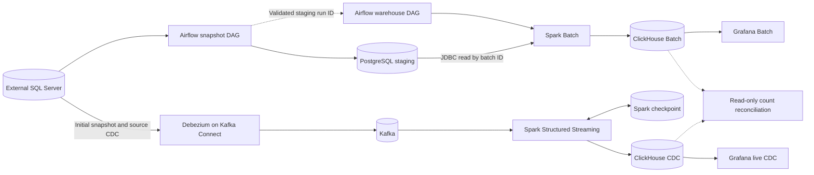
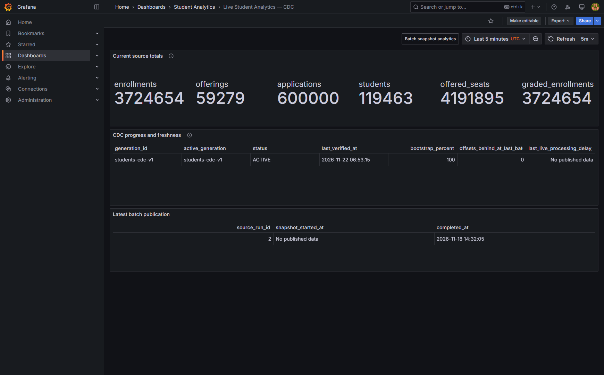

# Student Data Engineering Platform

A local data engineering project that turns operational SQL Server data into analytics for enrollment, course capacity, admissions and grades. It shows how to publish a reproducible analytical snapshot and serve ongoing source changes from the same database.

| Data product | What it answers | What becomes visible |
|---|---|---|
| **Batch** | How do enrollment, capacity and grade outcomes vary by term and department? | A validated dimensional snapshot tied to one staging run |
| **Change data capture (CDC)** | What does the source contain now, and which changes has the pipeline processed? | A verified baseline followed by sealed inserts, updates and deletes |

## Architecture



**Batch.** Airflow reads 15 tables and their source counts in one SQL Server snapshot transaction. It copies typed rows to PostgreSQL in bounded chunks and verifies each table’s source, fetched and stored counts. The staging DAG passes the completed source run ID to the warehouse DAG. Spark checks the pinned input, builds nine dimensions and three facts, verifies the candidate in ClickHouse and publishes it through a final marker. [Batch pipeline](docs/04-data-pipelines/batch.md)

**CDC.** Debezium builds its own initial snapshot and then reads committed changes at source offsets. Kafka retains the keyed events. Spark verifies each microbatch in ClickHouse before it commits checkpoint progress. The active generation exposes the latest nondeleted rows, and the event panels count deduplicated live operations. Batch and CDC publish independently, so each can be read at its own boundary. [CDC pipeline](docs/04-data-pipelines/cdc.md)

### Data model and outputs

- **Batch warehouse.** The application, offering and enrollment facts each have their own grain. Dimensions support filters such as academic term, department and grade. Student and applicant keys are pseudonymized with HMAC. Batch views select the latest validated staging run.
- **CDC database.** The event ledger, batch seals and active generation support current source totals, operation history and processing diagnostics. A replayed change has the same logical identity, and a winning delete removes the row from current state.
- **Reconciliation.** Applications, offerings and enrollment attempts can be compared at the same business grain across the two publications. [Model and object catalog](docs/05-data-platform/warehouse.md) · [Reconciliation guide](docs/04-data-pipelines/reconciliation.md)

### Technology stack

| Component | Responsibility |
|---|---|
| External SQL Server | Source records, snapshot isolation and CDC capture instances |
| PostgreSQL 16 | Typed Batch staging and a separate Airflow metadata database |
| Airflow 3.1.5 | SQL Server extraction, staging verification and Spark Batch orchestration |
| Kafka 3.9.1 and Debezium 2.7.3 on Connect | Retained events, connector lifecycle, source offsets and schema history |
| Spark 3.5.6 | Dimensional transforms and independent checkpointed CDC processing |
| ClickHouse 24.8 | Separate Batch and CDC databases with explicit publication |
| Grafana 11.5.2 | Provisioned Batch and CDC dashboards |
| Docker Compose, Python and SQL | Local service orchestration, application code and data definitions |

## Quick start

### Prerequisites and configuration

Use Docker with Compose v2, GNU Make, and Python 3.11 or 3.12 with `venv`. The host needs access to image registries, package indexes and Maven. On WSL2, keep the checkout on the Linux filesystem. Use a SQL Server that your containers can reach. An authorized source owner must confirm snapshot isolation for Batch and CDC capture, Agent jobs, reader access and retention for the 15 tables before CDC starts.

Run these commands from the fresh checkout.

```bash
python3 -m venv .venv
make install
test -f .env || cp .env.example .env
```

Edit the private `.env` and set the SQL Server endpoint, database, schema, approved reader and TLS settings. Start with the local defaults for the other services. Initialization creates missing local passwords and keys. Preserve those values with the named volumes. [Environment template](.env.example) · [Setup and source checks](docs/03-infrastructure/setup.md)

### First run

1. Run `make up` and then `make status`. Startup initializes PostgreSQL, ClickHouse and Airflow, prepares Kafka topics, registers or verifies Debezium, and starts Spark streaming and Grafana. The first connector registration can start a SQL Server snapshot. Allow time for CDC bootstrap after the services start.
2. Open Grafana at `http://localhost:13000` with its UI admin credentials. For the first full demonstration, wait for **CDC progress and freshness** to show an active generation.
3. Open Airflow at `http://localhost:18080` with its UI admin credentials. Unpause `sqlserver_to_postgres_staging` and `postgres_to_clickhouse_warehouse`, then trigger **only the staging DAG**. Leave `BATCH_SNAPSHOT_SCHEDULE` blank for manual runs. The staging DAG passes a successful manifest to the warehouse DAG automatically.
4. Check **Latest batch publication** in Grafana for the new staging run ID. With both products published, run `make reconcile`. [Operations runbook](docs/07-operations/runbook.md)

CDC owns its snapshot-to-stream handoff. Its baseline and source offsets come from Debezium, with Kafka and Spark tracking downstream progress. The Airflow extract has a separate snapshot boundary and supplies an independent analytical product. Waiting for CDC activation before the first Batch run avoids overlapping full reads and gives CDC an established capture boundary. Compare the two boundaries before interpreting differences.

### Subsequent runs

Use `make up` to resume with the existing volumes, connector offsets and Spark checkpoint. With a blank Batch schedule, startup starts no new Batch extract. Trigger one when you want an updated Batch snapshot. Use `make down` to stop the stack while keeping its named volumes.

| Task | Command |
|---|---|
| Start only Batch and Grafana | `make up-pipeline` |
| Start only the CDC path and Grafana | `make streaming-up` |
| Check services and startup logs | `make status`, `make logs` |
| Retry warehouse publication for a successful staging run | `make warehouse-load RUN_ID=123` using the actual run ID |
| Validate local configuration and run unit tests | `make compose-config`, `make test` |

## Dashboards and validation

| Dashboard | What to check |
|---|---|
| **Batch Snapshot — Student Enrollment, Capacity & Grades** | Term and department filters, enrollment attempts, offered seats, applications and grade measures |
| **Live Student Analytics — CDC** | Current source totals, verified bootstrap, sampled lag, live operation counts and trend, latest changes and the last Batch publication |

CDC event metrics use sealed live changes in the active generation and exclude snapshot reads. Sampled lag describes the last verified batch. Use Connect status and Spark logs to distinguish a quiet source from an unavailable worker. [Dashboard queries and KPI definitions](docs/06-observability-and-quality/grafana.md)

`make reconcile` reports signed differences as **CDC minus Batch** for the three shared measures. Equal counts support count parity at the observed boundaries. Compare timestamps and recent operations to explain a difference. [Reconciliation and quality checks](docs/04-data-pipelines/reconciliation.md) · [Tests and dated runtime evidence](docs/06-observability-and-quality/testing-and-validation.md)



This 22 November 2026 capture predates the live operation panels and records an earlier deployment. See the gallery for the Airflow DAG graph, source ERD and screenshot provenance. [Visual evidence](docs/assets/README.md)

## Limitations and recovery

The services share one host, and both data products share a ClickHouse server. Initial snapshots, replay and heavy analytical queries compete for memory and disk. Source and Kafka retention bound recovery. Keep Kafka data, Connect offsets, the Spark checkpoint and the ClickHouse CDC ledger compatible when restoring. Use the existing checkpoint on routine restarts.

The local stack uses a PostgreSQL admin for application access and a ClickHouse admin for the publishers and Grafana. Use it as a trusted local project. Source readiness and controlled mutations depend on the permissions and environment provided by the source owner. [Backup, recovery and troubleshooting](docs/07-operations/runbook.md)

## Repository and documentation

| Path | Contents |
|---|---|
| `airflow/` | Extraction DAG, warehouse DAG and typed staging loader |
| `spark/` | Batch transformation, CDC normalization and streaming worker |
| `db/` | Source assessment and readiness, PostgreSQL staging DDL, ClickHouse DDL and reconciliation |
| `debezium/`, `clickhouse/`, `grafana/` | Connector registration, database configuration and dashboard provisioning |
| `scripts/`, `tests/` | Initialization, topic preparation, unit tests and integration fixtures |
| `docs/` | Foundation, architecture, infrastructure, pipelines, data platform, observability and operations |

Follow the documentation index for the engineering decisions, object catalogs and operational procedures. [Documentation index](docs/README.md)
