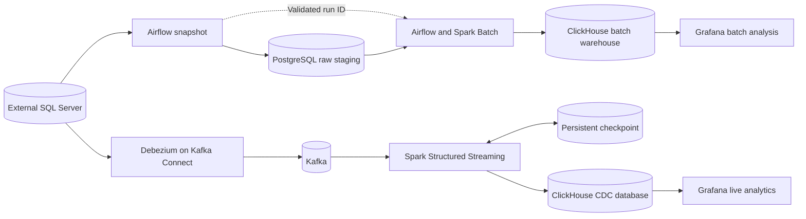

# Student Data Engineering Platform

This local data engineering project turns student and academic records from SQL Server into two analytical products. **CDC serves the live Grafana dashboard. Batch produces independently verified snapshots for analysis, recovery and reconciliation.** Running a batch snapshot is an operator decision by default.



## Run locally

You need Docker with Compose v2, Python 3.11 or 3.12, and access to the external SQL Server source. The test environment uses Airflow 3.1.5, Spark 3.5.6, PostgreSQL 16, ClickHouse 24.8, Kafka 3.9.1, Debezium 2.7.3 and Grafana 11.5.2. Builds and the first Spark run need registry and Maven access.

```bash
make install
make init
# Fill in the SQL Server settings in the private .env file.
make compose-config
make test
```

Use `.env.example` as the configuration reference. `make init` creates `.env` when needed and generates local passwords. SQL Server credentials come from the DBA. See the [runbook](docs/10-operations/operational-runbook.md) before enabling CDC on a source or upgrading existing volumes.

| Need | Command or action |
|---|---|
| Start batch and Grafana | `make up`, then unpause the two batch DAGs in Airflow and trigger `sqlserver_to_postgres_staging` |
| Retry a warehouse publication | `make warehouse-load RUN_ID=123`, using the successful staging run ID |
| Start live CDC and Grafana | After source readiness checks, run `make streaming-up` |
| Compare published counts | `make reconcile` once both pipelines have published |
| Inspect health | `make status` and `make logs` |
| Stop the stack | `make down`, which preserves named volumes |

The default local interfaces are [Airflow](http://localhost:18080) and [Grafana](http://localhost:13000). Open **Live Student Analytics — CDC** for current source counts, seat capacity, recorded grades, and stream progress. The **Batch Snapshot** dashboard uses the published dimensional model by term and department.

The historical batch dashboard captures show [enrollment](docs/14-screenshots/07-grafana-overview.png), [capacity and admissions](docs/14-screenshots/07b-grafana-capacity-admissions.png), and [grades](docs/14-screenshots/08-grafana-grades.png).

## How the pipelines work

- **Batch** reads 15 tables in a single SQL Server snapshot transaction. It reconciles each extracted and staged count before Airflow passes the staging run ID to Spark. Spark validates the dimensional model, checks what ClickHouse stored, and publishes the snapshot through a final marker.
- **CDC** consumes Debezium’s completed baseline and subsequent source changes. Spark verifies Kafka positions in ClickHouse before committing a microbatch. The event view deduplicates logical changes and the current-state model applies the latest source version, including deletes. Kafka and Spark persist separate recovery state.
- **Reconciliation** compares applications, offerings and enrollments at the same business grain and reports both publication references. A delta can reflect data changed after the batch snapshot. The comparison is read-only and neither pipeline depends on it.

## Project files

| Path | Contents |
|---|---|
| `airflow/` and `spark/` | Batch DAGs and loaders, transformations and CDC processing |
| `db/` | Source assessment, DBA scripts, PostgreSQL staging and both ClickHouse models |
| `debezium/`, `clickhouse/`, `grafana/` | Service configuration, connector registration and dashboards |
| `scripts/` and `tests/` | Bootstrap, provisioning, unit tests and isolated integration fixtures |
| `docs/` | Architecture, data model, operations, tests, decisions and validation evidence |

This is a single-host deployment. Retention bounds replay, and volumes must be backed up separately for host-loss recovery. The [architecture](docs/02-architecture/architecture-overview.md), [data model](docs/02-architecture/data-model.md), [test guide](docs/09-development-and-testing/integration-testing.md), and [implementation status](docs/12-implementation/implementation-status.md) document the limits and the evidence.
