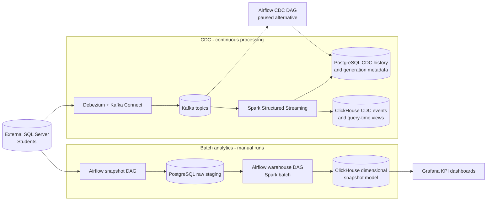

# Students Data Engineering Platform

**An end-to-end, Docker-based data engineering learning project** that ingests student data from SQL Server, stages it in PostgreSQL, builds a dimensional ClickHouse warehouse with Apache Spark, orchestrates batch workflows with Apache Airflow, and presents analytics in Grafana.

**Project type:** Local development and training · **Source:** External SQL Server `Students` database · **Runtime:** Docker Compose

[Architecture](#architecture) · [Getting started](#getting-started) · [Pipelines](#working-with-the-pipelines) · [Dashboards](#analytics-and-screenshots) · [Project status](#implementation-status) · [Documentation](#documentation)

---

## Overview

The platform demonstrates two complementary data-processing patterns:

- **Batch analytics:** a consistent SQL Server snapshot is loaded into PostgreSQL; Spark transforms the latest successful staging run into nine dimensions and three facts in ClickHouse. Grafana reads the published warehouse views.
- **Change data capture (CDC):** Debezium publishes SQL Server changes through Kafka. A continuously running Spark Structured Streaming consumer writes CDC history and stream metadata to PostgreSQL and an event model to ClickHouse.

The two paths are deliberately separate. **The Grafana dimensional warehouse is currently full-snapshot based; it does not automatically incorporate CDC changes.** Incremental warehouse updates and row-level SCD Type 2 integration remain future development work.

### Technology stack

| Layer | Technology | Responsibility |
| --- | --- | --- |
| Operational source | Microsoft SQL Server | Source `Students` database; source-side CDC |
| Staging and control | PostgreSQL | Typed `raw` tables, execution metadata, CDC history and generation state |
| Event ingestion | Debezium, Kafka Connect, Apache Kafka | Capture and transport database change events |
| Processing | Apache Spark 3.5.6 | Full-snapshot transformations and Structured Streaming |
| Orchestration | Apache Airflow 3.1.5 | Manual batch DAGs and task monitoring |
| Analytics warehouse | ClickHouse | Snapshot-based dimensional model and separate CDC projections |
| Visualization | Grafana | Student enrollment, capacity, admissions and grade KPIs |
| Deployment | Docker Compose | Reproducible local services and persistent volumes |

## Architecture



> **Consumer ownership:** `sqlserver_debezium_cdc_to_staging` is an alternative CDC consumer and should remain paused while `spark-cdc-stream` owns the stream. Both consumers must not write to the same intended sinks without a coordinated ownership and offset strategy.

For component-level diagrams and design rationale, see the [architecture handbook](docs/02-architecture/architecture-overview.md) and [streaming diagram](docs/02-architecture/diagrams/streaming-pipeline.md).

## Implementation status

**Evidence date: 21 November 2026.** These are results reported during local testing, not continuous health guarantees. Older reports document earlier states and should be read with their dates.

| Capability | Last reported evidence | State |
| --- | --- | --- |
| PostgreSQL, ClickHouse, Kafka and Connect | Services running; relevant health checks passed | Operational at last check |
| SQL Server full staging | Successful historical extraction of 15 source tables | Implemented |
| ClickHouse batch warehouse | Published views containing 3,724,654 enrollments, 59,279 offerings and 600,000 applications | Populated; snapshot based |
| Airflow warehouse execution environment | DAG import errors: zero; Java 17 and Spark 3.5.6 present in scheduler | Runtime verified; latest post-patch task execution not confirmed |
| Spark CDC initial snapshot | `snapshot_events_complete = t` and captured-offset progress at 100% | Consumption boundary reached |
| CDC generation activation | PostgreSQL status was `BOOTSTRAPPING` in the last supplied result | **Activation not yet confirmed** |
| Grafana | ClickHouse datasource tested; a local 18-panel dashboard was shown | Dashboard available locally; provisioned JSON may differ until committed |
| Incremental CDC-to-star-schema loading | Not implemented in the current batch loader | Planned |

The warehouse safety update adds `verify_spark_runtime` to the Airflow DAG and avoids republishing a completed **full** source run in the common case. Neither change implements incremental SCD2 processing. See the [21 November validation update](docs/13-validation/validation-update-2026-11-21.md) for precise evidence and limits.

## Getting started

### Prerequisites

- Docker Engine or Docker Desktop with Docker Compose v2.
- Git and a Bash-compatible terminal (WSL2 recommended on Windows).
- Python 3.11 or 3.12 for optional host-side commands and tests.
- Access to the **external** SQL Server `Students` database, plus the appropriate snapshot/CDC permissions.
- Sufficient local memory; approximately **16 GB host RAM** is recommended for the full stack. Run only the services you need.

SQL Server is **not** supplied as a container in this repository. The source administrator is responsible for the external database and required source permissions.

### First-time installation

These commands are for a **new installation**, not for restarting or repairing an already-running CDC stream.

```bash
# Clone the project
git clone https://github.com/pzolfaghari72/students-data-engineering-platform.git
cd students-data-engineering-platform

# Create your local configuration (does not overwrite an existing .env)
cp -n .env.example .env

# Edit .env: fill the external SQL Server connection and required secrets.
# Keep the file private; never commit it.

# Prepare the local project and validate its configuration
make init
docker compose config --quiet

# Start the core databases, Airflow and Grafana
make up
make status
```

`make up` starts the regular batch-and-dashboard services. **It does not run a full data extraction or start the Spark CDC stream.** Follow the [quick-start guide](docs/01-getting-started/quick-start.md), [environment reference](docs/01-getting-started/environment-configuration.md), and [operational runbook](docs/10-operations/operational-runbook.md) for additional setup details.

### Local interfaces

| Service | Address | Description |
| --- | --- | --- |
| Airflow | [localhost:18080](http://localhost:18080) | DAG monitoring and manual execution |
| Grafana | [localhost:13000](http://localhost:13000) | Analytical dashboard |
| PostgreSQL | `localhost:15433` | Host-side staging/database client access |
| ClickHouse HTTP | `localhost:18123` | HTTP/JDBC access |
| ClickHouse native | `localhost:19000` | Native clients |
| Kafka | `localhost:19094` | Host-side broker access |
| Kafka Connect REST | [localhost:18083](http://localhost:18083) | Connector monitoring |

Host port mappings are local to this Compose configuration. Containers use internal service names and ports (for example, `postgres:5432`, `clickhouse:8123`, `kafka:9092`).

## Working with the pipelines

### 1. Full snapshot: SQL Server → PostgreSQL

The Airflow DAG **`sqlserver_to_postgres_staging`** reads the 15 source tables through a consistent source snapshot and stores rows in PostgreSQL `raw` tables with extraction-batch metadata.

1. Confirm source connectivity, permissions and SQL Server snapshot isolation.
2. Trigger the DAG **manually** in Airflow only when a new full extraction is intended.
3. Wait for `create_pipeline_run` → `load_consistent_snapshot` → `finish_pipeline_run` to succeed.
4. Verify all required extraction batches are successful before publishing the warehouse.

**Do not trigger another full snapshot just to check whether existing CDC is still running.** See [batch execution](docs/10-operations/batch-execution.md) and [snapshot consistency](docs/04-data-ingestion/snapshot-consistency.md).

### 2. Batch warehouse: PostgreSQL → Spark → ClickHouse

The separate Airflow DAG **`postgres_to_clickhouse_warehouse`** remains **manual** (`schedule=None`). Its tasks are:

```text
verify_spark_runtime  -->  load_clickhouse_warehouse
```

Spark selects the latest successful full staging run, creates nine dimensions and three facts, validates the result, and writes a new `snapshot_id` to ClickHouse. Only after the tables are written does it publish a completion record in `warehouse_model_loads`. Views such as `fact_course_enrollment` select the latest completed publication.

Read-only published-fact check:

```bash
docker compose exec -T clickhouse sh -c '
clickhouse-client \
  --port "$CLICKHOUSE_NATIVE_PORT" \
  --user "$CLICKHOUSE_USER" \
  --password "$CLICKHOUSE_PASSWORD" \
  --database "$WAREHOUSE_DB_NAME" \
  --query "
    SELECT
      (SELECT count() FROM fact_course_enrollment) AS enrollments,
      (SELECT count() FROM fact_course_offering) AS offerings,
      (SELECT count() FROM fact_application) AS applications
  "
'
```

The separate `make warehouse-load` command is an **alternative** publisher; do not run it at the same time as the Airflow warehouse DAG. Consult the [dimensional model](docs/07-data-warehouse/fact-and-dimension-tables.md) and [publication strategy](docs/07-data-warehouse/data-publication-and-reconciliation.md).

### 3. Continuous CDC: Debezium → Kafka → Spark

The running Spark application consumes Debezium events using a persistent checkpoint, writes PostgreSQL `history.cdc_events` and stream-generation metadata, and appends ClickHouse `cdc_events` records. The CDC current-state and Student SCD2 projections are **separate from the batch star schema**.

To inspect an **existing** stream without restarting it:

```bash
# Container status and recent output
docker compose --profile streaming ps -a spark-cdc-stream
docker compose logs --tail=80 spark-cdc-stream

# Read-only PostgreSQL generation status
docker compose exec -T postgres sh -c '
psql -U "$POSTGRES_USER" -d students_staging -P pager=off -c "
SELECT query_name, status, snapshot_events_complete
FROM metadata.streaming_generations;
"'
```

`100%` snapshot consumption is **not** sufficient to claim the CDC generation is published. Confirm PostgreSQL generation activation and ClickHouse active-generation publication before declaring bootstrap complete. Do **not** reset offsets, delete checkpoints or restart a working stream merely to refresh status. See [streaming operations](docs/10-operations/streaming-execution.md) and [checkpoint recovery](docs/05-streaming-and-cdc/checkpoints-and-recovery.md).

## Data model and SCD Type 2

The published dimensional warehouse consists of **nine dimensions** (Applicant, Class Standing, Course, Date, Degree, Department, Grade, Student and Term) and **three facts**:

| Published fact view | Grain |
| --- | --- |
| `fact_application` | One row per source `ApplicantId` |
| `fact_course_offering` | One row per `CourseOfferingId` |
| `fact_course_enrollment` | One row per `CourseEnrollmentId` |

Physical tables such as `dim_student_snapshots` and `fact_enrollment_snapshots` retain rows under their `snapshot_id`. The publication marker is **`warehouse_model_loads`** (not the historical `_v2` name). Grafana reads the published views instead of summing all historical physical snapshots.

**SCD2 boundaries:** PostgreSQL `scd.entity_versions` belongs to the paused legacy CDC consumer; the Spark stream does not maintain it. ClickHouse `cdc_student_scd2` derives versions from the separate CDC event model. The full-snapshot dimension tables do **not** have row-level `valid_from`/`valid_to` SCD2 history, and automated incremental updates to the analytical star schema have not been built. Read [SCD Type 2](docs/07-data-warehouse/scd-type-2.md) and [CDC warehouse design](docs/07-data-warehouse/cdc-warehouse-design.md).

## Analytics and screenshots

### Student Enrollment, Capacity & Grades

The locally observed Grafana dashboard has **18 panels** covering enrollments, unique students, course offerings, capacity ratios, applications, department comparisons, grade distribution and credit-weighted grade points. Its queries use the **published batch warehouse**; refreshing Grafana does not ingest CDC changes.


*Dashboard capture from the local training environment. Screenshots illustrate observed results at capture time; they are not live monitoring widgets.*

<details>
<summary><strong>Browse the project screenshot gallery</strong></summary>

| Area | Screenshot |
| --- | --- |
| SQL Server source relationships | [Source ER diagram](docs/14-screenshots/00-sqlserver-source-erd.png) |
| Docker services | [Docker status](docs/14-screenshots/01-docker-services.png) |
| Airflow orchestration | [DAG overview](docs/14-screenshots/02-airflow-dags.png) · [Staging DAG](docs/14-screenshots/03-airflow-staging-run.png) · [Warehouse DAG](docs/14-screenshots/06b-airflow-clickhouse-warehouse.png) |
| PostgreSQL and ClickHouse | [Staging schema](docs/14-screenshots/04-postgres-staging.png) · [Warehouse schema](docs/14-screenshots/06-clickhouse-warehouse.png) |
| Grafana dashboards | [Capacity and admissions](docs/14-screenshots/07b-grafana-capacity-admissions.png) · [Grade analytics](docs/14-screenshots/08-grafana-grades.png) |
| CDC services | [Kafka Connect](docs/14-screenshots/09-debezium-kafka.png) · [Paused Airflow CDC DAG](docs/14-screenshots/09b-airflow-cdc-dag.png) |

</details>

Some screenshots capture older container or DAG states. Keep their original timestamps/captions, and replace them with new evidence only after taking authentic captures. See [KPI definitions](docs/08-analytics-and-monitoring/business-kpis.md) and [Grafana operations](docs/08-analytics-and-monitoring/grafana.md).

## Repository layout

```text
.
├── airflow/       # Airflow DAGs, staging extractors and requirements
├── spark/         # Warehouse batch loader and CDC streaming consumer
├── debezium/      # SQL Server CDC connector registration and settings
├── db/            # Source assessment, PostgreSQL and ClickHouse SQL
├── grafana/       # Dashboards and datasource provisioning
├── scripts/       # Local environment/setup helpers
├── tests/         # Unit tests
├── docs/          # Technical handbook, diagrams and validation evidence
├── docker-compose.yml
├── Makefile
└── .env.example   # Configuration template (not real credentials)
```

## Everyday operations and troubleshooting

These commands inspect the environment without executing a data load:

```bash
make status
docker compose --profile '*' ps -a
docker compose logs --tail=100 airflow-scheduler
```

| Symptom | First place to look |
| --- | --- |
| Airflow DAG missing or failing to parse | DAG processor logs and `airflow dags list-import-errors --local` |
| Warehouse view has no new data | Last successful full source run and `warehouse_model_loads` publication marker |
| CDC progress stalls | Spark logs, `metadata.streaming_generations`, Kafka retention and checkpoint continuity |
| Grafana panel fails | ClickHouse datasource, published view names and dashboard SQL |
| Containers exit unexpectedly | Compose status, recent logs and host memory availability |

**Operational safeguards:** Leave the Airflow CDC DAG paused when Spark owns CDC. Do not run simultaneous full warehouse publishers. Do not use `docker compose down -v` to troubleshoot: it destroys named-volume state. `make down` also stops an active stream, so use it only when an intentional shutdown is appropriate. Never commit `.env`, raw student records or secret-bearing logs.

## Documentation

The README is a starting point; detailed procedures and source-grounded design notes live in `docs/`.

| Guide | Purpose |
| --- | --- |
| [Getting started](docs/01-getting-started/quick-start.md) | Installation, environment variables and startup |
| [System architecture](docs/02-architecture/architecture-overview.md) | Components, data boundaries and diagrams |
| [Infrastructure](docs/03-infrastructure/docker-compose.md) | Docker Compose services, networking and resources |
| [Data ingestion](docs/04-data-ingestion/source-extraction.md) | SQL Server snapshot loading and PostgreSQL staging |
| [Streaming and CDC](docs/05-streaming-and-cdc/spark-structured-streaming.md) | Debezium, Kafka, Spark streaming and checkpoints |
| [Spark processing](docs/06-data-processing/spark-batch.md) | Warehouse transformations and validations |
| [ClickHouse warehouse](docs/07-data-warehouse/fact-and-dimension-tables.md) | Dimensions, facts, snapshots and CDC projections |
| [Analytics and KPIs](docs/08-analytics-and-monitoring/business-kpis.md) | Grafana metrics and interpretation |
| [Batch runbook](docs/10-operations/batch-execution.md) | Controlled snapshot and warehouse execution |
| [Streaming runbook](docs/10-operations/streaming-execution.md) | CDC monitoring and recovery precautions |
| [Current evidence (21 Nov 2026)](docs/13-validation/validation-update-2026-11-21.md) | Latest supplied checks and remaining uncertainties |
| [Architecture decisions](docs/adr/index.md) | Rationale for technology and design choices |

**Scope:** This is an educational, single-node system—not a production-ready deployment. Its limitations include non-atomic writes across PostgreSQL and ClickHouse, unverified CDC publication at the last supplied checkpoint, and the unfinished incremental CDC-to-star-schema transformation. Historical validation documents remain available for comparison but do not describe current live status.
