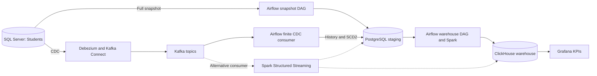
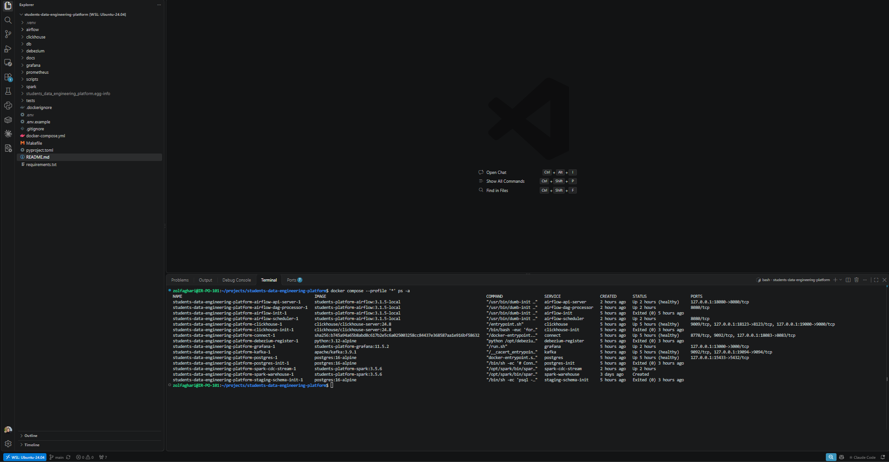
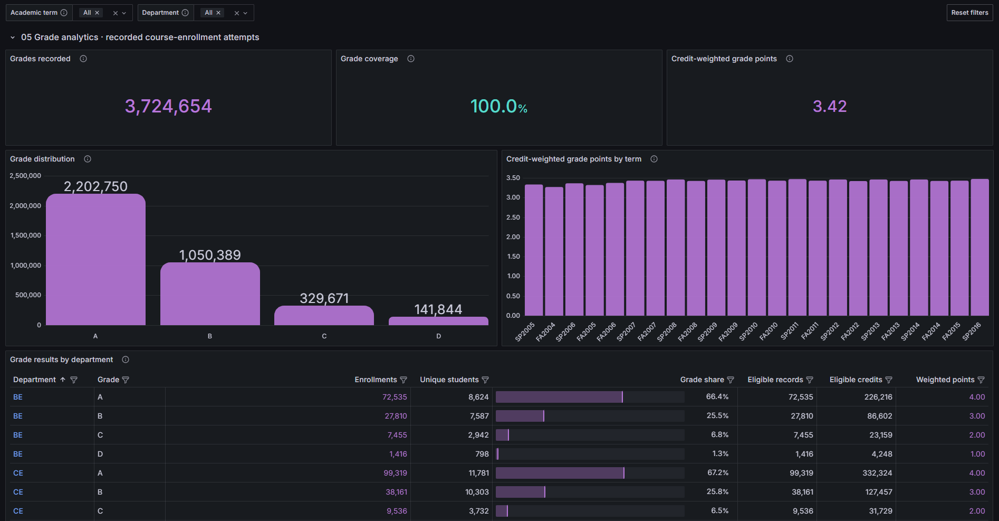
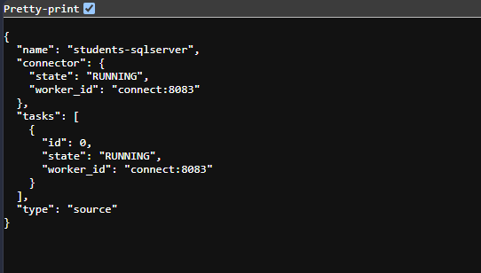

# Students Data Engineering Platform

A beginner-friendly, Docker-based data engineering project that moves student data from **SQL Server** through **PostgreSQL staging** into a **ClickHouse analytics warehouse**, orchestrates batch workflows with **Apache Airflow** and **Apache Spark**, and visualizes business KPIs with **Grafana**. An optional **Debezium + Kafka + Spark Structured Streaming** path explores change data capture (CDC).

## Contents

- [Architecture](#architecture)
- [Project in action: screenshots and evidence](#project-in-action-screenshots-and-evidence)
- [Quick start](#quick-start)
- [Service URLs and ports](#service-urls-and-ports)
- [Run the batch pipeline](#run-the-batch-pipeline)
- [CDC and streaming (optional)](#cdc-and-streaming-optional)
- [Operations and troubleshooting](#operations-and-troubleshooting)
- [Documentation handbook](#documentation-handbook)

## Architecture

There are two independent data-processing paths. Only the **batch** path is required to populate the standard business dashboards.



**Batch:** SQL Server → Airflow snapshot DAG → PostgreSQL raw staging → Airflow warehouse DAG / Spark → ClickHouse published snapshot → Grafana.

**CDC:** SQL Server CDC → Debezium / Kafka Connect → Kafka → either a finite Airflow CDC consumer or a separate Spark Structured Streaming service. These alternatives require an explicit ownership/offset plan; do not run both against the same sinks without reconciling them.

PostgreSQL also stores extraction/pipeline metadata and CDC/SCD2 history. Airflow coordinates finite DAG runs; the streaming application has its own lifecycle. Prometheus-based infrastructure monitoring is intentionally out of scope.

For deeper diagrams, see the [architecture overview](./docs/02-architecture/architecture-overview.md), [system context](./docs/02-architecture/diagrams/system-context.md), [batch pipeline](./docs/02-architecture/diagrams/batch-pipeline.md), and [streaming pipeline](./docs/02-architecture/diagrams/streaming-pipeline.md).

### SQL Server source data model

The source *Students* database has related tables for students, applicants, course enrollments, course offerings, courses, departments, terms, degrees, and academic metadata. This diagram shows **table relationships and column names**, not student records.


*Figure 1 — SQL Server source entity-relationship diagram. The batch extractor reads these source entities into PostgreSQL staging; the warehouse uses a transformed dimensional model.*


## Project in action: screenshots and evidence

These are screenshots from the **actual local development environment**, shared for this README on **2026-11-21**. The Airflow screenshots display latest-run dates of **2026-11-18**. A screenshot documents what the UI showed at capture time; it does not certify all services or all data-quality checks. The filenames below use **relative paths**, so they render on GitHub when the accompanying `docs/assets/screenshots/` folder is present.

### 1. Docker Compose services and startup



*Figure 2 — Docker Compose startup and `docker compose ps -a`. PostgreSQL, ClickHouse, Kafka, Kafka Connect, and Airflow API are shown healthy. The one-shot setup jobs show `Exited (0)`; the two separate Spark containers appear as `Created`, not running. The screenshot records the state at that moment, not ongoing health.*

### 2. Airflow DAG overview


*Figure 3 — Three registered DAGs: `sqlserver_to_postgres_staging`, `postgres_to_clickhouse_warehouse`, and `sqlserver_debezium_cdc_to_staging`. Each shows a green **latest run** indicator on 2026-11-18; earlier unsuccessful runs are also visible in the history. The CDC DAG toggle is off in this capture.*

### 3. SQL Server → PostgreSQL staging DAG


*Figure 4 — `sqlserver_to_postgres_staging` contains `create_pipeline_run` → `load_consistent_snapshot` → `finish_pipeline_run`. The latest-run indicator is green (2026-11-18 14:14:53). The graph demonstrates the workflow structure; individual batch row counts should be validated separately.*

### 4. PostgreSQL raw staging schema


*Figure 5 — `students_staging` in DBeaver. The `raw` schema shows the 15 extracted source-table structures, alongside `metadata`, `history`, and `scd` schemas. This image documents **schema presence**; it does not display row counts or prove that the latest extraction is complete.*

### 5. Airflow + Spark warehouse load — task-level screenshot pending

The DAG overview in **Figure 3** shows a green latest-run indicator for `postgres_to_clickhouse_warehouse` at **2026-11-18 17:55:45**. That supports a statement about the **Airflow DAG run state**, but it does not show the Spark task logs, data-quality checks, or published snapshot counts.

To complete this slot, open the latest `postgres_to_clickhouse_warehouse` run, inspect `load_clickhouse_warehouse`, and capture a task-level success and publication result as `05-airflow-warehouse-run.png`. **Do not start a new warehouse load just to take the screenshot**; older successful run details can be inspected without changing data.

### 6. ClickHouse dimensional warehouse


*Figure 6 — ClickHouse `students_warehouse` schema. The `dim_*_snapshots` and `fact_*_snapshots` **physical tables** retain data across loads. Views such as `dim_student`, `dim_grade`, and `fact_course_enrollment` select the latest published snapshot using `warehouse_model_loads`; **Grafana queries those views**. Legacy tables remain visible in this capture. DBeaver's physical row estimates are not counts for the current published snapshot.*

A previous `SELECT count() FROM fact_course_enrollment` returned **3,724,654**, but this schema diagram does not itself verify that count or the other fact views.

### 7. Grafana: enrollment, capacity, and admissions


*Figure 7 — Grafana overview for the selected academic-term and department scope. The KPI cards show rounded values for enrollment records, unique students, course offerings, offered seats, enrollment/capacity ratio, and applications; charts show enrollment by term and department.*


*Figure 8 — Department capacity ratios, application status, applications by entry term, and department comparisons. The applications-by-entry-term panel displays **50K for each term**. This may reflect the source distribution or query logic and should be checked against the ClickHouse `fact_application` view before interpreting it as a trend. Applications are labeled "all departments" because the published application fact view has no department key.*

### 8. Grafana: grade analytics



*Figure 9 — Grade analytics panels include recorded grades, coverage, credit-weighted grade points, grade distribution, a term comparison, and department details. The numbers are **displayed dashboard outputs**, not independently reconciled metrics in this README.*

### 9. Debezium / Kafka Connect and Airflow CDC



*Figure 10 — The Kafka Connect REST root endpoint `http://localhost:18083/` responds and reports version `3.7.0`. This establishes **API availability only**, not the state of the SQL Server connector or the delivery of CDC events.*


*Figure 11 — Airflow's `sqlserver_debezium_cdc_to_staging` has a `consume_debezium_events` Python task and a green latest-run indicator (2026-11-18 18:00:09); the DAG is paused in the screenshot. A successful DAG run does **not** by itself prove that records were consumed, that Kafka offsets advanced, or that CDC events reached PostgreSQL.*

For connector readiness, inspect [`/connectors/students-sqlserver/status`](http://localhost:18083/connectors/students-sqlserver/status); verify the connector and tasks are `RUNNING` before describing the connector as healthy. Downstream CDC correctness requires separate event/count/offset checks.

### 10. Spark Structured Streaming — optional, not yet validated

A screenshot of an **actual successful streaming micro-batch** has not been provided. The Docker screenshot shows `spark-cdc-stream` as **Created**, not running. Leave `10-spark-streaming.png` pending until there is genuine progress and checkpoint evidence; do not start streaming solely to obtain a screenshot.

To inspect without starting it:

```bash
docker compose --profile streaming ps -a spark-cdc-stream
docker compose --profile streaming logs --tail=100 spark-cdc-stream
```

Streaming startup can consume Kafka records and write to PostgreSQL/ClickHouse; review the [CDC readiness report](./docs/13-validation/cdc-readiness-report.md) before enabling it.

## Quick start

### Prerequisites

- Docker Desktop or Docker Engine with Docker Compose v2.
- Git, `make`, Bash, and Python 3.11 or 3.12.
- Approximately 16 GB RAM recommended for the full local stack.
- Access to the external SQL Server database, with credentials and read permissions from the database administrator.
- SQL Server snapshot isolation enabled for the extraction workflow; CDC requires additional SQL Server configuration and permissions.

On Windows, use WSL2 or a VS Code terminal with Docker available.

### 1. Clone and configure

```bash
git clone https://github.com/pzolfaghari72/students-data-engineering-platform.git
cd students-data-engineering-platform

# For a NEW installation only. Do not overwrite an existing working .env.
cp -n .env.example .env
```

The current **hybrid Compose configuration** hardcodes fixed infrastructure settings (internal service names, ports, database names, image versions, etc.). Keep environment-specific values and secrets in `.env`, such as the external SQL Server host, database passwords, Airflow keys, and student-ID HMAC key.

> **Important:** If `.env.example` contains `REPLACE_WITH_EXISTING_...` placeholders, fill those values before running the project. Do not assume `make init` generates them automatically. If reusing an existing deployment, retain its working credentials, Fernet key, student HMAC key, and volumes. Do not publish `.env` or run `docker compose config` in an unredacted screenshot.

Optional Python host setup, as documented in the project:

```bash
python3 -m venv .venv
source .venv/bin/activate
make install
```

### 2. Validate and start

```bash
# Validate the parsed Compose configuration without printing secrets.
docker compose config --quiet

# Project-specific Make targets, as described in this handbook.
make init
make up
make status
```

`make up` is the intended normal batch/dashboard startup path. Use the Make targets rather than `docker compose up` with every service: in the current Compose file, **Kafka, Kafka Connect, and connector registration have no profile**, whereas the one-shot Spark warehouse service uses `batch` and Spark Structured Streaming uses `streaming`. A raw full-stack startup can therefore also attempt CDC registration.

If `clickhouse-init` exits unsuccessfully, fix the warehouse DDL before retrying. In particular, old views that reference `degree_id` or `*_v2_snapshots` are incompatible with the current renamed warehouse model. The DDL should include the current tables/views **without** the obsolete duplicate legacy section.

### 3. Inspect service status

```bash
make status

docker compose --profile '*' ps -a
```

A one-shot service that has finished correctly normally shows `Exited (0)`. A long-running service should show an appropriate running/healthy state.

## Service URLs and ports

Ports below refer to the **host machine**, not the Docker network. The existing Compose mapping binds them to `127.0.0.1`.

| Service | Local address | Purpose |
| --- | --- | --- |
| Airflow | [http://localhost:18080](http://localhost:18080) | DAG monitoring and manual triggers |
| Grafana | [http://localhost:13000](http://localhost:13000) | Business KPI dashboards |
| PostgreSQL | `localhost:15433` | Staging database / Airflow metadata |
| ClickHouse HTTP | `localhost:18123` | HTTP queries / JDBC |
| ClickHouse native | `localhost:19000` | Native client |
| Kafka | `localhost:19094` | Optional CDC broker, when started |
| Kafka Connect REST | [http://localhost:18083](http://localhost:18083) | Optional connector monitoring |

Within containers use their internal endpoints: `postgres:5432`, `clickhouse:8123`, `kafka:9092`, and `connect:8083`.

## Run the batch pipeline

Starting services does not automatically extract SQL Server data. Run the batch stages in order, and save evidence at each successful checkpoint.

### Step A — SQL Server → PostgreSQL staging

1. Confirm SQL Server connectivity and snapshot-isolation permissions.
2. In the Airflow UI, manually trigger **`sqlserver_to_postgres_staging`**.
3. Verify the DAG and its table batches succeeded before running the warehouse stage.
4. Capture `03-airflow-staging-run.png`.

For safe, aggregate staging evidence, run:

```bash
docker compose exec -T postgres \
  psql -U postgres_admin -d students_staging -c \
  "SELECT schemaname, tablename
   FROM pg_catalog.pg_tables
   WHERE schemaname IN ('raw', 'metadata', 'history')
   ORDER BY schemaname, tablename;"
```

You can also show the latest pipeline metadata if the corresponding schema is initialized:

```bash
docker compose exec -T postgres \
  psql -U postgres_admin -d students_staging -c \
  "SELECT pipeline_name, run_type, status, started_at, completed_at
   FROM metadata.pipeline_runs
   ORDER BY started_at DESC LIMIT 10;"
```

Only publish screenshots that omit connection secrets and student-identifying information. See the [batch execution guide](./docs/10-operations/batch-execution.md).

### Step B — PostgreSQL → ClickHouse warehouse

1. Confirm staging completed and `clickhouse-init` succeeded.
2. Manually trigger **`postgres_to_clickhouse_warehouse`** in Airflow.
3. Inspect its **`load_clickhouse_warehouse`** Spark task. Capture `05-airflow-warehouse-run.png` only after success.
4. Query the published ClickHouse views and record the result date:

```bash
docker compose exec -T clickhouse clickhouse-client \
  --database students_warehouse \
  --query "SELECT count() AS enrollments FROM fact_course_enrollment"
```

After **all three fact views** have been repaired/verified, check their counts together:

```bash
docker compose exec -T clickhouse clickhouse-client \
  --database students_warehouse \
  --query "
    SELECT
      (SELECT count() FROM fact_course_enrollment) AS enrollments,
      (SELECT count() FROM fact_course_offering) AS offerings,
      (SELECT count() FROM fact_application) AS applications
  "
```

The standalone `make warehouse-load` / Compose `spark-warehouse` batch job is an **alternative** to the Airflow warehouse DAG. Do not execute both warehouse publishers at the same time.

### Step C — Open Grafana

Open [http://localhost:13000](http://localhost:13000), navigate to the student business KPI dashboard, check that panels return data, then capture `07-grafana-overview.png` and `08-grafana-grades.png`.

Dashboard readiness depends on valid published ClickHouse views and datasource permissions; a running Grafana container alone does not validate the metrics. See [Grafana dashboards](./docs/08-analytics-and-monitoring/grafana.md) and [business KPIs](./docs/08-analytics-and-monitoring/business-kpis.md).

## CDC and streaming (optional)

CDC is a separate workflow and **not required** for the batch dashboard. The project uses Debezium via Kafka Connect and Kafka, with two alternative consumption patterns:

- **Airflow CDC task:** a finite consumer that persists CDC history/SCD2 in PostgreSQL.
- **Spark Structured Streaming:** a long-running service that reads Kafka and can write to PostgreSQL and ClickHouse sinks, using a persistent checkpoint.

Do not run both consumer paths against shared sinks without an intentional ownership plan. Connector registration success does not prove the initial Debezium snapshot is complete. Check SQL Server permissions, connector status, topic/offset continuity, and sink lineage before declaring CDC validated.

For read-only inspection, when the relevant services are running:

```bash
docker compose ps -a kafka connect debezium-register
curl -fsS http://localhost:18083/connectors
```

For connector and Kafka topic inspection (read-only), replace the connector name if yours differs:

```bash
# Connector/task status (look for RUNNING; status alone does not prove CDC delivery)
curl -fsS http://localhost:18083/connectors/students-sqlserver/status

# Kafka topic names (topic existence alone does not prove CDC events are arriving)
docker compose exec -T kafka /opt/kafka/bin/kafka-topics.sh \
  --bootstrap-server kafka:9092 --list
```

Read the [CDC readiness report](./docs/13-validation/cdc-readiness-report.md) and [streaming execution/recovery guide](./docs/10-operations/streaming-execution.md) before attempting the streaming profile. Never discard Kafka data or Spark checkpoints just to make an error disappear.

## Operations and troubleshooting

### Check running services and logs

```bash
make status

docker compose --profile '*' ps -a

docker compose logs --tail=100 clickhouse-init

docker compose logs --tail=100 airflow-scheduler

docker compose logs --tail=100 grafana
```

Use `make logs` for the project's standard logs target. Avoid posting unredacted connection strings, passwords, or personally identifying data.

### Stop safely

```bash
make down
```

`make down` stops the local stack without intentionally removing named data volumes. **Never use `docker compose down -v` on an existing populated environment** unless permanent deletion has been deliberately planned and backed up. Do not remove ClickHouse/PostgreSQL volumes or Kafka/Spark checkpoints to troubleshoot schema errors.

See the [operational runbook](./docs/10-operations/operational-runbook.md) and [startup and shutdown guide](./docs/10-operations/startup-and-shutdown.md).

## Documentation handbook

The README is the beginner-friendly entry point. Detailed guides remain the reference for architecture, configuration, data modeling, and recovery.

| Area | Reference guides |
| --- | --- |
| Getting started | [Project overview](./docs/01-getting-started/project-overview.md) · [Prerequisites](./docs/01-getting-started/prerequisites.md) · [Installation](./docs/01-getting-started/installation.md) · [Environment configuration](./docs/01-getting-started/environment-configuration.md) · [Quick start](./docs/01-getting-started/quick-start.md) |
| Architecture | [Architecture overview](./docs/02-architecture/architecture-overview.md) · [Batch](./docs/02-architecture/batch-architecture.md) · [Streaming](./docs/02-architecture/streaming-architecture.md) · [Data model](./docs/02-architecture/data-model.md) · [Diagrams](./docs/02-architecture/diagrams/system-context.md) |
| Infrastructure | [Docker](./docs/03-infrastructure/docker-fundamentals.md) · [Compose](./docs/03-infrastructure/docker-compose.md) · [Networking](./docs/03-infrastructure/services-and-networking.md) · [Persistence](./docs/03-infrastructure/volumes-and-persistence.md) · [Troubleshooting](./docs/03-infrastructure/troubleshooting.md) |
| SQL Server / staging | [SQL Server source](./docs/04-data-ingestion/sql-server-source.md) · [Snapshot extraction](./docs/04-data-ingestion/source-extraction.md) · [Snapshot consistency](./docs/04-data-ingestion/snapshot-consistency.md) · [Airflow](./docs/04-data-ingestion/airflow.md) · [PostgreSQL](./docs/04-data-ingestion/postgresql-staging.md) |
| CDC and streaming | [CDC](./docs/05-streaming-and-cdc/cdc-fundamentals.md) · [Debezium](./docs/05-streaming-and-cdc/debezium.md) · [Kafka](./docs/05-streaming-and-cdc/kafka-fundamentals.md) · [Spark streaming](./docs/05-streaming-and-cdc/spark-structured-streaming.md) · [Checkpoint recovery](./docs/05-streaming-and-cdc/checkpoints-and-recovery.md) |
| Processing | [Spark batch](./docs/06-data-processing/spark-batch.md) · [Transformations](./docs/06-data-processing/transformations.md) · [Quality](./docs/06-data-processing/data-quality.md) · [Idempotency and retries](./docs/06-data-processing/idempotency-and-retries.md) |
| Warehouse | [ClickHouse](./docs/07-data-warehouse/clickhouse-fundamentals.md) · [Dimensional model](./docs/07-data-warehouse/dimensional-modeling.md) · [Facts and dimensions](./docs/07-data-warehouse/fact-and-dimension-tables.md) · [CDC model](./docs/07-data-warehouse/cdc-warehouse-design.md) · [Reconciliation](./docs/07-data-warehouse/data-publication-and-reconciliation.md) |
| Analytics | [Grafana](./docs/08-analytics-and-monitoring/grafana.md) · [Business KPIs](./docs/08-analytics-and-monitoring/business-kpis.md) |
| Development | [Project structure](./docs/09-development-and-testing/project-structure.md) · [Testing strategy](./docs/09-development-and-testing/testing-strategy.md) |
| Operations | [Runbook](./docs/10-operations/operational-runbook.md) · [Batch execution](./docs/10-operations/batch-execution.md) · [Streaming recovery](./docs/10-operations/streaming-execution.md) |
| Learning | [Six-phase learning roadmap](./docs/11-learning-path/learning-roadmap.md) |
| Validation and project reports | [Implementation](./docs/12-implementation/implementation-status.md) · [Final report](./docs/12-implementation/final-project-report.md) · [Runtime report](./docs/13-validation/runtime-validation-report.md) · [CDC readiness](./docs/13-validation/cdc-readiness-report.md) · [Tests](./docs/13-validation/test-results.md) |
| Architecture decisions | [ADR index](./docs/adr/index.md) |
