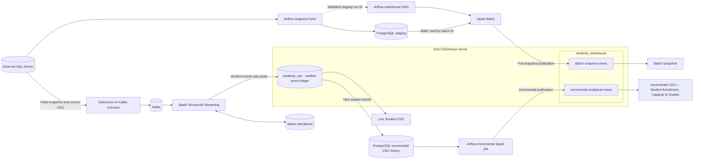
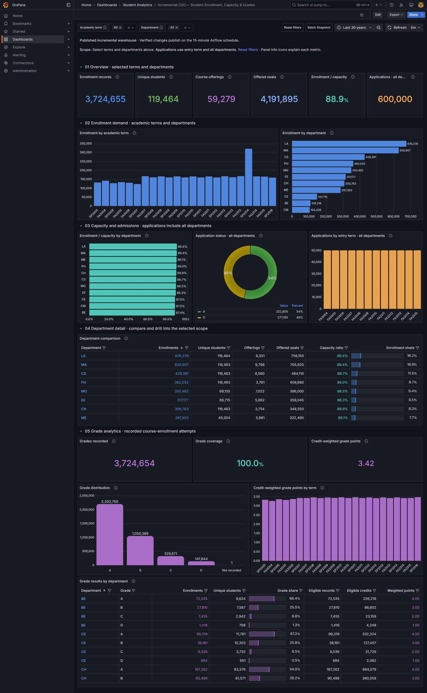
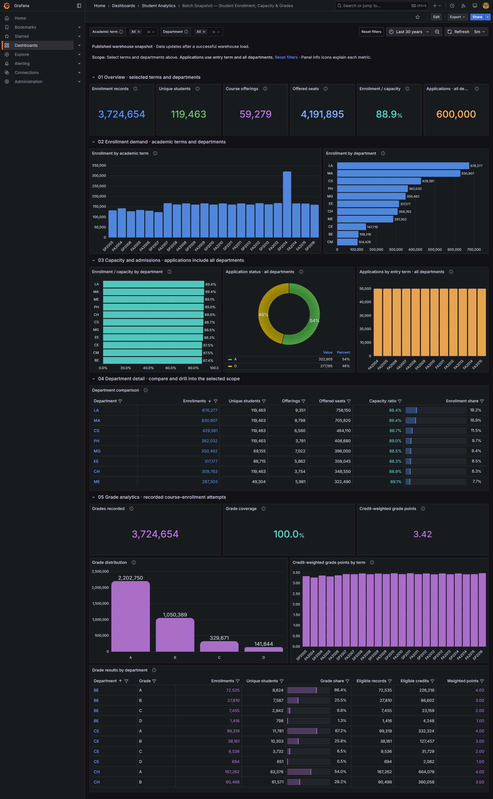
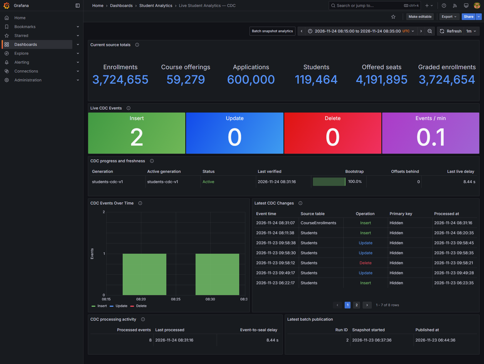

# Student Data Engineering Platform

A local data engineering project that turns operational SQL Server data into analytics for enrollment, course capacity, admissions and grades. It shows how to publish a reproducible analytical snapshot and serve ongoing source changes from the same database.

| Data product | What it answers | What becomes visible |
|---|---|---|
| **Batch** | What did the whole source dataset contain at the selected snapshot boundary? | A validated dimensional snapshot tied to one staging run |
| **Change data capture (CDC)** | What does the source contain now, and which changes has the pipeline processed? | A verified baseline followed by sealed inserts, updates and deletes |
| **Incremental analytics** | What are the latest enrollment, capacity, admissions and grade measures? | The current nine dimensions and three facts, with row-level dimension history |

## Architecture



**Batch.** Airflow reads 15 tables in one SQL Server snapshot transaction, stages and reconciles them in PostgreSQL, and hands the validated run to Spark. Spark builds nine dimensions and three facts, then publishes the full snapshot in ClickHouse. Keeping this independent extract gives the project a comparison point for reconciliation and a stable input for rebuilding a warehouse run. [Batch pipeline](docs/04-data-pipelines/batch.md)

**Live CDC.** Debezium captures a source baseline and committed changes. Kafka retains the events, and Spark verifies each microbatch in ClickHouse before committing its checkpoint. Live CDC shows current source rows, the timing of individual changes, and capture progress. This is where to check whether an insert reached the pipeline or a connector is lagging. [CDC pipeline](docs/04-data-pipelines/cdc.md)

**Incremental analytics.** After bootstrap, Airflow checks for new verified CDC batches every 15 minutes. It relays eligible events through PostgreSQL, projects changed rows with Spark, and publishes the analytical model in ClickHouse. This brings the source changes into the reporting metrics without repeating a full SQL Server extract. The job exits before starting Spark when there are no new seals. [Installation and cutover](docs/04-data-pipelines/incremental.md) · [SCD Type 2](docs/05-data-platform/scd-type-2.md)

### Databases and warehouse models

| Database | Why it exists |
|---|---|
| SQL Server `Students` | The operational source of record for the 15 tables. |
| PostgreSQL `students_staging` | Keeps Batch extracts and their validation metadata, plus the deduplicated incremental CDC relay and its run status. |
| PostgreSQL `airflow` | Stores scheduler, DAG and task state. |
| ClickHouse `students_cdc` | Stores source events, verified Spark seals and the active generation. It feeds Live CDC and supplies verified input to the incremental job. |
| ClickHouse `students_warehouse` | Houses **both** the Batch and incremental analytical models. Each has its own publication marker and its own published views. |

Both ClickHouse databases share one server. The analytical models share application, offering and enrollment fact grains and draw their filters from terms, departments, courses, grades and other dimensions. Student and applicant keys are pseudonymized with HMAC. [Database roles, flows and publication boundaries](docs/02-architecture/overview.md) · [Warehouse object catalog](docs/05-data-platform/warehouse.md)

### Technology stack

| Component | Responsibility |
|---|---|
| External SQL Server | Source records, snapshot isolation and CDC capture instances |
| PostgreSQL 16 | Batch staging, incremental CDC relay and a separate Airflow metadata database |
| Airflow 3.1.5 | Batch extraction and warehouse handoff, plus scheduled incremental publication |
| Kafka 3.9.1 and Debezium 2.7.3 on Connect | Retained events, connector lifecycle, source offsets and schema history |
| Spark 3.5.6 | Dimensional transforms and independent checkpointed CDC processing |
| ClickHouse 24.8 | Batch, incremental and CDC views selected by explicit publication markers |
| Grafana 11.5.2 | Provisioned Batch and Live CDC dashboards, plus generated incremental analytics |
| Docker Compose, Python and SQL | Local service orchestration, application code and data definitions |

## Quick start

### Prerequisites and configuration

Use Docker with Compose v2, GNU Make, and Python 3.11 or 3.12 with `venv`. The host needs access to image registries, package indexes and Maven. On WSL2, keep the checkout on the Linux filesystem. Use a SQL Server that your containers can reach. An authorized source owner must confirm snapshot isolation for Batch and CDC capture, Agent jobs, reader access and retention for the 15 tables before CDC starts.

Run these commands from the fresh checkout.

```bash
python3 -m venv .venv
make install
test -f .env || cp .env.example .env
```

Edit the private `.env` and set the SQL Server endpoint, database, schema, approved reader and TLS settings. Start with the local defaults for the other services. Initialization creates missing local passwords and keys. Preserve those values with the named volumes. [Environment template](.env.example) · [Setup and source checks](docs/03-infrastructure/setup.md)

### First run

1. Run `make up` and then `make status`. Startup initializes PostgreSQL, ClickHouse and Airflow, prepares Kafka topics, registers or verifies Debezium, and starts Spark streaming and Grafana. The first connector registration can start a SQL Server snapshot. Allow time for CDC bootstrap after the services start.
2. Open Grafana at `http://localhost:13000` with its UI admin credentials. For the first full demonstration, wait for **CDC progress and freshness** to show an active generation.
3. Open Airflow at `http://localhost:18080` with its UI admin credentials. Unpause `sqlserver_to_postgres_staging` and `postgres_to_clickhouse_warehouse`, then trigger **only the staging DAG**. Leave `BATCH_SNAPSHOT_SCHEDULE` blank for manual runs. The staging DAG passes a successful manifest to the warehouse DAG automatically.
4. Check **Latest batch publication** in Grafana for the new staging run ID. With both Batch and Live CDC published, run `make reconcile`. [Operations runbook](docs/07-operations/runbook.md)
5. Install, bootstrap and verify the incremental warehouse from the active CDC generation. Provision the incremental dashboard, then enable its 15-minute DAG and set Grafana Home to open it. [Incremental activation commands](docs/04-data-pipelines/incremental.md#activation-on-an-existing-volume)

CDC owns its snapshot-to-stream handoff. Its baseline and source offsets come from Debezium, with Kafka and Spark tracking downstream progress. The Airflow extract has a separate snapshot boundary and supplies an independent analytical product. Waiting for CDC activation before the first Batch run avoids overlapping full reads and gives CDC an established capture boundary. Compare the two boundaries before interpreting differences.

### Subsequent runs

Use `make up` to resume with the existing volumes, connector offsets and Spark checkpoint. With a blank Batch schedule, startup starts no new Batch extract. Trigger one when you want an updated Batch snapshot. Use `make down` to stop the stack while keeping its named volumes.

| Task | Command |
|---|---|
| Start only Batch and Grafana | `make up-pipeline` |
| Start only the CDC path and Grafana | `make streaming-up` |
| Install, test and bootstrap incremental analytics | `make incremental-install`, `make incremental-test`, `make incremental-bootstrap` |
| Check services and startup logs | `make status`, `make logs` |
| Retry warehouse publication for a successful staging run | `make warehouse-load RUN_ID=123` using the actual run ID |
| Validate local configuration and run unit tests | `make compose-config`, `make test` |

## Grafana dashboards

Open [Grafana Home](http://localhost:13000/) and sign in with the Grafana credentials in `.env`. After activation, Home opens **Incremental CDC— Student Enrollment, Capacity & Grades**. Each dashboard has its own data publication and query refresh cadence.

| Dashboard | Purpose | When the data changes | Grafana refresh |
|---|---|---|---|
| [Incremental CDC— Student Enrollment, Capacity & Grades](http://localhost:13000/d/students-enrollment-incremental) | Everyday enrollment, capacity, applications and grades | After Airflow verifies and publishes new sealed CDC batches on its 15-minute schedule | 5 minutes |
| [Batch Snapshot](http://localhost:13000/d/students-enrollment-kpis) | A reproducible full snapshot for reconciliation and recovery | After a successful Batch warehouse load publishes a source run | 5 minutes |
| [Live Student CDC](http://localhost:13000/d/students-live-cdc) | Source totals, operation history and streaming health | After Spark seals a CDC microbatch in the active generation | 1 minute |

The two enrollment dashboards share 18 panels and multi-select **Academic term** and **Department** filters. **Unique students** counts distinct students with an enrollment in the selected scope. **Applications** use the selected entry terms across all departments. Panel links drill into an academic term or department, and **Reset filters** restores All. [Panel guide and metric definitions](docs/06-observability-and-quality/grafana.md)

### Incremental CDC— Student Enrollment, Capacity & Grades



The incremental dashboard shows the published state of the enrollment, offering and application facts. The capture includes the new enrollment after its CDC change was verified and published. Open **Batch Snapshot** from this dashboard to compare against the independent full load. [Incremental pipeline and cutover](docs/04-data-pipelines/incremental.md)

### Batch Snapshot



The Batch capture uses the full snapshot for staging run 2. Compare publication boundaries before interpreting differences across dashboards. `make reconcile` reports **CDC minus Batch** counts for applications, offerings and enrollment attempts. [Reconciliation guide](docs/04-data-pipelines/reconciliation.md)

A new enrollment appears in Live CDC after Spark verifies it, in the incremental reports after Airflow publishes the affected batch, and in Batch after a later full snapshot includes it. Grafana refreshes each dashboard from its published views. `make incremental-verify` checks that the incremental model agrees with the exact sealed CDC cut it consumed. [An enrollment through all three flows](docs/02-architecture/overview.md#what-one-new-enrollment-looks-like)

### Live Student CDC



Live CDC shows the active generation, bootstrap progress, sampled Kafka lag, cumulative processing activity and the latest Batch publication. Its event cards and chart use the selected time range. The capture uses a fixed UTC window containing verified changes. [CDC panel guide](docs/06-observability-and-quality/grafana.md#live-student-cdc) · [Screenshot gallery](docs/assets/README.md#grafana-dashboards) · [Validation results](docs/06-observability-and-quality/testing-and-validation.md)

## Limitations and recovery

The services share one host, and the analytical and CDC models share a ClickHouse server. Initial snapshots, replay and heavy analytical queries compete for memory and disk. Source and Kafka retention bound recovery. Keep Kafka data, Connect offsets, the Spark checkpoint and the ClickHouse CDC ledger compatible when restoring. Use the existing checkpoint on routine restarts.

The local stack uses a PostgreSQL admin for application access and a ClickHouse admin for the publishers and Grafana. Use it as a trusted local project. Source readiness and controlled mutations depend on the permissions and environment provided by the source owner. [Backup, recovery and troubleshooting](docs/07-operations/runbook.md)

## Repository and documentation

| Path | Contents |
|---|---|
| `airflow/` | Extraction, Batch and incremental warehouse DAGs and typed staging loader |
| `spark/` | Batch and incremental projections, CDC normalization and streaming worker |
| `db/` | Source assessment and readiness, PostgreSQL staging DDL, ClickHouse DDL and reconciliation |
| `debezium/`, `clickhouse/`, `grafana/` | Connector registration, database configuration and dashboard provisioning |
| `scripts/`, `tests/` | Initialization, topic preparation, unit tests and integration fixtures |
| `docs/` | Foundation, architecture, infrastructure, pipelines, data platform, observability and operations |

Follow the documentation index for the engineering decisions, object catalogs and operational procedures. [Documentation index](docs/README.md)
