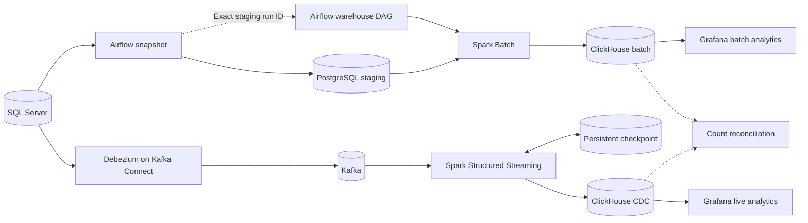

# Student Data Engineering Platform

A local data engineering project that turns student, admissions and course activity from SQL Server into analytical data products. It answers questions such as how enrollment compares with offered capacity, how applications vary by entry term, and how grade coverage changes across departments.

**Batch** publishes independently validated dimensional snapshots for historical analysis and reconciliation. **CDC** captures changes and serves current source totals in Grafana. The two paths share a source and a ClickHouse server while keeping their processing, databases and publication state separate.

## Architecture



- **Batch:** Airflow extracts 15 tables inside a SQL Server snapshot transaction and reconciles source, fetched and persisted counts. It hands the validated staging run ID to the warehouse DAG. Spark reads that exact run, builds nine dimensions and three facts, and publishes the candidate only after checking the ClickHouse writes. [Batch pipeline](docs/04-data-pipelines/batch.md) · [Database models](docs/02-architecture/data-model.md)
- **CDC:** Debezium captures an initial snapshot and subsequent changes. Spark consumes the retained Kafka log, verifies and seals microbatches, and saves progress in a persistent checkpoint. ClickHouse serves the active generation, resolves updates and deletes by source version, and aggregates the latest source rows for Grafana. [CDC pipeline](docs/04-data-pipelines/cdc.md)
- **Quality and recovery:** A failed batch candidate leaves the preceding snapshot visible. CDC can verify a replayed sealed batch using its recorded contents and checkpoint identity. Reconciliation compares applications, offerings and enrollment attempts and reports both publication references so an operator can distinguish timing differences from data defects. [Reconciliation](docs/04-data-pipelines/reconciliation.md) · [Operations](docs/07-operations/runbook.md)

## Technology stack

| Technology | Project responsibility |
|---|---|
| SQL Server and PostgreSQL 16 | External system of record and transaction-consistent extracts. PostgreSQL preserves typed staging batches and Airflow metadata. |
| Airflow 3.1.5, Python and SQL | Run-scoped orchestration, ingestion, validation and warehouse logic. |
| Kafka 3.9.1 and Debezium 2.7.3 on Connect | Partitioned, retained change data, connector lifecycle and source offsets. |
| Spark 3.5.6 | Batch joins and dimensional transforms, plus independent checkpointed microbatches for CDC. |
| ClickHouse 24.8 | Columnar batch warehouse and a separate CDC database with explicit publication markers. |
| Grafana 11.5.2 | Provisioned batch analytics and live CDC business totals, progress and freshness. |
| Docker Compose on Linux/WSL2 | Pinned local services, profile-specific startup and persistent volumes. |

## Run locally

Use Docker with Compose v2, Python 3.11 or 3.12 and an approved SQL Server reader. Setup needs registry, package index and Maven access. Keep the project on the Linux filesystem when using WSL2.

```bash
make install
make init
# Configure the SQL Server endpoint, TLS and approved reader in the private .env file.
make compose-config
make test
```

[.env.example](.env.example) lists the variables. `make init` generates missing local credentials. Preserve them with the volumes. Check source snapshot isolation for batch, and confirm SQL Server capture jobs, expected instances and retention before CDC startup. See [setup](docs/03-infrastructure/setup.md) and [source readiness](docs/05-data-platform/source-and-staging.md).

| Task | Command or action |
|---|---|
| Start and run batch | `make up`. In Airflow unpause both batch DAGs and trigger `sqlserver_to_postgres_staging`. |
| Retry the warehouse step | `make warehouse-load RUN_ID=123` with the eligible staging run ID. |
| Start CDC and Grafana | `make streaming-up` after source readiness checks. |
| Compare counts and inspect services | `make reconcile` after both publish. Inspect `make status` and `make logs`. |
| Stop local services | `make down` keeps named volumes. |

Default local interfaces are [Airflow](http://localhost:18080) and [Grafana](http://localhost:13000). Use **Live Student Analytics — CDC** for current totals and progress. Use **Batch Snapshot — Student Enrollment, Capacity & Grades** for term and department slicing, application status and grade measures. [KPI definitions](docs/06-observability-and-quality/grafana.md)

## Evidence and current status

On 22 November 2026, the local CDC generation was active with **4,623,487 verified bootstrap records** and zero offsets behind at the last sealed batch. Published batch run 2 and active CDC matched on **600,000 applications**, **59,279 offerings** and **3,724,654 enrollment attempts**. Twenty-five unit tests and isolated batch, replay and publication checks are recorded. The external-source acceptance still requires a fresh full run through the current Airflow handoff and controlled source changes on an authorized fixture. SQL Server Agent and cleanup retention also require DBA confirmation.

The stack runs on a single host. Kafka and SQL Server retention bound replay, and host-loss recovery requires compatible backups of Kafka, Spark checkpoints and databases. [Validation and limitations](docs/06-observability-and-quality/testing-and-validation.md)


The capture shows the batch dashboard’s enrollment breakdowns. The [visual gallery](docs/assets/README.md) dates and classifies execution evidence and links to the current diagrams.

## Repository and documentation

| Path | What to find |
|---|---|
| `airflow/` and `spark/` | Orchestration, typed ingestion, batch transformations and streaming |
| `db/` | Source assessment and readiness, PostgreSQL staging, ClickHouse DDL and reconciliation |
| `debezium/`, `clickhouse/` and `grafana/` | Connector registration, analytical database configuration and dashboards |
| `scripts/` and `tests/` | Setup and provisioning commands, unit tests and disposable integration fixtures |
| [Documentation](docs/README.md) | Seven sections from foundations to operations, with engineering decisions and visual evidence |

Start with the [foundation guide](docs/01-foundation/data-engineering.md), then follow the [architecture](docs/02-architecture/overview.md), [engineering decisions](docs/02-architecture/decisions.md) and [runbook](docs/07-operations/runbook.md).
