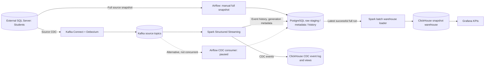
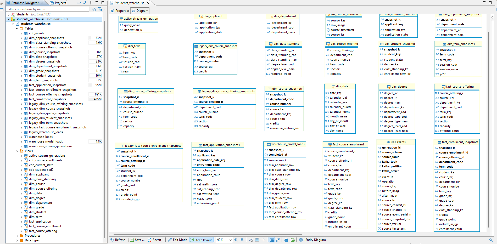
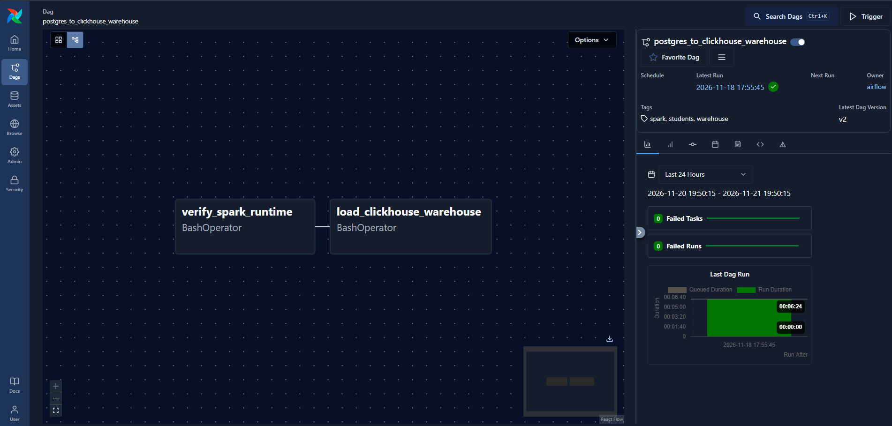
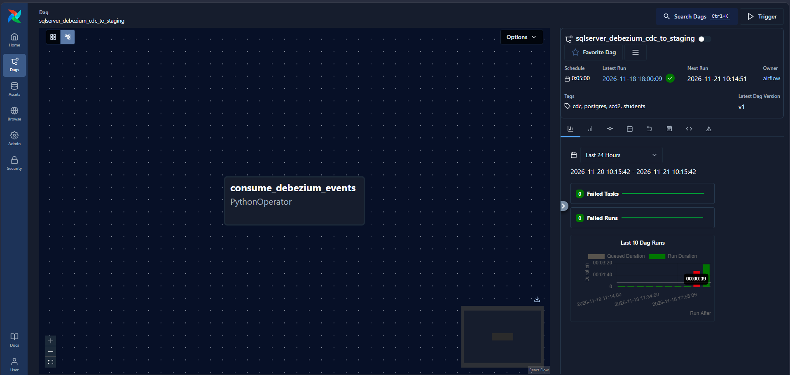

# Students Data Engineering Platform

A local, beginner-friendly data engineering training project. SQL Server is the source, PostgreSQL is staging, ClickHouse is the analytical warehouse, Apache Airflow orchestrates finite jobs, Apache Spark handles transformations and streaming, and Grafana displays ClickHouse KPIs.

## Contents

- [Architecture](#architecture)
- [Current implementation and status](#current-implementation-and-status)
- [Screenshots and demonstrations](#screenshots-and-demonstrations)
- [Quick start](#quick-start)
- [Airflow batch workflow](#airflow-batch-workflow)
- [CDC and streaming](#cdc-and-streaming)
- [ClickHouse and Grafana](#clickhouse-and-grafana)
- [Operations](#operations)
- [Documentation](#documentation)

## Architecture



**Important separation:** The published Grafana facts and dimensions are built from PostgreSQL **full snapshot batches**, not from incremental CDC events. The Spark streaming consumer currently writes PostgreSQL CDC history and a separate ClickHouse CDC event model. PostgreSQL `scd.entity_versions` is a legacy SCD2 path used by the paused Airflow CDC consumer; Spark streaming does not populate that table. ClickHouse `cdc_student_scd2` is a query-time CDC projection, not the batch `dim_student` table. An automatic, incremental CDC-to-analytical-star-schema SCD2 loader is **not implemented yet**.

## Current implementation and status

The following is **observed evidence**, not a guarantee that services are still running now:

| Component | Evidence from 2026-11-21 | Interpretation |
| --- | --- | --- |
| PostgreSQL, ClickHouse, Kafka, Connect | Healthy in combined read-only health report | Infrastructure was operational |
| Spark CDC | Running; checkpointed consumer progress and no obvious recent errors | Continuous consumer operational at the time |
| CDC initial snapshot | `snapshot_events_complete = t`, reported offsets at 100% | Snapshot consumption reached its boundary; generation remained `BOOTSTRAPPING` in that same check |
| CDC generation publication | Not shown after the 100% check | **Still requires checking** status and ClickHouse active generation |
| Airflow | Local DAG import errors: zero; Java 17 and Spark 3.5.6 available in scheduler | Runtime prerequisites present; individual DAG execution not thereby proven |
| Full source staging | Successful historical full snapshot of 15 tables | Full-load path exists and populated staging |
| ClickHouse analytical warehouse | 3,724,654 enrollments; 59,279 offerings; 600,000 applications; 600,000 applicants | Populated published batch views |
| Grafana | ClickHouse datasource reported working | Warehouse query connection is operational |
| Warehouse orchestration | Manual `postgres_to_clickhouse_warehouse`; a locally applied safety patch adds `verify_spark_runtime` | Local code may be ahead of GitHub until committed |

The local safety patch also adds a published-full-run guard to `spark/load_warehouse.py`. It prevents rebuilding an already published **full** staging run in the common case; it does not create CDC/SCD2 incremental loading. The GitHub default branch may not yet contain this local patch. See [2026-11-21 validation update](./docs/13-validation/validation-update-2026-11-21.md).

Keep the Airflow CDC DAG paused while Spark CDC owns the source stream. Do not reset Kafka, connector offsets, Spark checkpoints or database volumes to force progress.

## Screenshots and demonstrations

Screenshots document historical UI states and must not be mistaken for live health or current run status. The actual repository image directory is `docs/14-screenshots/`.

### Source and batch






### Grafana and CDC




The old Docker screenshot may show Spark CDC as `Created`; later runtime reports show it `Up` and consuming events. Screenshot captions must retain their capture date. A newer Spark microbatch screenshot is still optional evidence, not a reason to restart a working stream.

## Quick start

New installation only:

```bash
git clone https://github.com/pzolfaghari72/students-data-engineering-platform.git
cd students-data-engineering-platform
cp -n .env.example .env
# Fill required values; never print or commit the secrets.
docker compose config --quiet
make init
make up
make status
```

`make up` starts the normal core, Airflow and dashboard path; it does **not** run the source extraction or start Spark CDC. Use the documented `make cdc-up` / `make streaming-up` only when starting a **new** validated stream. Do not run startup targets again merely to check an already-running stream.

| Interface | Host address |
| --- | --- |
| Airflow | http://localhost:18080 |
| Grafana | http://localhost:13000 |
| PostgreSQL | localhost:15433 |
| ClickHouse HTTP/native | localhost:18123 / localhost:19000 |
| Kafka external | localhost:19094 |
| Kafka Connect REST | http://localhost:18083 |

These are host-facing ports from the checked local Compose configuration, not the internal ports used between containers. Setup is expanded in [Quick Start](./docs/01-getting-started/quick-start.md) and [Environment Configuration](./docs/01-getting-started/environment-configuration.md).

## Airflow batch workflow

Both batch DAGs remain manually triggered (`schedule=None`):

1. Trigger `sqlserver_to_postgres_staging` for a **controlled full reload**, not on every refresh. Its tasks are `create_pipeline_run` -> `load_consistent_snapshot` -> `finish_pipeline_run`.
2. Confirm successful staging batches for all 15 source tables.
3. Trigger `postgres_to_clickhouse_warehouse` only if a new successful full snapshot needs to be published. The locally patched DAG performs `verify_spark_runtime` -> `load_clickhouse_warehouse`.
4. Validate the ClickHouse published views. Grafana queries those views automatically.

The separate `make warehouse-load` job is an alternative warehouse publisher. **Never run it concurrently with the Airflow warehouse job.** The full warehouse loader is not a 15-minute incremental CDC/SCD2 job; leave its Airflow schedule manual until new semantics and checkpoints are implemented and tested.

See [Batch Execution](./docs/10-operations/batch-execution.md) and [Warehouse Publication](./docs/07-data-warehouse/data-publication-and-reconciliation.md).

## CDC and streaming

SQL Server CDC -> Debezium in Kafka Connect -> Kafka topics -> one Spark Structured Streaming consumer -> PostgreSQL CDC history/generation metadata and ClickHouse `cdc_events`.

The previous Airflow CDC consumer, `sqlserver_debezium_cdc_to_staging`, is **paused** because it is an alternative consumer path, not an additional layer to run concurrently. The current stream uses a persistent checkpoint and the PostgreSQL generation state. On 2026-11-21 the consumed-offset boundary reached 100%, but the last supplied generation status was still `BOOTSTRAPPING`. Before calling the CDC data active, verify both PostgreSQL generation status and ClickHouse `warehouse_stream_generations` / `active_stream_generations`.

Do not confuse completed snapshot **consumption** with active CDC publication or tested source changes (`c/u/d`). Read [Streaming Execution](./docs/10-operations/streaming-execution.md) and [SCD Type 2](./docs/07-data-warehouse/scd-type-2.md).

## ClickHouse and Grafana

The current batch model is nine dimensions and three facts with physical `dim_*_snapshots` and `fact_*_snapshots` tables. A completed row in `warehouse_model_loads` selects the published `snapshot_id`. The exposed views include `dim_student`, `dim_applicant`, `fact_course_enrollment`, `fact_course_offering` and `fact_application`.

The newer dashboard is **Student Enrollment, Capacity & Grades**, with 18 panels covering enrollment, capacity, admission, department comparisons and grade analytics. It uses a ClickHouse datasource; it does not trigger ingestion. Number displays were changed locally to use full integers with thousands separators rather than abbreviations; verify a refreshed Grafana export before claiming every panel format is permanently provisioned in GitHub.

Refer to [Business KPIs](./docs/08-analytics-and-monitoring/business-kpis.md), [Grafana](./docs/08-analytics-and-monitoring/grafana.md), and [Fact and Dimension Tables](./docs/07-data-warehouse/fact-and-dimension-tables.md).

## Operations

Read-only platform check (when the locally generated helper is present):

```bash
python3 check_students_platform.py
```

Basic checks:

```bash
make status
docker compose --profile '*' ps -a
```

`make down` stops containers while retaining named volumes, but do not stop an active streaming job without a recovery reason. Never run `docker compose down -v` as normal cleanup. Use the [Operational Runbook](./docs/10-operations/operational-runbook.md).

## Documentation

Start with [Architecture](./docs/02-architecture/architecture-overview.md), [Quick Start](./docs/01-getting-started/quick-start.md), [Batch Execution](./docs/10-operations/batch-execution.md), [Streaming Execution](./docs/10-operations/streaming-execution.md), [Warehouse SCD2](./docs/07-data-warehouse/scd-type-2.md), and the [2026-11-21 validation update](./docs/13-validation/validation-update-2026-11-21.md).

The [2026-11-16 final project report](./docs/12-implementation/final-project-report.md), [2026-11-16 CDC readiness report](./docs/13-validation/cdc-readiness-report.md), and [earlier technical context](./docs/PROJECT_TECHNICAL_CONTEXT.md) are **historical snapshots**. Their recorded blockers must not be represented as current without repeating those checks.
