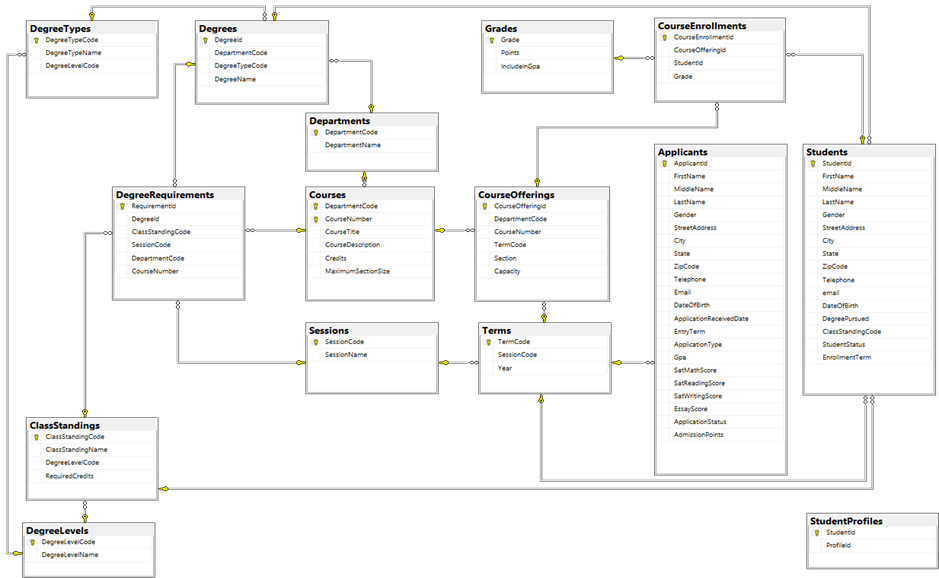
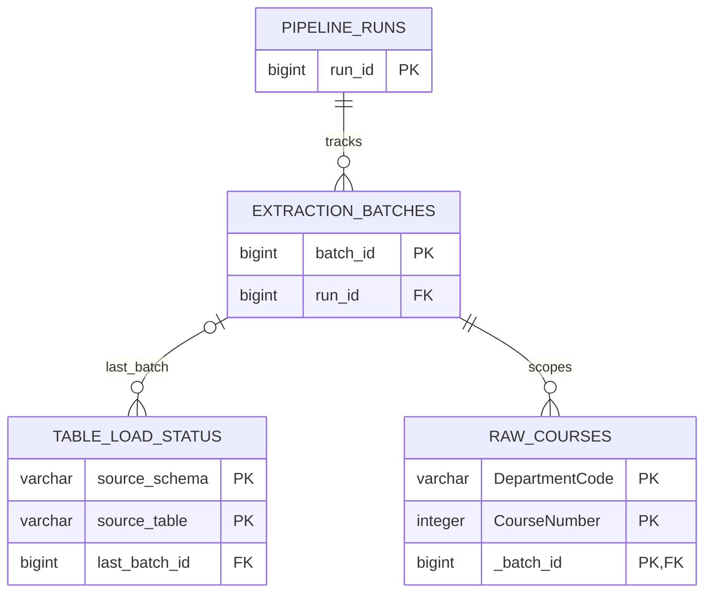
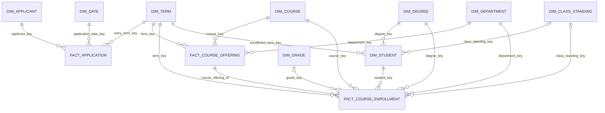
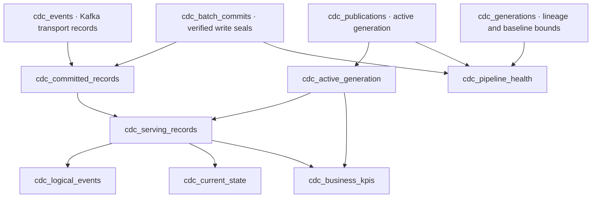

# Database models across the pipelines

The [SQL Server DDL and assessment](../../db/source_assessment) describe the upstream contract. The staging and batch diagrams below use the modeled tables and keys in this repository. The streaming diagram follows how ClickHouse publishes verified events.

## SQL Server source

The assessed source includes composite course identity `(DepartmentCode, CourseNumber)`, offerings keyed by `CourseOfferingId`, and enrollment attempts keyed by `CourseEnrollmentId`. The [15-table extraction mapping](../../airflow/dags/students_staging/source_tables.py) fixes the application boundary and preserves source-key columns.

## PostgreSQL staging

One metadata run tracks a separate extraction batch per table. Each raw table has a foreign key to its extraction batch and includes that batch in its primary key. The latest table status is keyed by source schema and table. See the [PostgreSQL DDL](../../db/staging_postgres/staging_ddl) for physical constraints and types.

## ClickHouse batch

The diagram shows logical joins within one published snapshot. The application grain is one applicant record, the offering grain is one course offering, and the enrollment grain is one attempt. Spark checks keys and references before publishing. Grade and class standing can be absent. Spark pseudonymizes student and applicant keys and derives an unambiguous course key from the composite source key. ClickHouse physical tables repeat those grains by `snapshot_id`; the publication marker selects one validated source run for the views. The [fact and dimension catalog](../05-data-platform/warehouse.md#batch-dimensional-model) maps view names to tables. The [DDL](../../db/warehouse_clickhouse/warehouse_ddl.sql) defines the projections.

## ClickHouse CDC

Transport records are identified within a generation by Kafka topic, partition and offset. Logical event identity includes the source table, canonical source key, operation and source version. The current-state grain is one latest nondeleted row per source table and key. The published KPI views aggregate those rows. See the [CDC warehouse design](../05-data-platform/warehouse.md#cdc-event-and-current-state-model) and [CDC DDL](../../db/warehouse_clickhouse/cdc_warehouse_ddl.sql).
