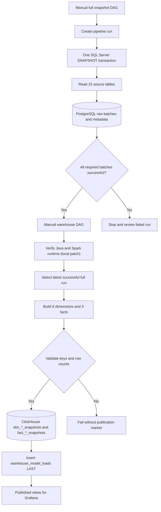
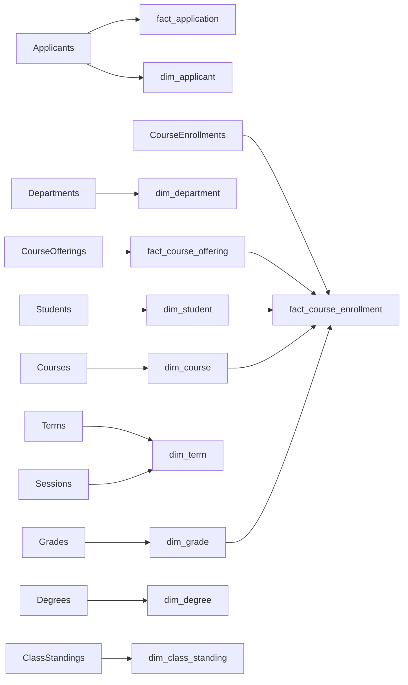
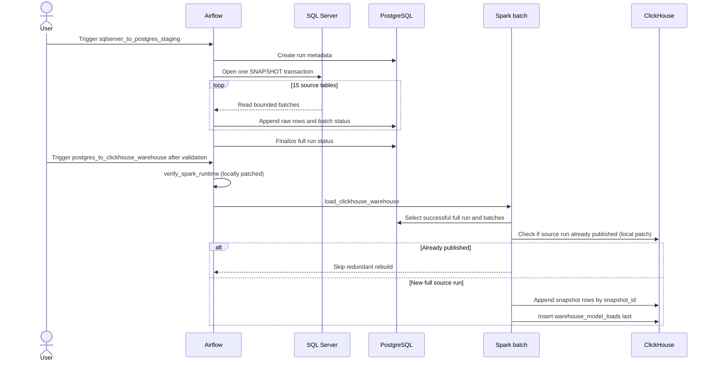

# Batch Pipeline Diagrams

Two **manual Airflow DAGs**: a full SQL Server snapshot to PostgreSQL staging, followed by a controlled Spark warehouse publication.

## Batch flow

## Source-to-star-schema shape

## Execution sequence

The local guard does not make two concurrent publishers safe. The batch path is not incremental CDC-to-star-schema SCD2. Older reports of SQL Server snapshot isolation being off describe a **dated** readiness check; verify the source setting before a new full extraction.

See [Batch Architecture](../batch-architecture.md) and [Batch Execution](../../10-operations/batch-execution.md).
