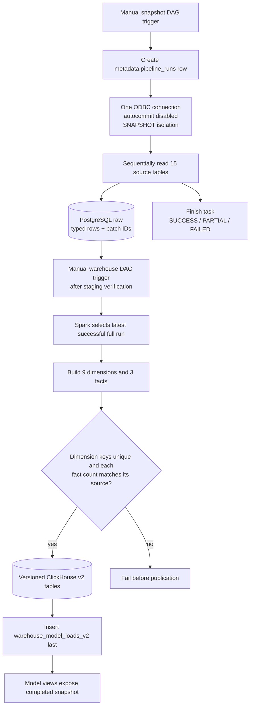
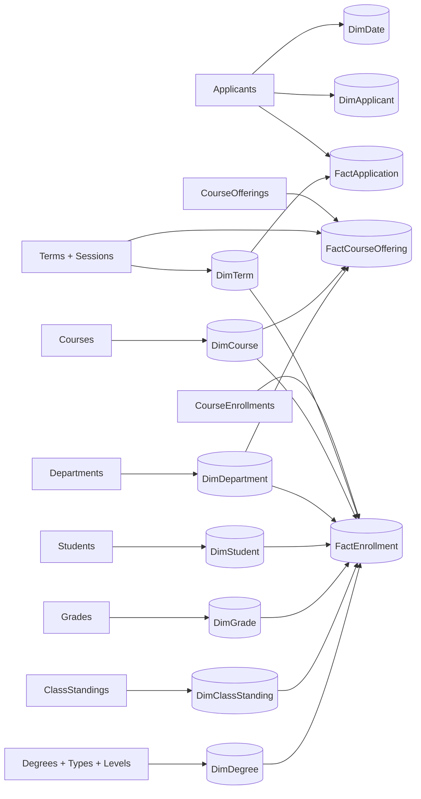
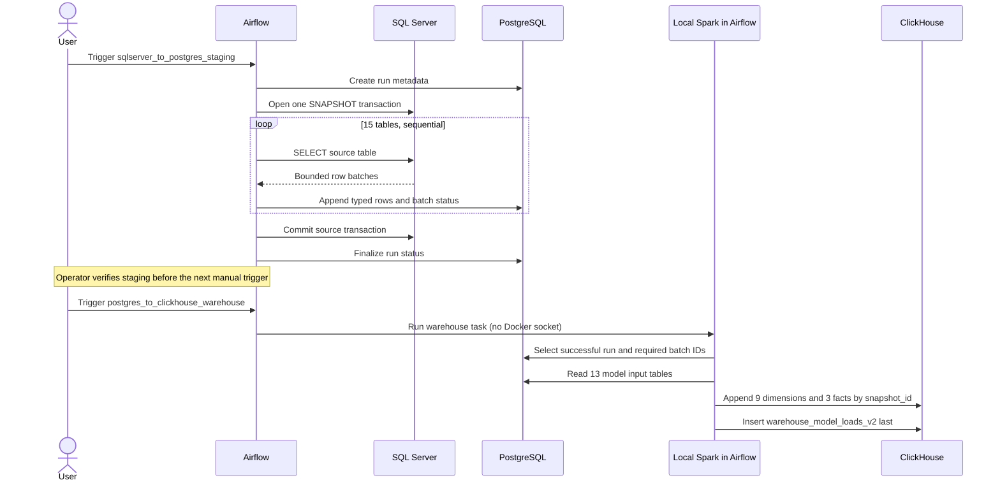

# Batch Pipeline Diagrams

Canonical flow for the SQL Server snapshot and subsequent Spark warehouse
publication. The snapshot and warehouse publication are separate, manually
triggered Airflow DAGs.

## Batch pipeline

## Source-to-warehouse map

## Batch execution sequence

The implementation requires SQL Server `ALLOW_SNAPSHOT_ISOLATION=ON`; the
current readiness report records it as OFF. See
[snapshot consistency](../../04-data-ingestion/snapshot-consistency.md).
