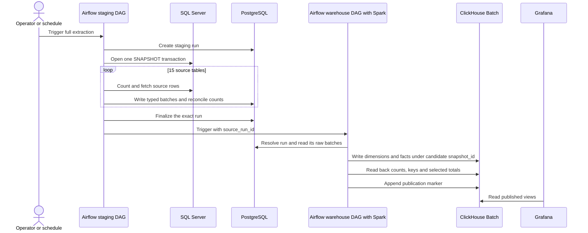

# Batch pipeline diagram

This sequence describes the current code. The [Airflow captures](../../14-screenshots/README.md#airflow-batch-orchestration) record earlier graph revisions.

Staging persists diagnostic rows on failure. A failed extraction never reaches the Spark publication step. A failed candidate write can leave data behind while the serving views continue to resolve the most recent valid publication. [Batch reliability](../../06-data-processing/idempotency-and-retries.md)
