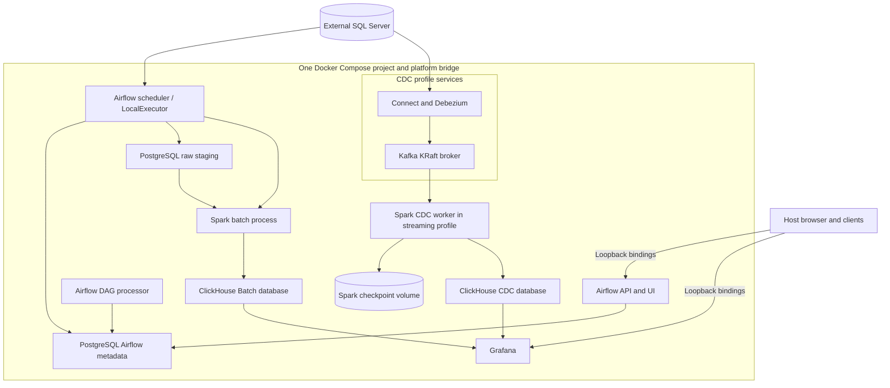

# Docker deployment diagram

The two ClickHouse databases share a server. PostgreSQL hosts both of its listed databases. Compose persists database files, broker data, checkpoints and Grafana state in named volumes. One-shot jobs initialize roles, schemas and connector registration. [Service inventory](../../03-infrastructure/docker-compose.md) · [Ports](../../03-infrastructure/services-and-networking.md)
