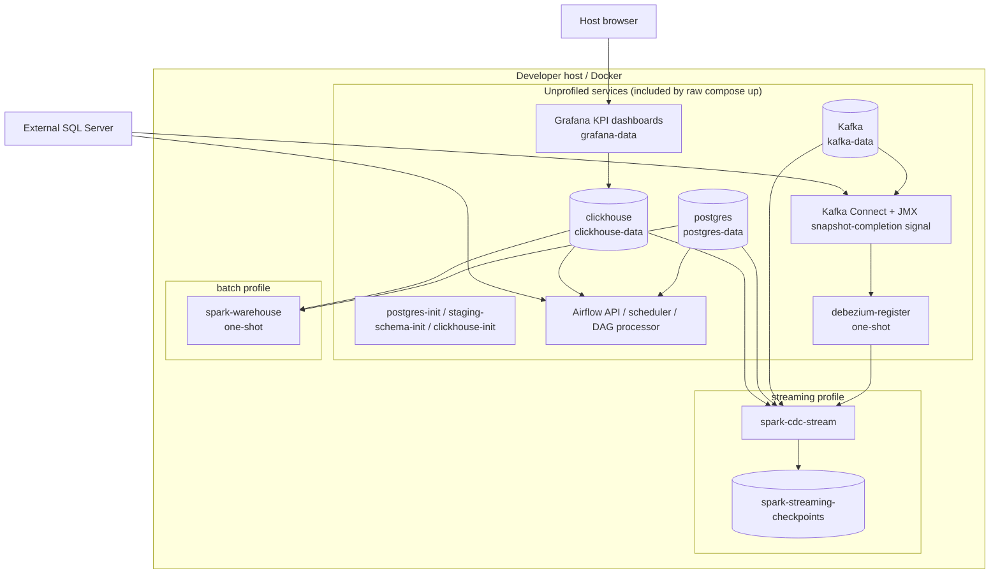

# Docker Deployment Diagram

This is the canonical Compose service map. Only the two Spark services have
profiles; the Make targets select service names to avoid starting every
unprofiled service.

All inter-container traffic uses the `platform` bridge network and Compose
service DNS. Host-published ports bind to loopback. An unqualified
`docker compose up` includes the unprofiled Kafka, Connect, and registration
services. Prefer the explicit Make targets for normal startup; do not start
all services or profiles unless CDC prerequisites and connector registration
are intentionally being handled.
