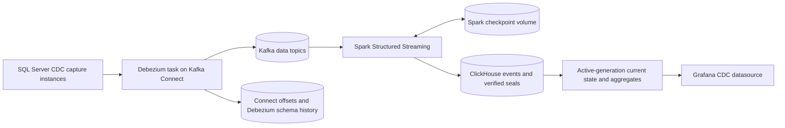
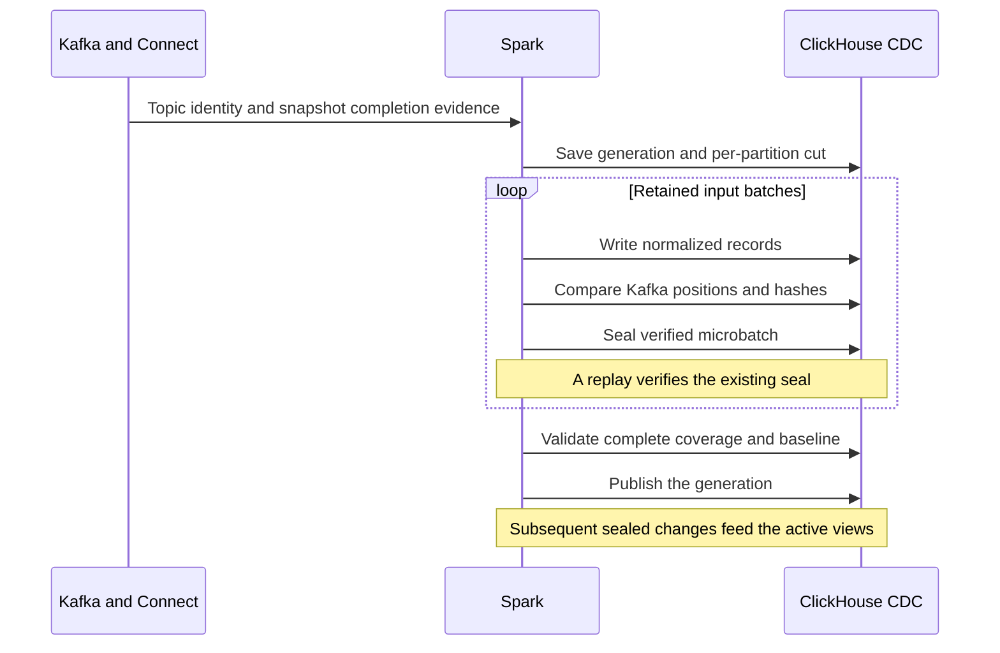

# CDC pipeline diagrams

The saved Kafka cut can include early live events. The baseline LSN and snapshot markers identify the completed snapshot cohort. [Bootstrap and event identity](../../05-streaming-and-cdc/event-processing.md)
