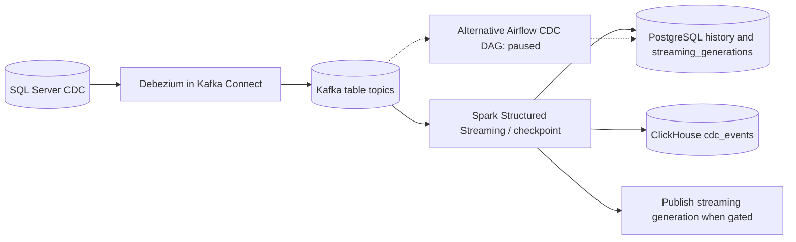
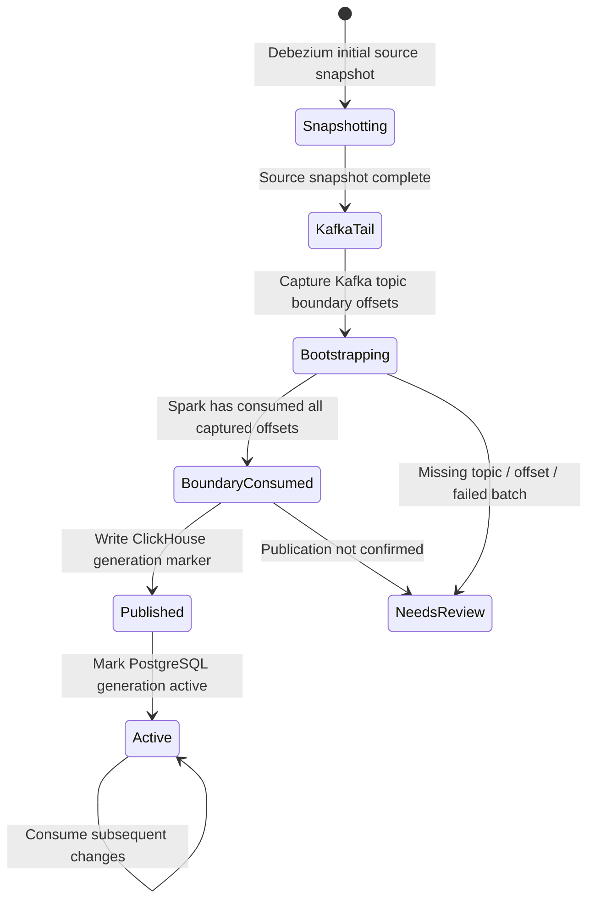
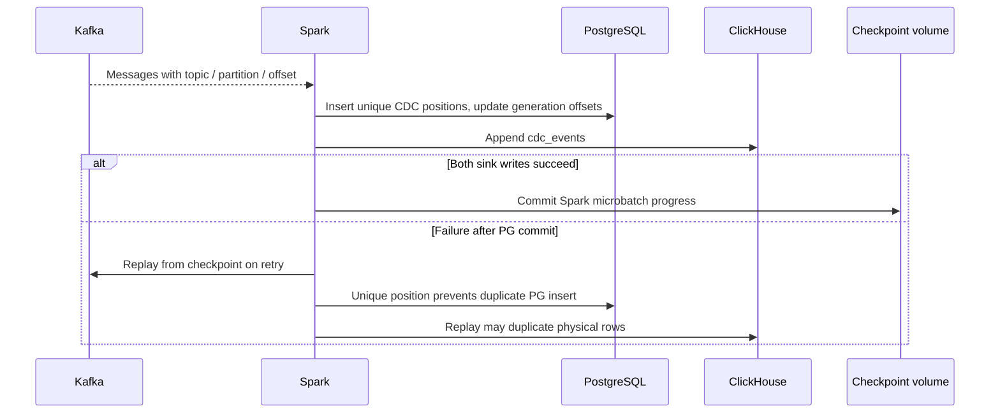
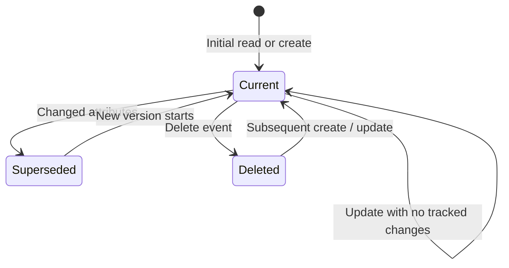

# CDC and Streaming Diagrams

The current active CDC consumer design is Spark Structured Streaming. The older Airflow CDC DAG is **paused** and should not be enabled as a second owner of the same source/sinks.

## Flow

The batch `fact_course_enrollment` and `dim_student` views are **not** updated by this CDC event path.

## Bootstrap state machine

**2026-11-21 observation:** PostgreSQL reported `snapshot_events_complete=t` and 100% consumed offsets, but the same query still showed `BOOTSTRAPPING`. That proves the **BoundaryConsumed** step, not necessarily **Published** or **Active**. The final ClickHouse generation marker and PostgreSQL `ACTIVE` state were not supplied.

## Spark microbatch and recovery

## Student SCD Type 2 projection

`cdc_student_scd2` is a **ClickHouse query-time projection** over a published generation; it is not a Spark materialization into the batch `dim_student` dimension. The legacy PostgreSQL `scd.entity_versions` path is maintained by the paused Airflow consumer, not by the running Spark stream.

See [Streaming Architecture](../streaming-architecture.md) and [Streaming Execution](../../10-operations/streaming-execution.md).
