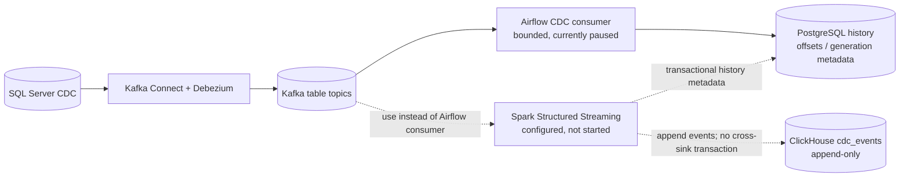
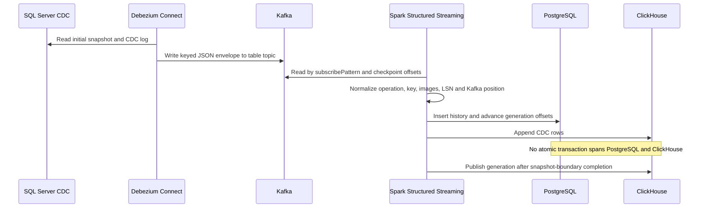
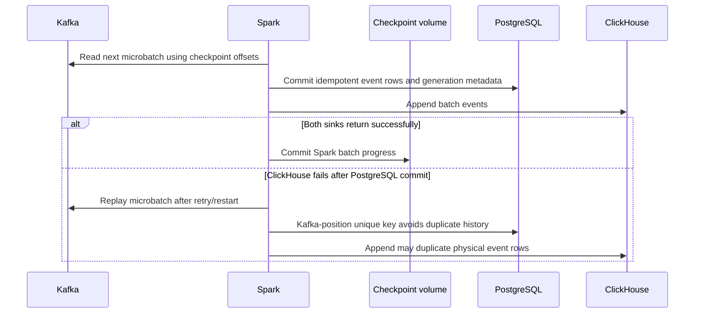
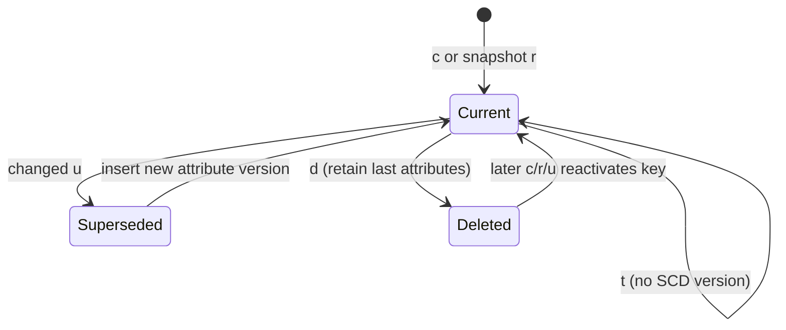

# CDC and Streaming Diagrams

The following diagrams describe code/configuration paths and their validation
limits. The Airflow CDC consumer and Spark streaming consumer must not compete
for one logical sink/checkpoint.

## CDC pipeline

## CDC lifecycle

```mermaid
stateDiagram-v2
    [*] --> SourceReady: CDC enabled / login and Agent verified
    SourceReady --> ConnectorRegistered: create-only registration
    ConnectorRegistered --> Snapshotting: Debezium initial snapshot
    Snapshotting --> KafkaTail: snapshot complete; connector streams log
    KafkaTail --> ConsumerBootstrapping: capture per-partition Kafka end offsets
    ConsumerBootstrapping --> ActiveGeneration: consume through all captured ends
    ActiveGeneration --> KafkaTail: process later changes
    ConsumerBootstrapping --> Blocked: missing topics / offsets / checkpoint
    ConnectorRegistered --> Blocked: SQL permissions or capture job failure
```

## Debezium → Kafka → Spark sequence

## Streaming recovery sequence

The Spark app checks Debezium's exported snapshot-complete metric before
capturing Kafka end offsets. Per-partition Kafka offsets establish consumer
progress, not a single SQL Server transaction LSN across multiple topics.

## Student SCD Type 2 lifecycle

The PostgreSQL consumer implements generic transitions for its selected
tables. The ClickHouse `cdc_student_scd2` view derives Student history from
the event log; the Spark consumer does not update PostgreSQL's SCD table.
