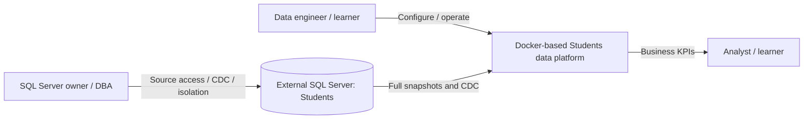
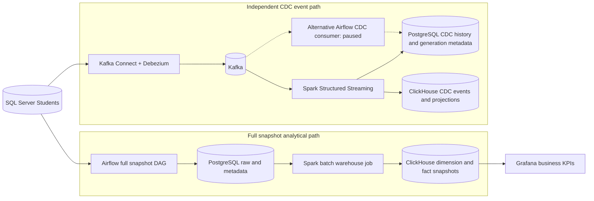

# System Context and Data Model Diagrams

These diagrams distinguish the demonstrated batch model, the currently running Spark CDC consumer, and the still-unimplemented incremental CDC-to-analytical-star-schema integration.

## System context

## Complete architecture

The Spark CDC consumer was observed running on 2026-11-21 and its initial snapshot Kafka offsets later reached 100%. The supplied PostgreSQL status was still `BOOTSTRAPPING`; ClickHouse generation publication was not independently confirmed. The paused Airflow consumer is not a second simultaneously operating branch.

## ClickHouse batch dimensional model (simplified)

```mermaid
erDiagram
    DIM_APPLICANT ||--o{ FACT_APPLICATION : applicant_key
    DIM_DATE ||--o{ FACT_APPLICATION : application_date_key
    DIM_TERM ||--o{ FACT_APPLICATION : entry_term_key
    DIM_COURSE ||--o{ FACT_COURSE_OFFERING : course_key
    DIM_DEPARTMENT ||--o{ FACT_COURSE_OFFERING : department_key
    DIM_TERM ||--o{ FACT_COURSE_OFFERING : term_key
    DIM_STUDENT ||--o{ FACT_COURSE_ENROLLMENT : student_key
    DIM_COURSE ||--o{ FACT_COURSE_ENROLLMENT : course_key
    DIM_DEPARTMENT ||--o{ FACT_COURSE_ENROLLMENT : department_key
    DIM_TERM ||--o{ FACT_COURSE_ENROLLMENT : term_key
    DIM_GRADE ||--o{ FACT_COURSE_ENROLLMENT : grade_key
    DIM_DEGREE ||--o{ FACT_COURSE_ENROLLMENT : degree_key
    DIM_CLASS_STANDING ||--o{ FACT_COURSE_ENROLLMENT : class_standing_key
    WAREHOUSE_MODEL_LOADS ||--o{ FACT_APPLICATION : snapshot_id
    WAREHOUSE_MODEL_LOADS ||--o{ FACT_COURSE_OFFERING : snapshot_id
    WAREHOUSE_MODEL_LOADS ||--o{ FACT_COURSE_ENROLLMENT : snapshot_id
```

Relationships depict the **analytical** model, not a guarantee of every physical ClickHouse foreign-key constraint or every SQL Server source relationship. Current tables use `dim_*_snapshots` and `fact_*_snapshots` without the obsolete `_v2` suffix; `warehouse_model_loads` publishes the snapshot. See [Data Model](../data-model.md) and [Warehouse Tables](../../07-data-warehouse/fact-and-dimension-tables.md).
