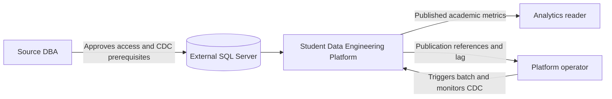

# System context

A source DBA owns change capture, access and source retention. A platform operator owns deployment, workflow runs and recovery within the local environment. An analytics reader sees published measures. Shared storage and the common dashboard are inside the platform boundary, with independently published batch and CDC models.

For detailed views, see the [deployment](deployment-architecture.md), [batch sequence](batch-pipeline.md), [streaming sequence](streaming-pipeline.md), and [source and warehouse models](../data-model.md).
