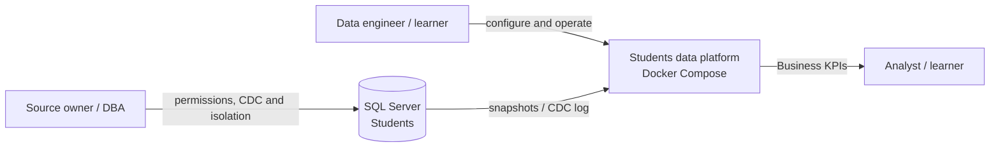
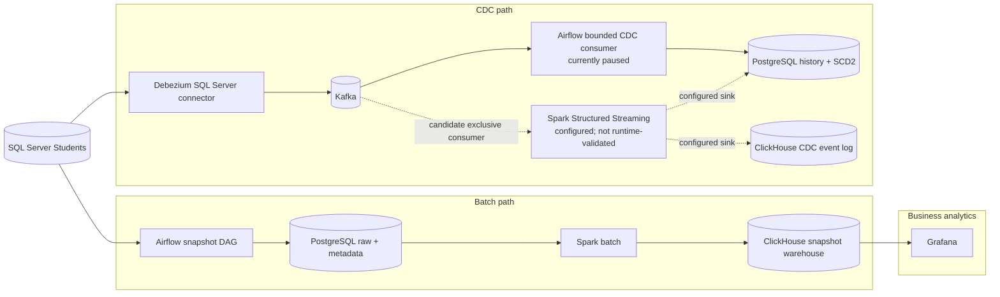
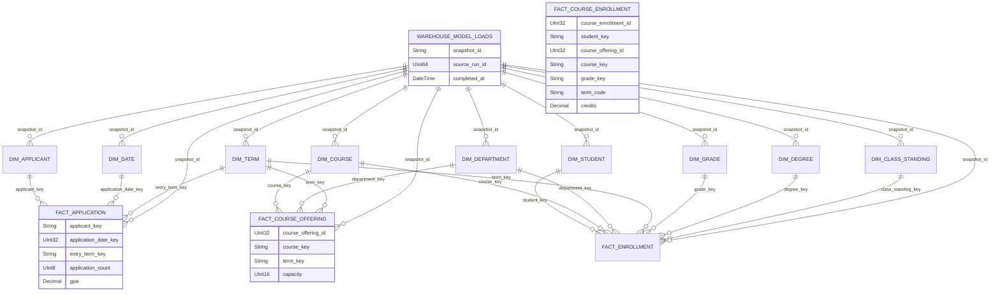

# System Context and Data Model Diagrams

These are the canonical system context, complete architecture, and model
diagrams. Solid batch edges describe the implemented workflow; dashed CDC
edges distinguish configured but unvalidated streaming behavior.

## System context

## Complete architecture

## Implemented ClickHouse batch dimensional model

The event-history and PostgreSQL schemas are detailed in
[Data Model](../data-model.md); do not infer source relationships from this
analytical ER diagram.
