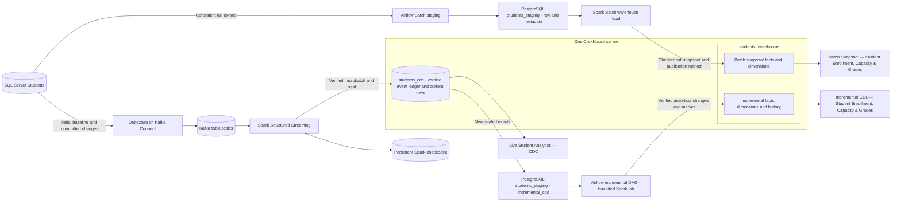

# System architecture

SQL Server is the source of record for the 15 student tables. The platform publishes three views of those records. Live CDC shows what Spark has verified at the source-event level. Incremental analytics turns verified changes into current enrollment, capacity, admissions and grade measures. Batch preserves a full, reproducible cut for reconciliation and recovery.

## Why there are three dashboards

| Dashboard | Question it answers | Why the publication is useful |
|---|---|---|
| **Incremental CDC— Student Enrollment, Capacity & Grades** | What are the current enrollment, capacity, admissions and grade measures? | CDC changes feed the same analytical model and filters as Batch. Airflow checks for changes every 15 minutes, so the main reporting dashboard can stay current without a full source extract for every change. |
| **Batch Snapshot — Student Enrollment, Capacity & Grades** | What did the entire source dataset contain at one consistent point? | A full SQL Server snapshot provides an independently verified comparison point. A saved run can be inspected, reconciled or reloaded from its staging data. |
| **Live Student Analytics — CDC** | Which source changes reached the pipeline, and how far has capture progressed? | Raw source-grain totals, operation history, bootstrap status and Kafka lag make it possible to follow an insert, update or delete through capture and diagnose delays. |

The two enrollment dashboards share nine dimensions, three facts, 18 panels and the same term and department filters. A fact records one application, one course offering or one enrollment attempt. Dimensions supply terms, departments, courses, grades and other descriptions for analyses that join or group those facts. Live CDC reads the event and current-row views directly and presents counts and diagnostics at source grain. [Dashboard metrics](../06-observability-and-quality/grafana.md) · [Warehouse model](../05-data-platform/warehouse.md)

## What each database stores

| Store | Data and ownership | Why this boundary exists |
|---|---|---|
| SQL Server `Students` | Operational student, course, term, offering, enrollment and related source records. | Applications record transactions here. Batch reads a consistent snapshot and Debezium reads changes captured from the transaction log. |
| PostgreSQL `students_staging` | `raw` stores typed rows from Batch extracts. `metadata` records run IDs, table batches and expected versus recorded row counts. `incremental_cdc` keeps verified logical events, relay receipts and incremental run status. | Batch can reload an exact successful extract. Incremental retries can resume from validated relay history, keyed by the original CDC generation and source version. |
| PostgreSQL `airflow` | Airflow DAG runs, task states and scheduler metadata. | Airflow can track orchestration state independently of the data artifacts kept in staging. |
| ClickHouse `students_cdc` | Source row images, event positions, Spark batch seals, generation markers, current-row views and pipeline health. | The ledger retains the evidence needed for replay and diagnostics and gives incremental processing a verified starting point. |
| ClickHouse `students_warehouse` | Batch snapshot tables and published facts and dimensions, alongside the `incremental_*` typed records, publication markers, facts, dimensions and history. | Grafana can report from both analytical models with stable business definitions. The separate markers preserve their independent publication boundaries and keep a partially written candidate out of dashboard results. |

The database names shown are the defaults from `.env.example`. They are configurable for each deployment. Batch and incremental are two analytical models in **one** ClickHouse warehouse database. CDC has its own logical database on the same ClickHouse server. Both ClickHouse databases share the host, disk, memory and server availability. [Configuration](../03-infrastructure/setup.md) · [ClickHouse model catalog](../05-data-platform/warehouse.md)

Kafka retains Debezium's ordered records by topic and partition. Spark separately persists its checkpoint. The ClickHouse seals record which microbatches were verified and which offsets they cover. Together these let the stream resume and let the warehouse verify its input. A Grafana dashboard queries these published ClickHouse views and holds its own time range, filters and refresh setting.

## How the data flows

### Batch full snapshot

1. `sqlserver_to_postgres_staging` reads all source tables within one SQL Server snapshot transaction and copies the typed data into PostgreSQL. It validates source, extracted and staged row counts and records each table's batch ID.
2. Airflow passes the successful staging run ID to `postgres_to_clickhouse_warehouse`. The Spark job reads exactly that run's batches, builds the three facts and nine dimensions and validates the candidate rows in ClickHouse.
3. The job records the successful load in `warehouse_model_loads`. The Batch views select the latest published source run. Grafana refreshes the views on its five-minute query schedule. A new full load is needed to publish a new Batch snapshot.

The full extract gives the project an independent view of the source for reconciliation and recovery. A copy of a validated staging run can rebuild its snapshot without repeating that source extraction. [Batch sequence and failure handling](../04-data-pipelines/batch.md)

### Live source CDC

1. Debezium establishes a source baseline and then captures committed SQL Server changes. It sends keyed records to Kafka, which retains them for replay.
2. The running Spark streaming query reads Kafka and writes candidate records to `students_cdc`. It checks the stored positions and publishes a seal before it commits its checkpoint. The active generation becomes available after its bootstrap is verified.
3. The live dashboard reads current nondeleted rows, deduplicated operation counts and the latest seal. The one-minute Grafana refresh re-queries those views. The selected time range controls the event cards and trend by the first verified processing time.

This path answers whether a committed change reached ClickHouse and whether capture is keeping up. An old last-seal timestamp can occur when the source is quiet. Check the connector task and streaming query when investigating freshness. [CDC processing and replay](../04-data-pipelines/cdc.md)

### Incremental analytical warehouse

1. The `postgres_to_clickhouse_incremental` DAG looks for sealed batches after the last successful warehouse watermark every 15 minutes. It verifies the source seals and copies eligible events into PostgreSQL's deduplicated `incremental_cdc` history. It exits before starting a Spark projection when no new seals exist.
2. Spark processes bounded pages of new logical events and writes typed changes to `students_warehouse`. The job verifies the candidate before writing its marker to `incremental_publications`. That marker advances the warehouse watermark. Failed writes remain outside the visible publication and can be retried from the relay.
3. Current fact views join the published records to current reference data. A change to a grade, course or offering can update an existing analytical result through those joins. Eight attribute-bearing dimensions also expose SCD Type 2 history so analysts can see when attributes changed. The calendar is derived from application dates.
4. On its next five-minute refresh, **Incremental CDC— Student Enrollment, Capacity & Grades** reads the new publication. Grafana Home opens this dashboard once the deployment is configured.

The incremental path consumes the ledger already written by the existing Spark stream. Its initial bootstrap derives from the verified CDC baseline and retained seals, and routine runs read new sealed batches. This keeps current reporting tied to verified source positions and avoids expensive full extracts for each change. [Incremental pipeline and activation](../04-data-pipelines/incremental.md) · [Dimension history](../05-data-platform/scd-type-2.md)

## What one new enrollment looks like

1. SQL Server commits the new enrollment. Once Spark verifies and seals the change, Live CDC can show the insert under **Latest CDC Changes**. Its **Enrollments** total includes the current row.
2. Once Airflow publishes the affected sealed batch and Grafana refreshes, **Enrollment records** increases in the incremental dashboard for the matching term and department. **Unique students** increases only if this was the student's first qualifying enrollment in that selection.
3. The Batch dashboard continues to show the records in its published source run. Its counts include the enrollment when a later full snapshot includes it. Publication timestamps and verified changes explain the difference in the meantime.

A row inserted in `Students` contributes to the Live CDC **Students** total. The enrollment dashboards derive **Unique students** from distinct student keys in the selected enrollment attempts. A benchmark therefore needs the same publication boundary and metric scope. The current screenshots illustrate this with **3,724,654** enrollments in Batch run 2 and **3,724,655** in the later CDC and incremental publications. [Dashboard screenshots](../assets/README.md#grafana-dashboards)

To compare the independent Batch and current CDC totals for applications, offerings and enrollment attempts, run `make reconcile`. To verify the incremental facts and their scope against the **same** sealed CDC cut, run `make incremental-verify`. [Reconciliation guide](../04-data-pipelines/reconciliation.md)
