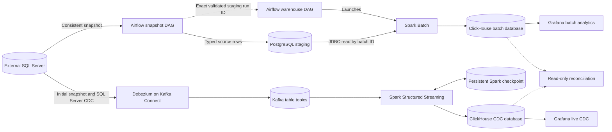

# System architecture

The platform publishes two independent data products from an external SQL Server source. Batch produces run-scoped dimensional snapshots. CDC produces latest nondeleted rows and low-latency aggregates. Both run locally through Docker Compose and share one ClickHouse server with distinct databases and writer identities.

| Publication boundary | What becomes visible | Lineage |
|---|---|---|
| SQL Server to staging | All 15 staged tables reconcile for one successful source run | Run ID, per-table batch IDs, source and persisted counts |
| Staging to ClickHouse batch | Facts and dimensions selected through the final marker | Source run ID, snapshot ID, completion time |
| Kafka to ClickHouse CDC | Sealed microbatches in the active generation after a verified baseline | Generation, broker/topic identity, partition offsets, source LSN and Spark checkpoint |
| ClickHouse to Grafana | Batch analytical views and CDC aggregate and health views | Selected batch snapshot and active CDC generation |

PostgreSQL is required for Airflow and batch staging. The stream runs when batch is idle and independently of Airflow. The shared ClickHouse server, Docker host, disk and source remain shared failure boundaries. A ClickHouse restart can affect both dashboards.

[Database models](data-model.md) · [Engineering decisions](decisions.md) · [Batch](../04-data-pipelines/batch.md) · [CDC](../04-data-pipelines/cdc.md) · [Reconciliation](../04-data-pipelines/reconciliation.md)
