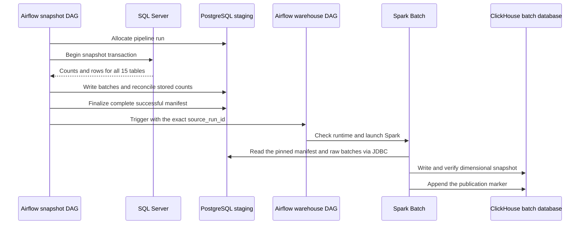

# Batch snapshot pipeline

Batch establishes one independently validated analytical cut of 15 SQL Server tables. It supports wide joins by academic term, department and grade, gives recovery a repeatable input, and provides a comparison boundary for live CDC.

## Extraction and handoff

Airflow models finite work as a directed acyclic graph. Its scheduler and task runtime execute dependencies. The metadata database records task and run state. In `sqlserver_to_postgres_staging`, run creation, extraction, finalization and the downstream trigger are separate tasks. The [Python loader](../../airflow/dags/students_staging/loader.py) reads source counts and rows in a single SQL Server snapshot transaction. It writes bounded chunks with PostgreSQL COPY. Each chunk and its staging counters commit together. Counts from that transaction, fetched rows and persisted rows are compared per table.

The start task checks the staging metadata schema before creating a run. The finalizer records a failed or partial extraction when a run exists and requires a complete manifest before triggering `postgres_to_clickhouse_warehouse`. XCom carries the run ID and small manifest metadata. The actual data remains in PostgreSQL. Airflow validates `source_run_id` before accepting a warehouse run. For a manual trigger, supply the **Successful staging run ID** in the trigger form. The warehouse then checks the Spark runtime and launches the job. A successful trigger confirms handoff. The warehouse task result and publication view show whether analytics are available. [Source and staging](../05-data-platform/source-and-staging.md) · [Airflow concepts](https://airflow.apache.org/docs/apache-airflow/3.1.5/core-concepts/index.html)

## Transformation and publication

[Spark Batch](../../spark/load_warehouse.py) uses DataFrames and JDBC to read the exact reconciled raw batches even if a newer staging run exists. It builds nine dimensions and three facts. Term and course keys follow the model’s source relationships, student and applicant keys use HMAC, and optional grade and class-standing attributes remain optional. Spark checks source-versus-target row counts, key uniqueness and required joins. It creates a fresh `snapshot_id`, writes the candidate and compares stored counts, keys and selected totals. It appends `warehouse_model_loads` only after verification. Published views prefer the highest successful `source_run_id`, breaking ties by completion time and snapshot ID. [Warehouse catalog](../05-data-platform/warehouse.md)

## Operation and failure handling

| Situation | Action and visibility |
|---|---|
| On-demand run | Unpause both batch DAGs and trigger `sqlserver_to_postgres_staging`. A recurring schedule is optional through `BATCH_SNAPSHOT_SCHEDULE`. |
| Source extract fails | Investigate the SQL Server transaction, staging constraint or network error, then trigger a fresh extraction. Partial staging data remains scoped to the failed run. |
| Warehouse validation or runtime fails | Check the preflight, JDBC and Spark logs. Retry the exact successful staging ID with `make warehouse-load RUN_ID=123`. |
| Warehouse retry after success | The loader detects the existing publication for the source run. It leaves the snapshot counts unchanged. |
| Failure before warehouse publication | Incomplete candidate rows can remain in storage. Views continue to select the prior published snapshot. |

The supported DAG permits one active warehouse run. The run check and marker protect normal retries within that orchestration contract. The [fixture](../../tests/integration/batch_publication.py) tests run pinning, retry and an empty initial input. Operational checks are in the [runbook](../07-operations/runbook.md).
