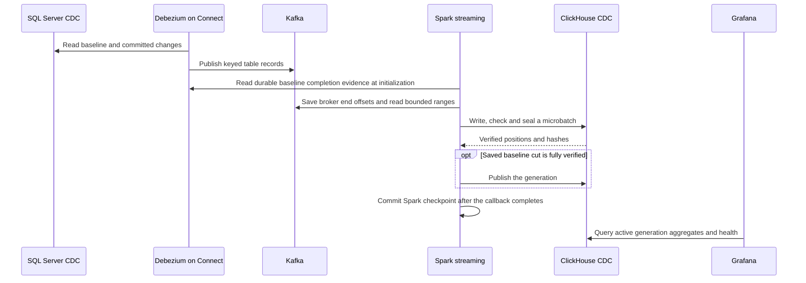

# CDC streaming pipeline

SQL Server CDC records committed table changes through capture instances backed by transaction log processing. Debezium supplies an initial snapshot and a change event stream. Connect manages the connector task, source offsets, status and schema history. The Kafka log allows Spark to process independently of connector polling and replay retained records. PostgreSQL serves batch staging and has no CDC sink responsibilities.



## Capture, topics and envelope

Debezium starts from its own SQL Server snapshot and source offset. Start CDC before using the first analytical Batch snapshot as a comparison point. The baseline represents surviving rows at its boundary. Per-event history begins with changes captured after that boundary. Batch writes to its own warehouse, while CDC resumes from Connect and Spark offsets. [Reconciliation boundaries](reconciliation.md)

The source owner verifies SQL Server Agent capture and cleanup jobs, connector permissions, retention and the 15 capture instances. The [registration utility](../../debezium/register_connector.py) validates connector configuration before creating it. Existing registrations are checked for lineage drift. New connectors start with the configured initial snapshot. Keep Connect’s config, status, offset and Debezium schema-history topics durable. [Source readiness](../05-data-platform/source-and-staging.md) · [Debezium SQL Server 2.7](https://debezium.io/documentation/reference/2.7/connectors/sqlserver.html)

Each business topic uses `<prefix>.<database>.<schema>.<table>` and delete-based retention. A partition supplies ordered offsets; an offset identifies one record in that partition. Spark ties its checkpoint and generation to broker and topic identity. Recreating a topic under the same name changes that lineage. Record keys identify source rows, including composite keys. JSON values contain operation, source metadata and before/after images. The [normalizer](../../spark/cdc_events.py) validates source names, keys, required record shapes and LSN fields before fingerprinting canonical records.

The [environment template](../../.env.example) sets `DEBEZIUM_SNAPSHOT_MODE=initial`, `DEBEZIUM_SNAPSHOT_ISOLATION_MODE=snapshot`, and `KAFKA_NUM_PARTITIONS=1` per table topic with seven days of retention. The [topic preparation script](../../scripts/prepare_cdc_topics.sh) checks the data-topic settings, keeps schema history in one partition with unlimited retention, and requires compaction for Connect’s config, offset and status topics. The data-topic policy bounds replay. The internal topics preserve the connector state needed to interpret that data.

| Record | Meaning during serving |
|---|---|
| `r` | Snapshot read. Serving uses reads from the verified completed snapshot boundary. |
| `c` | Create. A later create can restore a previously deleted key. |
| `u` | Update with an after image. The latest source version determines visible fields. |
| `d` | Delete. The logical event remains available, and a winning delete removes the row from current state. |
| Kafka tombstone | Keyed record with a null value. It advances transport coverage and contributes no logical change. |

### Example offering update

This synthetic record uses an offering key from the assessed source schema. Kafka carries the topic `students.Students.dbo.CourseOfferings`, partition `0`, offset `41`, and key `{"CourseOfferingId": 17}` separately from the Debezium value shown below. The row images show only the fields used in this example.

```json
{
  "op": "u",
  "before": {"CourseOfferingId": 17, "Capacity": 10},
  "after": {"CourseOfferingId": 17, "Capacity": 12},
  "source": {
    "db": "Students",
    "schema": "dbo",
    "table": "CourseOfferings",
    "snapshot": "false",
    "commit_lsn": "00000027:000001d0:0003",
    "change_lsn": "00000027:000001d0:0002",
    "event_serial_no": 1
  }
}
```

Once the batch is sealed in the active generation, the offering’s capacity is 12. Replaying this same change at a new offset produces another transport record for the same logical event. Replaying an older source change leaves the capacity at 12 because SQL Server’s log sequence numbers (LSNs) and event serial number determine precedence. A later delete removes the offering from the current count. A following Kafka tombstone advances transport progress without creating a second delete.

## Verified writes, deduplication and replay

[Structured Streaming](https://spark.apache.org/docs/3.5.6/structured-streaming-programming-guide.html) treats the changing input as a DataFrame. The [Spark worker](../../spark/stream_cdc.py) subscribes to the allowlisted topics and consumes bounded microbatches. `STREAMING_MAX_OFFSETS_PER_TRIGGER` and `STREAMING_TRIGGER_INTERVAL` control the work envelope. In `foreachBatch`, it verifies contiguous positions, writes transport records, compares stored positions and fingerprints, and appends a seal. The callback can also publish the generation before returning. Spark commits progress separately once the callback succeeds. On startup, Spark can finish activation for an already sealed baseline. If it stops after a seal, replay compares batch contents, digest and query identity with the existing ledger before progressing.

The generation captures a Kafka end-offset cut at bootstrap. Spark verifies coverage through that cut and confirms the terminal baseline against durable Connect offsets and retained records. Connector `RUNNING` and JMX counters are diagnostics. The ClickHouse publication marker determines availability. An existing active generation can continue serving while a replacement bootstraps.

Transport identity is generation and Kafka topic, partition and offset. Logical identity includes table, canonical key, operation and source version within that generation. The warehouse views filter to sealed, eligible records, deduplicate logical events and select the latest nondeleted source image. [CDC model](../05-data-platform/warehouse.md#cdc-event-and-current-state-model)

| Failure | Recovery boundary |
|---|---|
| Worker stops before its seal | The same microbatch is eligible for retry. Unsealed records stay out of serving views. |
| Seal exists ahead of the Spark commit | Existing verified writes are rechecked using the same checkpoint and query identity. |
| Kafka retention passed a needed offset, or identity differs | Startup fails closed. Restore matching state or plan a new connector, topics, checkpoint and baseline. |
| ClickHouse state is behind the Spark checkpoint | Restore compatible Kafka, Spark and ClickHouse state together or use a new generation. |

The checkpoint lives in a named volume protected by a writer lock for the supported one-worker deployment. Keep checkpoint, generation and broker lineage paired. See the [runbook](../07-operations/runbook.md) and [replay fixture](../../tests/integration/streaming_replay.py).
