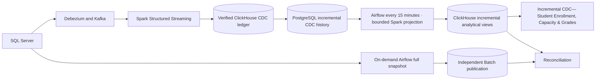

# Incremental analytical warehouse

The running Spark stream remains the Kafka consumer. It already writes a durable batch ledger in ClickHouse. The incremental warehouse reads that ledger after verification, relays the eligible changes to PostgreSQL, then projects those rows with a bounded Spark job. It can bootstrap from the retained CDC generation without using a Batch extract or restarting the stream.



## Source of truth and progress

The source for bootstrap is the active ClickHouse CDC generation and its retained seals. Batch run IDs and timestamps alone cannot prove that a full snapshot matches a CDC source position. The relay starts at CDC batch zero during bootstrap, checks for a contiguous sealed range, validates the checkpoint identity and verifies each batch digest. It admits the active baseline's snapshot reads and eligible live records through a pinned sealed batch. Tombstones and pre-baseline changes stay in the source ledger.

PostgreSQL records the first sealed batch for each logical event, keyed by generation, source table, canonical business key and source version. It keeps the analytical after-image or delete key and a payload hash. Replayed events with the same identity and content keep their original position. Conflicting payloads stop publication. The two source tables without columns in the existing analytical model, `DegreeRequirements` and `StudentProfiles`, contribute keys and event positions to the relay. Both are still checked against the transport seal.

Each incremental run appends projected rows under a new load ID. The job reads back the count and checksum for each written table, then appends one ClickHouse publication marker. The marker is the warehouse checkpoint and selects all successfully published loads in the current generation. A lost response after the marker is recovered in the PostgreSQL run ledger. An incomplete load has no visible marker. It can be replayed from durable PostgreSQL history without fetching the same payload from the CDC ledger again.

The DAG limits routine runs to 32 sealed Spark batches. Input and projection stay bounded to an individual source batch and a 10,000-row Spark page respectively. A run with no new seals exits before Spark starts. A PostgreSQL advisory lock also prevents overlap with an explicit bootstrap. The DAG and CLI use the same lock. The job refuses to mix two HMAC keys in a published generation.

## Activation on an existing volume

The new DAG is paused at creation. Installation, bootstrap and Grafana cutover are explicit because the first bootstrap copies the retained generation and shares disk, CPU and memory with the running stream. Plan that initial copy during a quiet period. Check free space in both database volumes and ensure Kafka Connect's source task and the existing Spark query are healthy.

1. Run `make test` and `make incremental-test`. The integration target uses temporary PostgreSQL and ClickHouse databases with synthetic changes. It uses the existing Airflow image and Spark runtime.
2. Run `make incremental-install` to create additive PostgreSQL and ClickHouse objects. This command uses the existing Compose credentials. On a running Airflow container configured with a nondefault CDC database, pass `--cdc-database YOUR_CDC_DB` to the installer and bootstrap. The scheduled task reads the existing `CDC_DB_NAME` Compose setting when Airflow is next deployed with the updated configuration.
3. Run `make incremental-bootstrap` and `make incremental-verify`. The verification command compares the dimensional and fact counts, capacity and distinct enrolled students against the exact sealed CDC cut. A failed candidate can be retried with the same bootstrap command. The committed ledger remains the input while the stream continues.
4. Render and provision a dashboard preview. Run the analytical queries. Compare with the Batch counts if a comparable source boundary is available. Where the boundaries differ, account for verified changes between the cuts. When the preview is ready, unpause the new DAG. Confirm its next scheduled run in Airflow and verify publication with the queries below.
5. Keep the separate preview as the current analytics dashboard, or explicitly promote the original dashboard UID after verification. Retain the Batch view and its published data for reconciliation.

```bash
make incremental-install
make incremental-bootstrap
make incremental-verify

python3 scripts/render_incremental_dashboard.py \
  grafana/dashboards/enrollment-performance.json \
  grafana/dashboards/enrollment-incremental.json

docker compose exec -T airflow-scheduler airflow dags unpause postgres_to_clickhouse_incremental
```

**Incremental CDC— Student Enrollment, Capacity & Grades** has UID `students-enrollment-incremental`. Grafana's file provider loads the generated JSON through the running bind mount. It retains the same 18 data panels, variables and filters and links back to the Batch Snapshot. Set it as the organization home after verification when both dashboards should remain available under their own UIDs.

```bash
docker compose exec -T grafana sh -ec '
  curl -fsS -u "$GF_SECURITY_ADMIN_USER:$GF_SECURITY_ADMIN_PASSWORD" \
    -X PATCH -H "Content-Type: application/json" --data-binary @- \
    http://127.0.0.1:3000/api/org/preferences
' <<'JSON'
{"homeDashboardUID":"students-enrollment-incremental"}
JSON
```

Send the previous `homeDashboardUID` value to the same endpoint to restore the organization home. An empty value restores Grafana's default home.

To promote the original UID, first back up its exact dashboard file outside the provisioning directory. Render the candidate to a temporary path, then install that candidate as `grafana/dashboards/enrollment-performance.json`. Restore the backup to that path to roll back Grafana queries. The full snapshot views remain available for comparison. To stop scheduled incremental processing, pause only the new DAG.

```bash
backup_dir=$(mktemp -d)
cp grafana/dashboards/enrollment-performance.json "$backup_dir/enrollment-performance.json"
python3 scripts/render_incremental_dashboard.py --promote \
  "$backup_dir/enrollment-performance.json" "$backup_dir/promoted.json"
cp "$backup_dir/promoted.json" grafana/dashboards/.enrollment-performance.pending
mv grafana/dashboards/.enrollment-performance.pending grafana/dashboards/enrollment-performance.json
```

If you need to roll back, use the backup directory from the promotion step.

```bash
cp "$backup_dir/enrollment-performance.json" grafana/dashboards/.enrollment-performance.pending
mv grafana/dashboards/.enrollment-performance.pending grafana/dashboards/enrollment-performance.json
docker compose exec -T airflow-scheduler airflow dags pause postgres_to_clickhouse_incremental
```

## Verification and recovery

Run these in the configured ClickHouse warehouse database:

```sql
SELECT generation_id, through_batch, normalized_rows, published_at
FROM incremental_publication_status;

SELECT count() AS enrollment_attempts, uniqExact(student_key) AS unique_students
FROM incremental_fact_course_enrollment;

SELECT count() AS offerings, sum(capacity) AS offered_seats
FROM incremental_fact_course_offering;

SELECT count() AS applications FROM incremental_fact_application;
```

Run the same aggregates against the legacy fact views for the Batch side. Record `snapshot_started_at` from `batch_publication_status` alongside the incremental marker. Compare equal cuts or explain intervening changes. Grafana retains its five-minute query refresh on top of the incremental publication schedule.

In PostgreSQL, inspect run state and progress without reading row images:

```sql
SELECT status, generation_id, after_batch, through_batch, normalized_rows,
       started_at, completed_at - started_at AS duration, error_message
FROM incremental_cdc.runs ORDER BY started_at DESC LIMIT 10;
```

A failed or interrupted load leaves its candidate rows unpublished. Airflow retries transient failures. A retry reuses the verified PostgreSQL history and creates a fresh candidate. For a new CDC generation, the job waits for an explicit bootstrap and its existing analytical publication stays readable. Keep the source CDC seals and their covered data through bootstrap. PostgreSQL relay history, ClickHouse typed projections, publications and the existing HMAC secret belong in backup planning. [Operations runbook](../07-operations/runbook.md)

## Operating limits

The publisher consumes sealed Spark batch boundaries. Kafka table partitions can deliver the rows of a source transaction in different batches. A current fact becomes visible when its required reference rows are present at a published boundary. A late reference change is resolved from the corresponding source order in dimension history. Reconciliation against Batch requires an independently established comparable source boundary.

Routine writes affect only new logical versions. Current fact views join typed source rows to current reference rows at query time. Large analytical scans and wide SCD history ranges still use ClickHouse resources. Failed candidate rows are retained and remain outside published views. Monitor disk after failed full bootstrap attempts.
