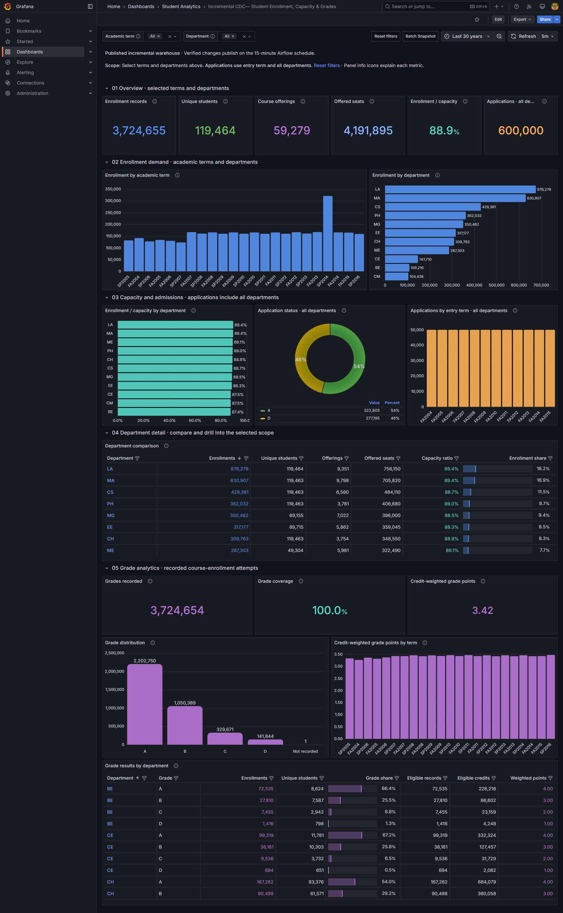
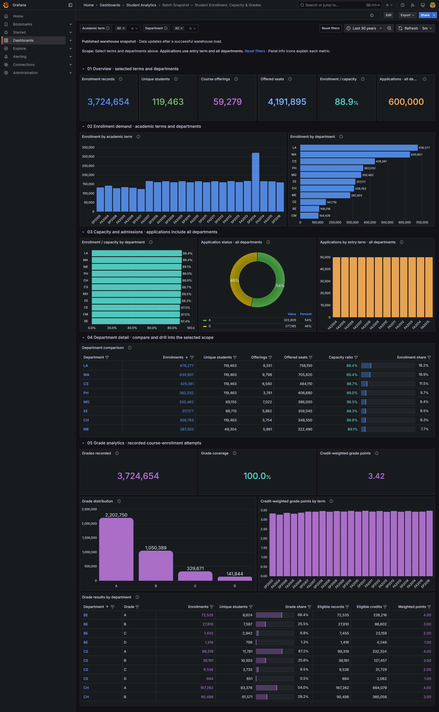
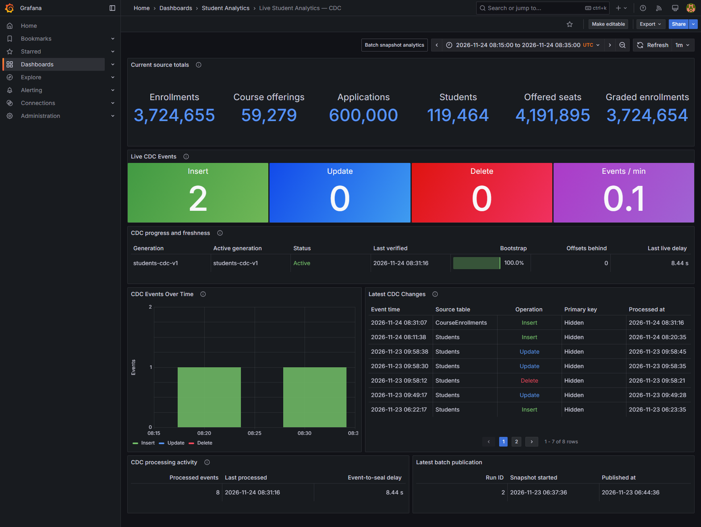

# Grafana dashboards and observability

Open [Grafana Home](http://localhost:13000/) and sign in with the Grafana credentials in your local `.env`. The table uses the default port. Use `GRAFANA_HOST_PORT` if your deployment publishes a different port.

| Dashboard | Use it for | Data and publishing cadence | Grafana refresh |
|---|---|---|---|
| [Incremental CDC— Student Enrollment, Capacity & Grades](http://localhost:13000/d/students-enrollment-incremental) | Everyday enrollment, admissions, capacity and grade reporting | The latest verified incremental warehouse publication. Airflow checks for sealed CDC changes every 15 minutes. | 5 minutes |
| [Batch Snapshot — Student Enrollment, Capacity & Grades](http://localhost:13000/d/students-enrollment-kpis) | A reproducible analytical snapshot for comparison, reconciliation and recovery | The latest successful full warehouse load by source run ID. Run Batch on demand or set its optional schedule. | 5 minutes |
| [Live Student Analytics — CDC](http://localhost:13000/d/students-live-cdc) | Current source totals, recent source changes and streaming health | The active CDC generation through sealed Spark microbatches. | 1 minute |

A Grafana refresh reruns the panel queries against the current published data. The incremental DAG skips work when there are no new seals, so the last publication can remain current during a quiet period. ClickHouse selects Batch and incremental publications independently, so a verified change can appear at different times in the three dashboards. [Publication and reconciliation](../04-data-pipelines/reconciliation.md)

The dashboards have different jobs. Use Live CDC to trace an insert or investigate capture lag. Use the incremental dashboard to see how verified changes affect enrollment, admissions and grade metrics. Use Batch to compare those metrics against a full independently verified extract. One ClickHouse server hosts both databases. The two analytical dashboards read separate models in `students_warehouse`. Live CDC reads source events and processing state in `students_cdc` and queries `students_warehouse` for the latest Batch publication. [End-to-end flows and database roles](../02-architecture/overview.md)

## Incremental CDC— Student Enrollment, Capacity & Grades



Grafana Home opens this dashboard after the organization home is configured. Its 18 data panels use the `students-warehouse` datasource and `incremental_fact_course_enrollment`, `incremental_fact_course_offering`, `incremental_fact_application` and their corresponding dimensions. The layout and business definitions match the Batch dashboard. The **Batch Snapshot** link opens the independent comparison dashboard. [Incremental warehouse and Grafana activation](../04-data-pipelines/incremental.md#activation-on-an-existing-volume)

SQL Server changes flow through Debezium, Kafka and Spark into the verified CDC ledger. The scheduled `postgres_to_clickhouse_incremental` DAG relays new sealed events through PostgreSQL and publishes changed analytical rows to ClickHouse. A subsequent Grafana refresh displays the new publication. For example, the capture shows **3,724,655 enrollment records** and **119,464 distinct enrolled students** after a verified enrollment insert.

On a new installation, bootstrap and verify the incremental model, then render its dashboard from the checked-in Batch layout using `scripts/render_incremental_dashboard.py`. The provisioner loads the generated JSON through the dashboard mount. Enable the DAG and set the organization home once the panel queries succeed. [Activation commands and rollback](../04-data-pipelines/incremental.md#activation-on-an-existing-volume)

## Batch Snapshot



The provisioned Batch dashboard also has 18 data panels and uses `students-warehouse`. Its queries read the published `fact_course_enrollment`, `fact_course_offering`, `fact_application` and `dim_*` views. Airflow runs a consistent SQL Server extract, stages it in PostgreSQL and passes the completed staging run ID to the Spark warehouse load. ClickHouse exposes the new facts and dimensions when the load publishes its final marker. [Batch pipeline](../04-data-pipelines/batch.md)

The screenshot shows **3,724,654 enrollment records** and **119,463 distinct enrolled students** in the full snapshot. To explain a difference against the incremental dashboard, use the same Academic term and Department filters on both and compare `batch_publication_status` with `incremental_publication_status`. For source-side comparison, check the capture window and the verified changes between publications. [Reconciliation guide](../04-data-pipelines/reconciliation.md)

## Shared enrollment dashboard filters and measures

Both analytical dashboards start with **All** academic terms and departments. The filters support multiple selections. Start with **Reset filters** to restore All, then choose the terms or departments you want to compare. Bar and table links apply the corresponding filter while carrying the other selection forward. The grade detail table’s column filters narrow displayed rows within that panel.

| Section | What the panels show |
|---|---|
| Overview | Enrollment records, distinct enrolled students, course offerings, offered seats, enrollment divided by capacity, and applications. |
| Enrollment demand | Enrollment attempts by academic term, ordered by year and session, and by department, ranked by enrollment count. |
| Capacity and admissions | Enrollment divided by capacity by department, application status, and applications by entry term. |
| Department detail | Enrollment records, unique students, offerings, seats, capacity ratio and enrollment share by department. |
| Grade analytics | Grades recorded, coverage, credit-weighted grade points, distribution of recorded codes, weighted points by term, and grade results by department. |

- **Enrollment records** count course attempts, including repeated attempts. **Unique students** counts distinct pseudonymous student keys that have at least one enrollment in the selected scope. A student taking courses in several departments counts once in the overview and once within each relevant department row.
- **Course offerings** include offerings with zero enrollments. **Offered seats** sum recorded capacity. **Enrollment / capacity** divides attempts by offered seats in the same scope. At zero seats the ratio is undefined. Orange highlights ratios of at least 100 percent for review.
- **Applications** use the academic term as the entry term and include all departments. The fact has no department grain. The status donut keeps blank and unmatched statuses under **Unknown**.
- **Grades recorded** counts nonblank grade codes, including codes excluded from GPA. **Grade coverage** divides this count by the selected enrollment attempts. The distribution preserves blank and null grades under **Not recorded**.
- **Credit-weighted grade points** divides `sum(grade_points * credits)` by `sum(credits)` for attempts with a recorded grade, the source inclusion flag, valid points and positive credits. Zero-point grades are eligible. The result is a pooled course-attempt measure. The department grade shares use all selected attempts in each department as the denominator.

## Live Student CDC



This dashboard has seven panels and opens on the last 15 minutes in UTC. The screenshot shows two verified inserts in the 11:45–12:05 Tehran window on 24 November 2026, displayed as 08:15–08:35 UTC in Grafana. The main panels read `students-cdc`. **Latest batch publication** reads `students-warehouse`.

| Panel | How to interpret it |
|---|---|
| Current source totals | Current nondeleted enrollments, course offerings, applications, students, offered seats and graded enrollments in the active generation. The **Students** value counts student records. |
| Live CDC Events | Count of verified inserts, updates and deletes first processed inside the selected window, plus the average number of events per minute over that window. |
| CDC progress and freshness | Processed and active generation, status, bootstrap progress, last verified seal, offsets behind at that seal and the sampled last live delay. |
| CDC Events Over Time | Stacked operation counts grouped by the first verified processing time. Inserts are green, updates blue and deletes red, matching the summary cards. |
| Latest CDC Changes | Up to 25 recent verified changes in the active generation, including source event and processing timestamps. People-related keys are hidden. |
| CDC processing activity | Cumulative verified live changes, last processing time and latest event-to-seal delay when the event timestamp is available. |
| Latest batch publication | Batch source run ID, snapshot start and publication time. |

The selected time range controls **Live CDC Events** and **CDC Events Over Time**. The latest changes table and processing activity summarize the active generation independently of that time range. CDC counts deduplicated source changes by their first Spark batch seal time. Snapshot reads and Kafka tombstones stay outside the operation counts. [CDC data path and verification](../04-data-pipelines/cdc.md)

## Troubleshooting and panel editing

| What you see | What to check |
|---|---|
| Latest enrollment appears in live CDC and the incremental dashboard shows an earlier count | Check the incremental DAG and publication timestamp. With visible source changes, verify that Airflow processed the next sealed batch and refresh Grafana after publication. |
| Incremental and Batch have different totals | Check term and department selections, then compare the two publication markers. Batch remains at its published snapshot until a new full run publishes. |
| Live event cards are zero or the trend is empty | Widen the range and check the active generation, Connect task state and Spark seals. A quiet stream can have a healthy connection and zero recent events. |
| Several analytical panels are empty | Start with **Reset filters** and check the datasource UID and publication marker. Open the panel’s **Inspect → Query** to see the exact query and error. |
| **Data is missing a time field** in the panel editor | Use **Stat** for a single aggregate, **Table** for rows or IDs, and **Time series** for a query with a timestamp and numeric measures. |

When editing an analytical panel, choose **Students Warehouse**. Its dashboard variables use Grafana interpolation before the SQL goes to ClickHouse. For a standalone ClickHouse query at All scope, use the model views directly.

```sql
SELECT uniqExact(student_key) AS unique_students
FROM incremental_fact_course_enrollment;
```

[Datasource configuration](../../grafana/provisioning/datasources/clickhouse.yml) · [Operations runbook](../07-operations/runbook.md#troubleshooting) · [Dashboard validation and evidence](testing-and-validation.md)

## Batch reader grant repair

An earlier deployment used a restricted ClickHouse reader with a grant for `fact_enrollment`. The published view is `fact_course_enrollment`. The grant was corrected before the switch to the local ClickHouse admin. When diagnosing a restricted reader, verify that its grants cover the exact view names used by the dashboard. [Batch warehouse DDL](../../db/warehouse_clickhouse/warehouse_ddl.sql)
