# Screenshots and visual evidence

These original captures document earlier executions of the student data platform. The running design is described in the [current architecture](../02-architecture/architecture-overview.md) and the [22 November live verification](../12-implementation/implementation-status.md#live-cdc-cutover). The [recovery inventory](../recovery-inventory.md) records the asset provenance.

## Source database and ERD

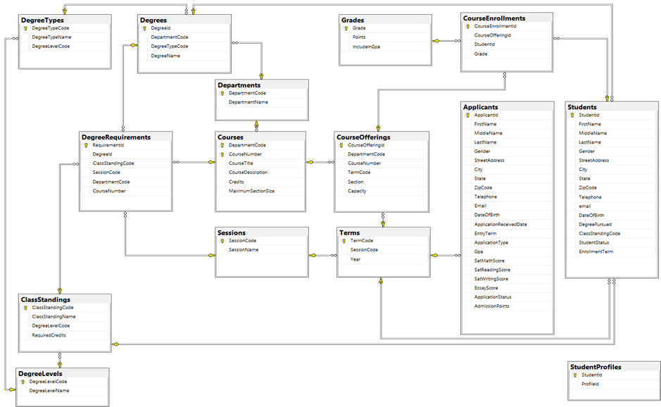

Trace a department and course through the offering and enrollment records, then compare the applicant and student relationships. The [database models](../02-architecture/diagrams/database-models.md) show how the assessed source maps to staging, the batch model and CDC.

## Infrastructure and Docker

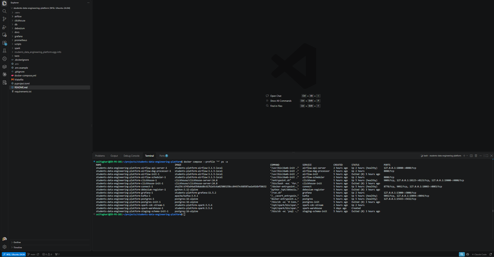

The WSL terminal shows healthy long-running containers and completed initialization services. This capture predates removal of the `spark-warehouse` Compose service. The [deployment diagram](../02-architecture/diagrams/deployment-architecture.md) identifies the current Spark execution points.

## Airflow batch orchestration

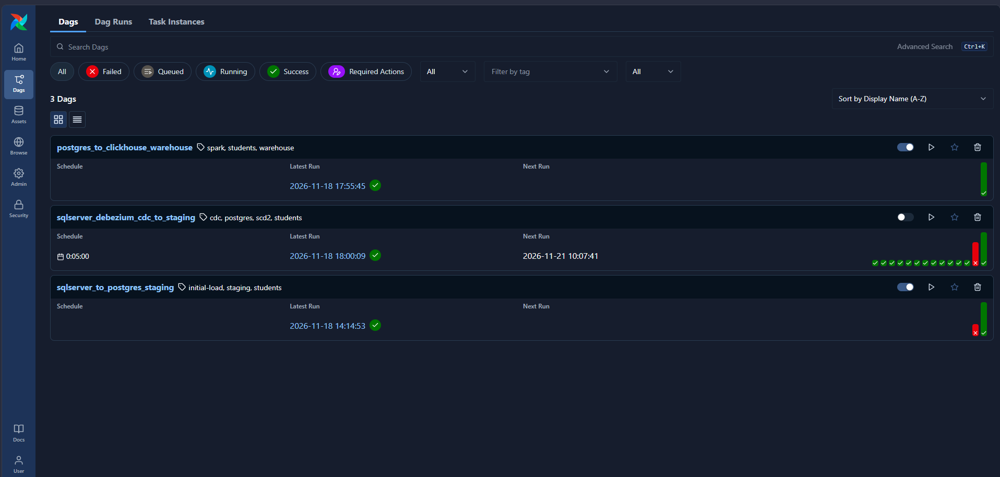

The earlier DAG list shows extraction, warehouse loading and a paused legacy CDC consumer. The [supported Airflow inventory](../04-data-ingestion/airflow.md) covers the two current batch DAGs.

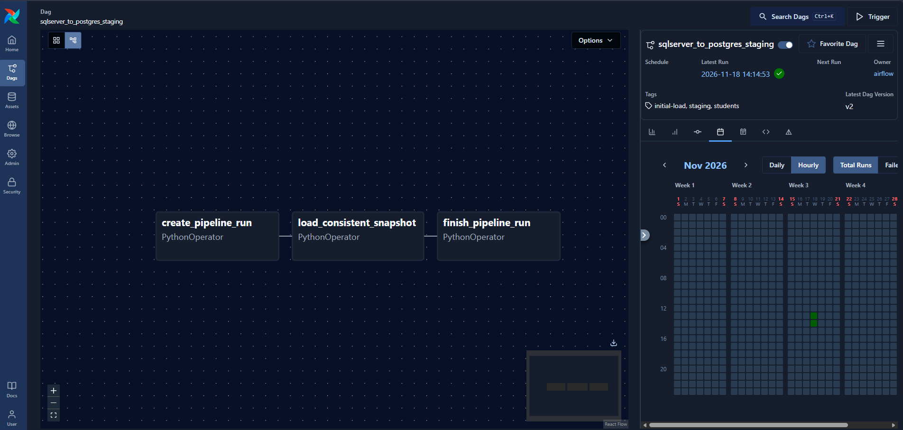

Follow staging from run creation through parallel table extraction and finalization. The current graph also includes the warehouse trigger after successful validation. [Batch execution](../10-operations/batch-execution.md)

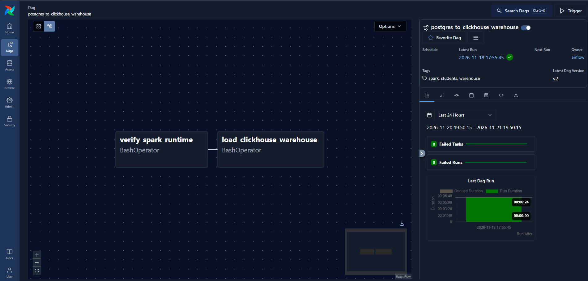

The warehouse graph shows its separate staging preflight and load. Current task parameters and staging-run handoff are shown in the [batch pipeline diagram](../02-architecture/diagrams/batch-pipeline.md).

## Databases and warehouse

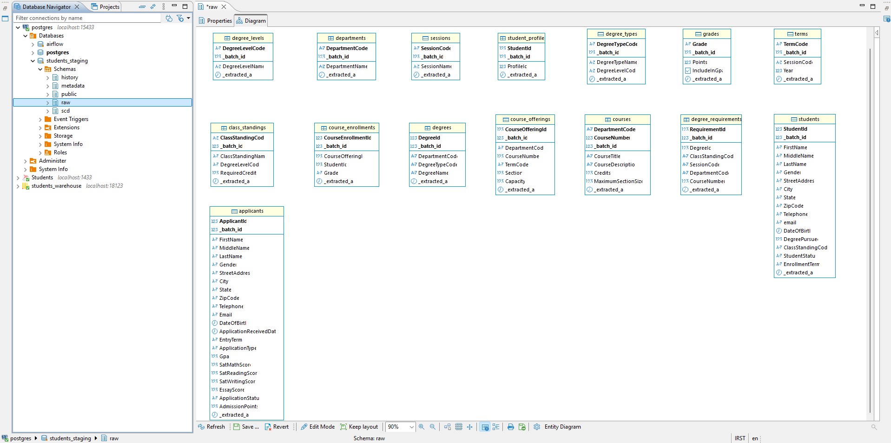

The staged table list shows how the academic source is preserved for processing. The capture includes historical schemas. The [staging guide](../04-data-ingestion/postgresql-staging.md) describes the current `raw` and `metadata` contract.

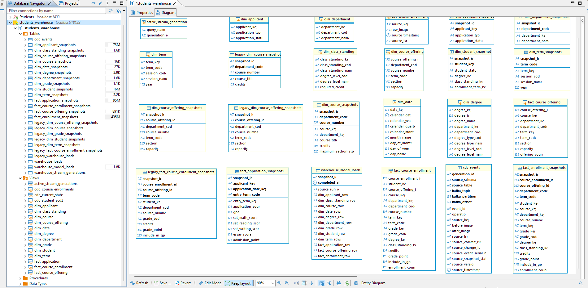

Look for the snapshot facts and dimensions and the publication marker. The earlier database also lists legacy CDC objects. The current [warehouse models](../02-architecture/diagrams/database-models.md) describe the dedicated CDC database.

## Grafana analytics

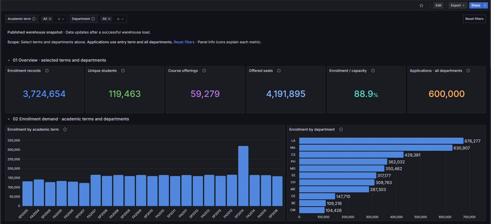

The overview shows academic enrollment, offering and student metrics by scope. These panels visualize the batch snapshot.

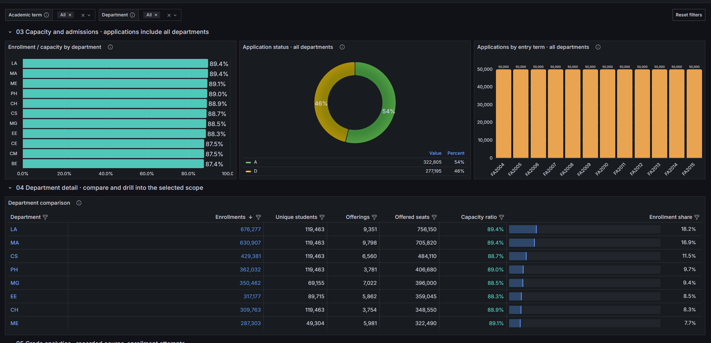

Capacity and utilization are grouped by offering department. Admissions uses application status and entry term.

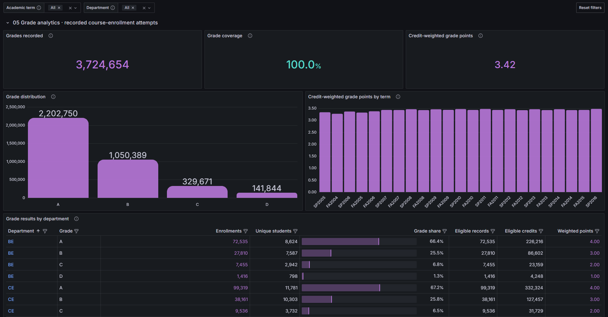

The grade panels illustrate coverage, distribution and credit-weighted grade points. See the current [KPI definitions](../08-analytics-and-monitoring/business-kpis.md) for their denominator and filter rules.

## Debezium and Kafka

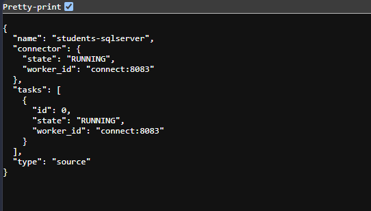

The Connect REST response shows connector and task execution. The equivalent current publication check also verifies Spark progress and an active ClickHouse generation. [Streaming execution](../10-operations/streaming-execution.md)

## Retired Airflow CDC consumer

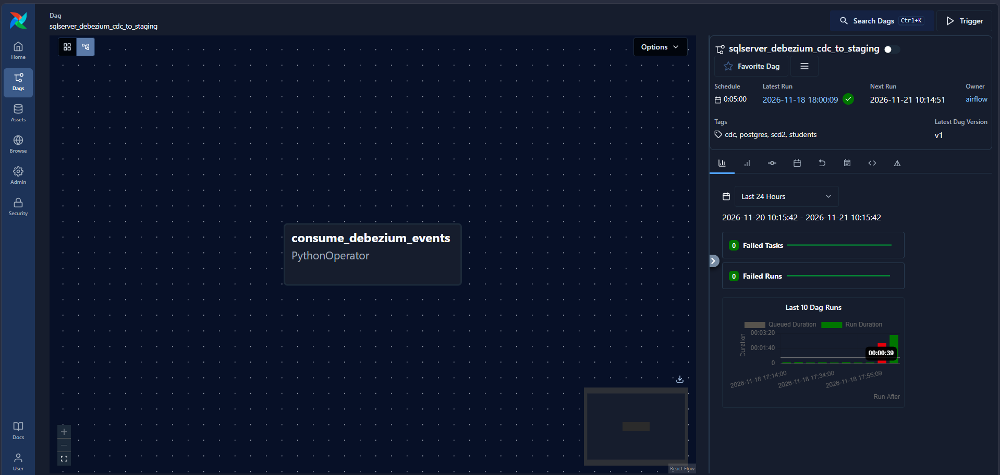

The graph preserves evidence of the former Airflow CDC design. Spark now consumes Kafka, stores its own checkpoint and publishes CDC directly to ClickHouse. [Engineering history](../12-implementation/engineering-history.md)

## Evidence coverage

Git contains no distinct capture of the final Spark CDC dashboard, current Spark execution UI, or current end-to-end Airflow handoff. The implementation status and validation records document the execution evidence available for those paths. The diagrams are authored descriptions of the current design.
