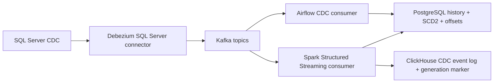

# Student Data Engineering Platform — Technical Context

**Purpose:** Give an independent reviewer a source-grounded description of the
repository, its intended data flows, and the evidence available about the
current local runtime. This is context for an audit, not a claim of production
readiness.

**Runtime evidence snapshot:** 2026-11-18, from the earlier local Docker and
database inspection. Repository facts below reflect the current working tree;
runtime state was not rechecked during this documentation-only update. Older
validation reports are identified as historical where they disagree. No
`.env` values are included or were read for this document.

## 1. Scope and review objective

The intended batch path is SQL Server `Students` → Airflow snapshot DAG →
PostgreSQL staging → a separately triggered Airflow warehouse DAG running
Spark → ClickHouse dimensional warehouse → Grafana. Kafka and Debezium
provide a separate CDC path. Airflow also has an optional, separate CDC
consumer DAG.

The repository contains code and configuration for all these components, but
the batch warehouse and the CDC paths have different levels of runtime
evidence. The existence of a component, a passing unit test, or a published
warehouse snapshot does not on its own prove the entire current Airflow-led
path works end to end.

## 2. Evidence labels and limitations

This document uses the following labels:

- **Verified working:** direct test or runtime evidence demonstrates the
  stated behavior, for the observed data and time only.
- **Implemented, not verified:** code or configuration exists, but no
  successful runtime evidence was found for that execution path.
- **Failed / blocked:** observed failure or an unresolved prerequisite prevents
  the path from being considered operational.
- **Not implemented:** no implementation was found.
- **Optional / not applicable:** an optional capability not required for the
  batch warehouse path.

Runtime observations are point-in-time. This review did not query SQL Server
live, inspect secret values, start or stop services, rebuild images, run a
pipeline, alter database state, or inspect a Grafana browser render. Database
counts below came from read-only queries; the PostgreSQL queries were wrapped
in read-only transactions and rolled back.

## 3. Executive assessment

| Area | Assessment | Evidence |
|---|---|---|
| PostgreSQL full snapshot staging | **Verified working for an existing snapshot** | One successful full run with all 15 expected table batches; row counts are recorded in Section 9. |
| ClickHouse batch warehouse | **Published data verified; Airflow integration not verified** | One v2 publication exists for staging run 1 with 600,000 applications, 59,279 offerings, and 3,724,654 enrollments. |
| Grafana | **Service and query evidence verified; visual rendering not verified** | Grafana was running; earlier read-only API/query checks returned data. No browser-render verification was performed. |
| Airflow warehouse execution in the earlier runtime snapshot | **Failed / not verified** | The inspected scheduler image lacked `java` and `spark-submit`; its image digest differed from the current local Airflow image tag. No successful Airflow run of the warehouse task was evidenced then. |
| Kafka and Connect | **Not running in the observed snapshot** | Both containers were exited. The latest source-topic listing in historical evidence had only Connect internal topics. |
| Airflow CDC consumer | **Paused, with unresolved persisted run state** | DAG is paused, but one DagRun remains `running` and its consumer task is `up_for_retry`. |
| Spark CDC streaming | **Failed** | Its container exited with status 1; the captured Python 3.8 runtime cannot import `datetime.UTC` from the CDC module. |
| Overall end-to-end readiness | **Not established** | Batch data exists in the warehouse, but current Airflow-to-Spark execution and end-to-end CDC are not verified. |

## 4. Architecture and data-flow diagrams

### Batch snapshot and warehouse publication

```mermaid
flowchart LR
    SQL["SQL Server: Students"] -->|"15-table SNAPSHOT transaction"| AF1["Airflow snapshot DAG"]
    AF1 -->|"ODBC Driver 18; SELECT *"| STG["PostgreSQL raw + metadata"]
    STG -->|"manual trigger after verification"| AF2["Airflow warehouse DAG"]
    AF2 -->|"local spark-submit; JDBC"| SP["Spark 3.5.6 batch job"]
    SP -->|"validated, append-only snapshot"| CH["ClickHouse v2 warehouse"]
    CH -->|"snapshot-aware views"| GF["Grafana dashboards"]
```

### CDC design (separate from the batch warehouse)

Airflow CDC and Spark streaming are two separate consumers of the same
Debezium source. The repository documentation describes them as alternatives;
they must not be treated as coordinated or safe to run concurrently without an
explicit consumer-ownership and offset plan. CDC data does not currently feed
the batch v2 dimensions and facts.

## 5. Compose service inventory

The service definitions are in [`docker-compose.yml`](../docker-compose.yml).
Only `spark-warehouse` and `spark-cdc-stream` currently have profiles:
`batch` and `streaming`. All other services are unprofiled. The states below
are from the earlier 2026-11-18 runtime snapshot and were not refreshed after
the current Compose edits.

| Service | Compose profile / role | Earlier observed state |
|---|---|---|
| `postgres` | None; staging and Airflow metadata databases | Running, healthy |
| `postgres-init` | None; one-shot database/user initialization | Exited successfully |
| `staging-schema-init` | None; one-shot staging schema initialization | No active container in the snapshot |
| `clickhouse` | None; analytical warehouse | Running, healthy |
| `clickhouse-init` | None; one-shot DDL/user initialization | Added in current Compose; not in the earlier snapshot |
| `spark-warehouse` | `batch`; one-shot Spark submission | No active container in the snapshot |
| `airflow-init` | None; Airflow database migration and admin initialization | Exited successfully |
| `airflow-api-server` | None; Airflow UI/API | Running |
| `airflow-scheduler` | None; scheduling and LocalExecutor tasks | Running |
| `airflow-dag-processor` | None; DAG parsing | Running |
| `kafka` | None; single-node KRaft broker | Exited (143) |
| `connect` | None; Debezium Kafka Connect | Exited (137) |
| `debezium-register` | None; one-shot connector registration/check | Not running |
| `spark-cdc-stream` | `streaming`; Spark consumer | Exited (1) |
| `grafana` | None; ClickHouse dashboards | Running |

Exit codes only describe the containers' recorded exit state; they do not
establish why Kafka or Connect stopped. Do not treat those earlier states as
the current runtime after the Compose edits.

An unqualified `docker compose up` includes all unprofiled services, including
Kafka, Connect, and connector registration. The Make targets select service
names explicitly; `make up` is the documented core/Airflow/Grafana path. Avoid
raw all-services startup. `docker compose --profile '*' up` also enables both
Spark services and is not the normal startup command.

## 6. Network, ports, and persistent state

Compose uses one internal `platform` bridge. The configured host bindings are
loopback-only:

| Service/interface | Host port |
|---|---:|
| PostgreSQL | `15433` |
| ClickHouse HTTP | `18123` |
| ClickHouse native | `19000` |
| Kafka external listener | `19094` |
| Kafka Connect REST | `18083` |
| Airflow API/UI | `8080` |
| Grafana | `13000` |

Internal service-to-service connections use Compose service names and
container-side ports from configuration, not these host ports. Kafka's
external advertised host is configurable. The ports are configuration, not
evidence that each corresponding service was running.

Named volumes are `postgres-data`, `clickhouse-data`, `kafka-data`,
`grafana-data`, and `spark-streaming-checkpoints`. Airflow DAGs, logs, and
plugins are bind-mounted; Spark applications are mounted read-only. Volumes
provide persistence, not backup or restore capability. No volume or database
was modified for this document.

## 7. Runtime and dependency facts

| Component | Declared / observed version |
|---|---|
| Airflow | 3.1.5; active scheduler Python 3.12.12 |
| Spark / PySpark | 3.5.6 |
| Airflow Dockerfile Java | OpenJDK 17 JRE |
| PostgreSQL | Image `postgres:16-alpine`; observed server 16.15 |
| ClickHouse | Image `clickhouse/clickhouse-server:24.8`; observed server 24.8.14.39 |
| Kafka | `apache/kafka:3.9.1` |
| Debezium Connect | Project image based on Debezium 2.7.3.Final |
| Grafana | Project image 11.5.2 |
| PostgreSQL JDBC | 42.7.5 |
| ClickHouse JDBC | 0.9.8 |
| Spark Kafka connector | `spark-sql-kafka-0-10_2.12:3.5.6` |
| Airflow Python packages | Airflow 3.1.5 and providers are installed with the official image constraints; PySpark is installed separately as 3.5.6 |
| Spark-image Python packages | `clickhouse-connect==0.8.15`, `kafka-python==2.3.3`, `psycopg2-binary==2.9.10` |

The Airflow dependency manifests are
[`airflow/requirements.txt`](../airflow/requirements.txt) and
[`airflow/requirements-spark.txt`](../airflow/requirements-spark.txt).
[`spark/requirements.txt`](../spark/requirements.txt) is separate. This
separation preserves Spark 3.5.6 / Py4J 0.10.9.7 rather than allowing Airflow's
constraints to select PySpark 4.x. The Dockerfile documents this separation.
Earlier candidate dependency checks reported compatible PySpark/Py4J
resolution and `pip check`; those are historical candidate-image checks, not
proof that the active Airflow container was updated.

**Earlier runtime discrepancy:** the scheduler container inspected for the
runtime snapshot did not have `java` or `spark-submit`, although the
Dockerfile installs Java 17 and the Spark requirements. Its image digest
differed from the current local image tag. This documentation update did not
recheck whether that image has since been deployed.

The host project manifest [`pyproject.toml`](../pyproject.toml) declares
Python `>=3.11,<3.13` and `python-dotenv`; it is not the dependency manifest
for either runtime image. Java, ODBC, JDBC, and Spark connector packages are
separate system/JVM dependencies.

## 8. SQL Server source

The source is configured by `SOURCE_DB_*` environment variables (host, port,
database, schema, user, password, ODBC driver, encryption, certificate
handling, timeout, and snapshot isolation). The values are intentionally not
reproduced here. The extraction code uses Microsoft ODBC Driver 18 and
requires `SOURCE_DB_SNAPSHOT_ISOLATION=SNAPSHOT`.

The assessed table list in
[`source_tables.py`](../airflow/dags/students_staging/source_tables.py) is:
`Applicants`, `ClassStandings`, `CourseEnrollments`, `CourseOfferings`,
`Courses`, `DegreeLevels`, `DegreeRequirements`, `Degrees`, `DegreeTypes`,
`Departments`, `Grades`, `Sessions`, `StudentProfiles`, `Students`, and
`Terms`. Extraction uses `SELECT *`; it does not explicitly select or order
columns in SQL.

No live source catalog inspection was performed for this document. The
PostgreSQL staging DDL declares expected column types and keys; that is not
independent verification of SQL Server's current source schema or its actual
primary/foreign-key constraints. Historical source evidence is inconsistent:
a CDC readiness report recorded SQL Server 16.0.1210.3, while a source
assessment artifact recorded 15.0.2200.2. The current source version,
snapshot-isolation setting, Agent state, CDC retention, and connector
permissions need a fresh authorized check.

An earlier read-only readiness report recorded source CDC enabled with 15
capture instances, but also reported that the configured login could not
inspect SQL Server Agent/retention. A subsequent successful full snapshot is
evidence that the extraction path completed at that time; it does not settle
the current database settings.

## 9. Extraction and PostgreSQL batch staging

The manual snapshot DAG in
[`sqlserver_to_postgres_staging.py`](../airflow/dags/sqlserver_to_postgres_staging.py)
creates a pipeline run, loads the 15 tables through one shared SQL Server
`SNAPSHOT` transaction, then finalizes metadata. It has `schedule=None`,
`max_active_runs=1`, no retries for the extraction task, and a four-hour task
timeout.

Warehouse publication is a separate manual DAG,
[`postgres_to_clickhouse_warehouse.py`](../airflow/dags/postgres_to_clickhouse_warehouse.py).
An operator triggers it after validating the PostgreSQL snapshot; the
extraction DAG does not start it automatically.

[`loader.py`](../airflow/dags/students_staging/loader.py) reads with
`fetchmany(5000)` and inserts into PostgreSQL in pages of 1,000 values. Each
fetched chunk is committed separately. A failed table can therefore leave
partial rows attached to a failed batch; the warehouse job selects only
successful batches. A later full run uses new batch IDs, retaining prior
snapshots rather than replacing them. The current batch path is a full
snapshot, not an incremental SQL Server watermark/CDC extraction.

The latest successful snapshot recorded in PostgreSQL had these row counts:

| Source table | Rows |
|---|---:|
| Applicants | 600,000 |
| ClassStandings | 6 |
| CourseEnrollments | 3,724,654 |
| CourseOfferings | 59,279 |
| Courses | 180 |
| DegreeLevels | 2 |
| DegreeRequirements | 364 |
| DegreeTypes | 3 |
| Degrees | 20 |
| Departments | 11 |
| Grades | 6 |
| Sessions | 3 |
| StudentProfiles | 119,463 |
| Students | 119,463 |
| Terms | 33 |

The counts prove that the recorded staging batches contain those numbers.
They are not an independent source-versus-target reconciliation. Raw tables
include names, addresses, contact data, dates of birth, and other source
attributes; staging and CDC JSON images therefore hold sensitive student data
and require appropriate access and retention controls.

## 10. PostgreSQL data model and staging semantics

The staging DDL is under
[`db/staging_postgres/staging_ddl/`](../db/staging_postgres/staging_ddl/).
The main schemas are:

- `raw`: typed, batch-scoped source copies with `_batch_id` and
  `_extracted_at`. Most tables have a composite primary key of source key plus
  batch ID and an index on `_batch_id`.
- `metadata`: pipeline runs, extraction batches, latest table status,
  watermarks, and Airflow CDC consumer offsets.
- `history`: immutable Debezium event rows with JSONB key/images and a unique
  `(kafka_topic, kafka_partition, kafka_offset)` constraint.
- `scd`: generic JSONB entity versions with a partial unique index for the
  current version per source entity.

`metadata.extraction_watermarks` exists, but the current full batch DAG does
not use it for incremental extraction. Batch retry behavior is append-by-new
batch, not in-place update. CDC event identity is replay-safe on the
PostgreSQL side through the unique Kafka-position constraint.

## 11. Spark batch transformation

[`spark/load_warehouse.py`](../spark/load_warehouse.py) locates the latest
successful full snapshot and requires successful batches for its required
source tables. It reads PostgreSQL through JDBC, using fetch size 10,000,
two read partitions for large keyed tables, and bounded local Spark settings
(`local[2]`, 768 MiB driver, two shuffle partitions).

It constructs nine dimensions and three facts, validates dimension/fact key
uniqueness, checks selected relationships for orphans, and compares each fact
row count with its source frame before publishing. Failed validation raises
an error before the publication marker is written. JDBC writes are append-only;
the publication record is written last so views can select the latest
complete snapshot. Old snapshot rows are retained; no automatic cleanup was
found.

`StudentProfiles` and `DegreeRequirements` are extracted to staging but are
not consumed by the v2 warehouse model. Other tables may serve as lookups
rather than direct facts.

## 12. ClickHouse warehouse model

DDL is in
[`warehouse_ddl.sql`](../db/warehouse_clickhouse/warehouse_ddl.sql).
The v2 model has nine dimensions and three facts; unversioned views select the
snapshot referenced by the latest row in `warehouse_model_loads_v2`.
Fact grains implied by the implementation are:

| Table | Grain / business key |
|---|---|
| `fact_application` | One row per `ApplicantId` |
| `fact_course_offering` | One row per `CourseOfferingId` |
| `fact_course_enrollment` | One row per `CourseEnrollmentId` |

Dimensions are applicant, class standing, course, date, degree, department,
grade, student, and term. Student and applicant identifiers in the analytical
model are HMAC pseudonyms; other surrogate keys are SHA-256 hashes of
namespaced key parts. The secret key is supplied at runtime and is not
included in this document.

One v2 publication exists for source run 1. Its publication metadata reports
600,000 applicants, 119,463 students, 59,279 offerings, and 3,724,654
enrollments. These are persisted-output counts, not a fresh pipeline run
performed during this documentation task.

## 13. Airflow orchestration and current runtime

Airflow uses `LocalExecutor`. Batch processing is split across two
`schedule=None` DAGs. `sqlserver_to_postgres_staging` creates the run, loads
the consistent snapshot, and finalizes metadata. After an operator verifies
the staging results, `postgres_to_clickhouse_warehouse` runs the separate
`load_clickhouse_warehouse` task. That task specifies PostgreSQL JDBC 42.7.5
and ClickHouse JDBC 0.9.8, local Spark execution, and a single retry.

The only successful historical snapshot DagRun found had
`create_pipeline_run`, `load_consistent_snapshot`, and
`finish_pipeline_run`, as expected for the extraction DAG. No successful
execution of the separate warehouse DAG was evidenced. The published
ClickHouse snapshot must not be attributed to a successful Airflow warehouse
task without further evidence.

At the earlier runtime snapshot, API server, scheduler, and DAG processor
were running. The inspected scheduler did not contain Java or `spark-submit`,
so the warehouse task could not be assumed runnable in that container.
Although the Dockerfile installs Java 17 and separately installs PySpark,
the runtime was not rechecked during this documentation update.

## 14. Kafka, Debezium, and CDC consumers

The connector registration helper is an unprofiled one-shot service. Its code
checks an existing connector and does not update it. Debezium is
configured to capture the 15 assessed source tables. Kafka and Connect were
not running in the observed runtime. The latest successful historical topic
listing found no source-table topics; because Kafka was stopped during the
current snapshot, the live topic set was not re-queried.

### Airflow CDC path

The Airflow CDC DAG reads Kafka and persists event history, offsets, and SCD2
state in PostgreSQL. At the current database snapshot, the DAG was paused.
One DagRun remained `running`; its `consume_debezium_events` task was
`up_for_retry`. Persisted run counts were 35 successful, 330 failed, and one
running. PostgreSQL CDC pipeline metadata recorded 661 failed and 35
successful runs. Earlier task logs recorded `KafkaTimeoutError: Unable to
bootstrap from kafka:9092`; Kafka is currently exited. The unresolved run
should be handled through the supported Airflow control plane, not by editing
database state.

### Spark Structured Streaming path

[`stream_cdc.py`](../spark/stream_cdc.py) reads the topic pattern, persists
events and generation offsets to PostgreSQL, appends event rows to ClickHouse,
then publishes a generation marker. The current Spark CDC container exited
with status 1. Its Python 3.8 runtime is incompatible with
[`cdc_loader.py`](../airflow/dags/students_staging/cdc_loader.py), which
imports `UTC` from `datetime` (available in Python 3.11+).

The current stream source also has a counter-placement defect in
`_persist_postgres_batch`: the loop executes one `INSERT ... RETURNING` per
event, but reads the cursor result and updates the operation counters only
after the loop. Consequently, the counters reflect only the final event in a
microbatch rather than each inserted event. Existing unit tests exercise the
`persisted_operation_counts` helper, not this loop's database/cursor behavior.
This contradicts historical readiness text claiming the stream counter fix
was applied; the source currently checked is the controlling evidence.

Current PostgreSQL CDC state is 175,000 unique event positions, all operation
`r` (snapshot/read records); no create/update/delete operations are present.
There are 15 saved offset rows for 15 topics, two with `next_offset = 0`.
`scd.entity_versions` contains 111,296 versions, all marked current and none
deleted. ClickHouse's CDC event and stream-generation tables both contain
zero rows. These values do not prove a running or complete CDC flow.

PostgreSQL is committed before the ClickHouse event write. A retry after a
ClickHouse failure is idempotent on the PostgreSQL unique key, but ClickHouse
uses append-only `MergeTree`, so a retry can duplicate physical CDC event
rows. Exactly-once behavior across both sinks has not been established.

## 15. Grafana dashboards

Grafana is provisioned with a ClickHouse datasource and the
`enrollment-performance` dashboard. Dashboard SQL queries use the latest
warehouse views and provide enrollment, distinct student, offering, seat
capacity, and term-series KPIs. Earlier read-only checks returned:

- 3,724,654 enrollment rows;
- 119,463 distinct students;
- 59,279 course offerings;
- 4,191,895 offered seats;
- 600,000 applications; and
- 23 term-series rows.

The dashboard panel description for “Course offerings” says sections
represented by enrollments, but its SQL counts rows from `fact_course_offering`.
Review whether the description or intended metric should change. Grafana's
container and health/API evidence were available, but visual rendering and
interactive filtering were not verified in a browser during this audit.

## 16. Tests, builds, and historical validation

[`Makefile`](../Makefile) provides `make test` for unit tests and
`make compose-config` for Compose parsing. Historical validation reports
dated 2026-11-16 recorded 13 unit tests passing, syntax checks, environment
validation, Compose parsing, and Debezium plugin-configuration validation.
These are dated results, not tests run for this document or proof of current
runtime behavior.

The CDC counter unit test validates a pure helper with synthetic values; it
does not validate the current database insert/counter loop described in
Section 14. There is no evidence here of a successful current end-to-end
integration test, streaming restart/replay test, or backup/restore test.

On 2026-11-18, before the latest Compose edits,
`docker compose --profile '*' config --services` successfully listed 14
services. The current Compose file defines 15 services, including the newly
added `clickhouse-init`. This documentation update did not start or validate
the services.

## 17. Runtime snapshot and resource envelope

At the point inspected:

- Docker server was 29.7.2 on Ubuntu 24.04.4 LTS, Linux x86_64; Compose was
  5.5.0.
- Docker reported 8,130,854,912 bytes of total memory for its VM
  (approximately 7.57 GiB).
- Running services were PostgreSQL, ClickHouse, the three Airflow services,
  and Grafana. PostgreSQL and ClickHouse health checks were healthy.
- Kafka, Connect, and Spark CDC were exited; one-shot initialization
  containers had completed.
- Container memory samples totaled approximately 2.2 GiB across the running
  services at that instant; ClickHouse used approximately 1.18 GiB.

Compose's configured caps include Kafka 1 GiB/1 CPU, Connect 1.5 GiB/1 CPU,
Spark CDC 1.5 GiB/1.5 CPU, batch Spark driver 768 MiB with a 1.5 GiB
container limit, Airflow scheduler 2 GiB/2 CPU, and Grafana 512 MiB/1 CPU.
Running all profiles together could place significant pressure on this
observed ~8 GiB Docker allocation. The “16 GB” value mentioned in earlier
conversation is not supported by this runtime snapshot.

## 18. Risks and open questions

1. **Airflow/Spark runtime mismatch:** Why do active Airflow containers use an
   image without Java or `spark-submit`, and what controlled deployment is
   approved for the candidate image?
2. **Airflow warehouse evidence:** Which exact process produced the existing
   ClickHouse v2 publication? A successful current Airflow warehouse task is
   not evidenced.
3. **CDC ownership and lineage:** Which consumer is intended to own source
   topics—Airflow or Spark—and how should the 175,000 PostgreSQL event
   positions and 15 offsets be reconciled with the currently stopped Kafka
   cluster and older historical reports?
4. **Stale Airflow run:** Why is a CDC DagRun still `running` with an
   `up_for_retry` task after the DAG was paused? Resolve through Airflow's
   supported controls.
5. **CDC counter correctness:** The current Spark loop counts only its last
   insert per microbatch; add a focused database/cursor-level test when
   implementation work is authorized.
6. **Python compatibility:** The Spark container's Python 3.8 cannot import
   `datetime.UTC` from the shared CDC module. Decide whether to align the
   Spark Python runtime or make the shared module compatible, while preserving
   Spark 3.5.6.
7. **Source readiness:** Re-check current SQL Server version, snapshot
   isolation, Agent/capture/cleanup jobs, retention, and connector permissions.
   Existing reports disagree on the SQL Server version and snapshot
   isolation's status changed or may have changed after the historical
   observation.
8. **Data reconciliation:** Confirm source-to-staging row counts and warehouse
   row counts against a controlled snapshot; existing publication counts alone
   are not source reconciliation.
9. **CDC delivery semantics:** Define acceptable duplicate handling across
   PostgreSQL and ClickHouse and test replay/recovery before claiming
   exactly-once or reliable dual-sink behavior.
10. **Data lifecycle:** Raw staging and CDC images contain identifying
    attributes; retention, access control, and backup/restore need explicit
    review. Named volumes are not backups.
11. **Dashboard semantics:** Confirm the course-offering panel description
    matches its query and business definition.
12. **Resource allocation:** The observed Docker memory allocation is about
    7.57 GiB, below the 16 GB discussed earlier. Avoid launching every
    optional profile without a resource plan.

## 19. Instructions for the independent reviewing AI

1. Treat repository source, current read-only runtime evidence, and dated
   reports as separate evidence classes. Prefer current source/runtime for
   current-state claims; explicitly call out contradictions.
2. Preserve the required versions: Airflow 3.1.5, Spark/PySpark 3.5.6, Java
   17, and the existing PostgreSQL/ClickHouse JDBC versions. Do not combine
   Airflow and Spark constraint resolution.
3. Do not infer the SQL Server schema, source keys, relationships, or current
   CDC readiness from table names or PostgreSQL DDL. Verify them from
   authorized source metadata if that is later approved.
4. Keep batch snapshot, Airflow CDC, and Spark streaming paths distinct.
   Do not assume both CDC consumers can run concurrently or that CDC currently
   updates the batch dimensional model.
5. Do not print or request `.env` contents, credentials, HMAC keys, student
   row values, or other sensitive data. Use variable names and aggregate
   counts only.
6. Unless separately authorized, do not edit files, rebuild/recreate
   containers, start optional services, change Airflow state, register a
   connector, alter Kafka topics/offsets, modify volumes/databases, or run a
   production-style extraction/publication.
7. If proposing a change, state the smallest change, its dependencies, the
   exact non-destructive validation, and a rollback/deployment boundary. Do
   not claim validation until it has actually been run.
8. Report status using the labels in Section 2 and identify the specific
   evidence and its date for each material conclusion.

### Source references

- [Compose services and configuration](../docker-compose.yml)
- [Batch DAG](../airflow/dags/sqlserver_to_postgres_staging.py)
- [Extraction loader](../airflow/dags/students_staging/loader.py)
- [Source table map](../airflow/dags/students_staging/source_tables.py)
- [Spark batch job](../spark/load_warehouse.py)
- [Spark CDC job](../spark/stream_cdc.py)
- [Batch warehouse DDL](../db/warehouse_clickhouse/warehouse_ddl.sql)
- [CDC warehouse DDL](../db/warehouse_clickhouse/cdc_warehouse_ddl.sql)
- [PostgreSQL staging DDL](../db/staging_postgres/staging_ddl/)
- [Architecture overview](./02-architecture/architecture-overview.md)
- [Historical CDC readiness report](./13-validation/cdc-readiness-report.md)
- [Historical runtime validation report](./13-validation/runtime-validation-report.md)
