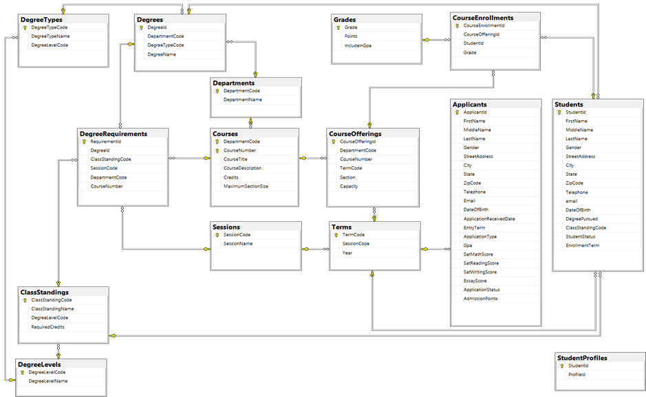
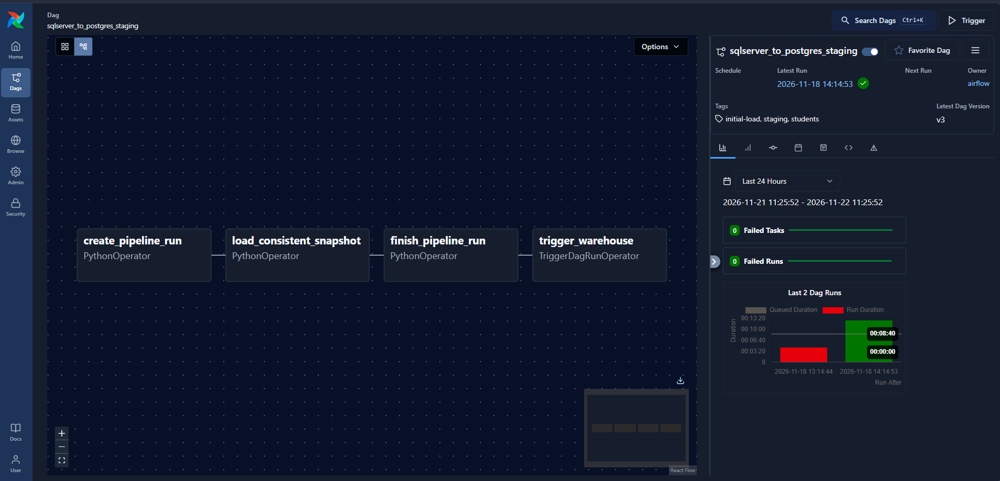
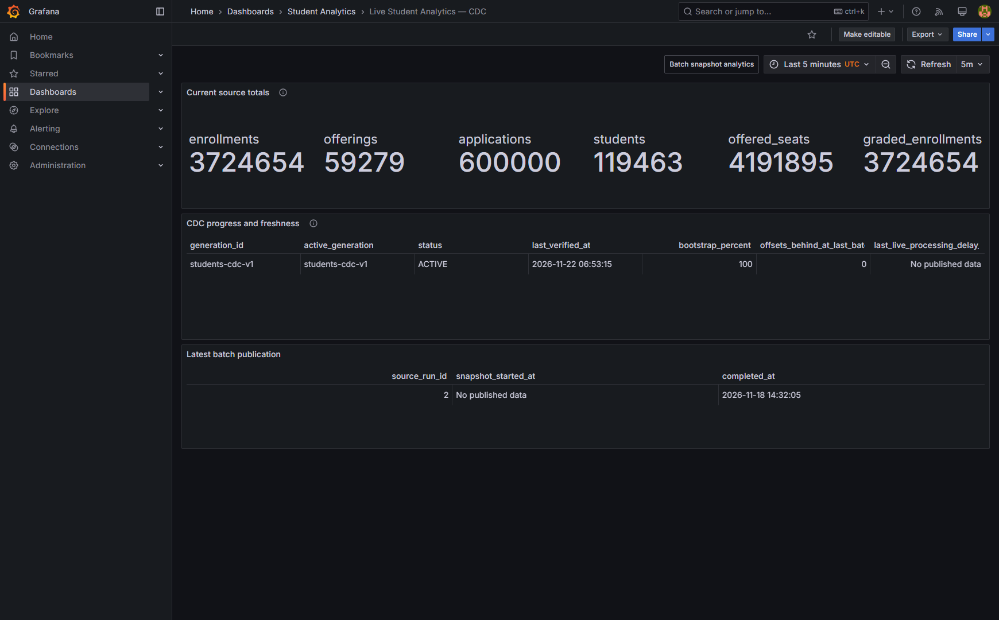

# Visual evidence and diagrams

Diagrams explain the checked-in design. Runtime captures show the services at their recorded boundaries. Historical captures document earlier executions and retired components.

## Source model

The assessed source relationships remain relevant. Follow the composite course key through the offering and enrollment tables. The [database models](../02-architecture/data-model.md) show the current PostgreSQL staging, batch star and CDC warehouse designs.

[Debezium connector and task status](screenshots/debezium-connector-status-history.png) shows the Connect REST status format and both components running in an earlier deployment. Current publication also requires verified Spark progress and ClickHouse generation activation.

## Updated diagrams

| Visual | What to notice |
|---|---|
| [System architecture](../02-architecture/overview.md) | Separate database publishers, a shared ClickHouse server and read-only reconciliation |
| [Batch sequence](../04-data-pipelines/batch.md) | The exact staging run ID and the final publication marker |
| [CDC sequence](../04-data-pipelines/cdc.md) | Debezium baseline proof, Spark’s checkpoint and ClickHouse seals |
| [Incremental analytics flow](../04-data-pipelines/incremental.md) | Verified CDC history, the 15-minute Airflow job, and the analytical publication Grafana reads |
| [Database models](../02-architecture/data-model.md) | Source relationships, run-scoped PostgreSQL keys, three fact grains and CDC serving views |

## Airflow task flow

The graph shows the four task names and the warehouse trigger after finalization. It predates the direct dependency from run creation to the finalizer, which now checks whether a staging run exists before finalizing it. The run dates in the image are historical. [Batch sequence](../04-data-pipelines/batch.md)

[Airflow DAG inventory](screenshots/airflow-batch-dag-inventory.png) shows the two supported batch DAGs and the displayed run dates. The image records the UI state at capture time, including its warning badge. See the [test evidence](../06-observability-and-quality/testing-and-validation.md) for import checks.

## Grafana dashboards

Captured from the local Grafana service on 24 November 2026. The analytical screenshots use **All** academic terms and departments. The Live CDC screenshot uses an explicit 08:15–08:35 UTC window containing verified changes. [Dashboard guide](../06-observability-and-quality/grafana.md)

| Capture | Publication and visible data |
|---|---|
| [Incremental CDC— Student Enrollment, Capacity & Grades](screenshots/grafana-incremental-analytics.png) | Grafana Home, with all 18 analytical panels. The incremental publication contains 3,724,655 enrollment attempts and 119,464 unique enrolled students. |
| [Batch Snapshot](screenshots/grafana-batch-snapshot.png) | Full snapshot for source run 2 with the shared analytical layout. It contains 3,724,654 enrollment attempts and 119,463 unique enrolled students. |
| [Live Student CDC](screenshots/grafana-live-cdc.png) | The active generation, operation counts and trend, bootstrap progress, latest verified changes and Batch publication. |

### Earlier Grafana captures

Captured on 22 November 2026. The dashboard shows six current source aggregates, the active generation with 100% verified bootstrap and zero sampled lag, and the batch publication for run 2. The older batch marker lacks a snapshot start time. This layout predates the live event panels and one-minute refresh.

## Earlier execution captures

| Original capture | What it demonstrates and where the design changed |
|---|---|
| [Docker and WSL](screenshots/docker-compose-history.png) | Container state and completed migrations. The captured `spark-warehouse` service has been retired. |
| Airflow DAG inventory at `76d9ed0:docs/14-screenshots/02-airflow-dags.png` | An earlier deployment. The newer Airflow capture above shows the Batch DAGs before the incremental DAG was added. |
| `55843c3:docs/14-screenshots/03-airflow-staging-run.png` | Staging run creation, extraction and finalization. The newer graph above shows the trigger edge added later. |
| [Airflow warehouse graph](screenshots/airflow-warehouse-preflight-history.png) | Warehouse runtime preflight and load. The current [batch sequence](../04-data-pipelines/batch.md) documents the exact run-ID handoff. |
| [PostgreSQL staging](screenshots/postgres-staging-history.png) | Typed raw tables and historical CDC schemas. Current PostgreSQL serves Batch staging, Airflow metadata and the incremental CDC relay. |
| [ClickHouse warehouse](screenshots/clickhouse-shared-warehouse-history.png) | Batch facts, dimensions and an older CDC model in the same database. The current CDC database has its own event and serving models. |
| [Batch enrollment](screenshots/batch-enrollment-history.png) | Enrollment by term and department, with counts in the earlier batch layout. |
| [Batch capacity and admissions](screenshots/batch-capacity-admissions-history.png) | Capacity by department and applications by status and entry term. The caption applies to batch analytics. |
| [Batch grades](screenshots/batch-grades-history.png) | Grade mix, coverage and weighted points in the earlier batch layout. |

## Obsolete workflow kept for history

The image at `55843c3:docs/14-screenshots/09b-airflow-cdc-dag.png` documents the former Airflow-to-PostgreSQL CDC path. Spark now reads Kafka and publishes CDC to ClickHouse. The earlier design and cutover are described in the [engineering decisions](../02-architecture/decisions.md) and the 21 November validation record at `55843c3:docs/assets/validation-2026-11-21.md`.

## Provenance

The original execution screenshots and source ERD are available byte for byte from pre-cleanup revision `76d9ed0`. The two copies of the source ERD were byte-identical and now share one path. The newer Airflow captures come from revision `55843c3`. Historical Markdown and original ADR files remain available in `99306b6`. The Grafana captures came from the running local service. [Cutover results and historical checks](../06-observability-and-quality/testing-and-validation.md)
